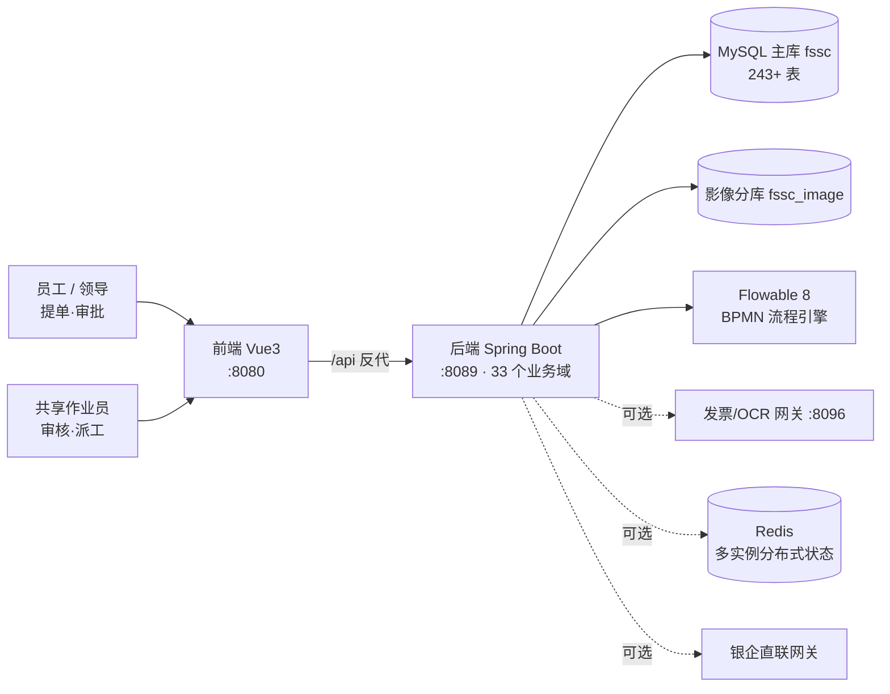

# FSSC · 集团财务共享服务平台

> 多租户 SaaS 财务共享中心（Financial Shared Service Center）——覆盖费用报销、应收应付、总账凭证、资产存货、资金票据、影像 OCR、共享作业运营与 BPMN 审批引擎的完整业务底座。
>
> 名称说明：这里的 **FSSC** 是"财务共享服务中心"这一行业通用缩写的字面含义，指本软件所服务的业务形态本身；本项目与任何同名或近名的商业软件、认证体系没有隶属或关联关系，也不包含其代码、界面素材或文档。

    

> ** 发布前校准状态**：本 README 的代码事实（域/表/端点/版本）由脚本从源码实测抽取（见 `docs/_facts/`）；`docs/getting-started.md` 中的启动步骤**尚未在一台干净机器上端到端跑通验证**。在标记为"已验证"之前，请把 Quickstart 视为高置信度草案而非承诺。

<details open>
<summary><b>English TL;DR</b>（本仓库不做整篇中英对照，理由见下）</summary>

**What this is.** A multi-tenant SaaS **financial shared service center** backend: expense claims → compliance pre-check → budget control → multi-level approval (Flowable BPMN) → shared-service work queues and scheduling → invoice verification → payment → journal vouchers → image archiving, with full cross-document drill-through and row-level data scope.

**Stack.** JDK 26 + Spring Boot 4.1 + Flowable 8 + MyBatis-Plus (245 mappers, **no Mapper XML**) on MySQL 8; Vue 3.5 + Vite 6 + Element Plus + bpmn-js 16.5 for the front end and the process designer.

**Read this first.** `docs/how-to-read-this-code.md` (how to orient in an AI-generated codebase), then `docs/module-map.md`, `docs/data-model.md`, `docs/permissions.md`, `docs/workflow-engine.md` §9 ("I need to change something — where do I touch?"). Every `path:line` citation in the docs is checked by `_tools/cite_check.mjs` in CI.

**Honest caveats.**
- **The UI is Chinese-only, and there is no i18n framework in this repo** (no `vue-i18n`, no `createI18n`, no `$t()`; `src/i18n/` holds a single bpmn-js canvas translation patch). Localising the interface is a separate, unfunded effort — don't go looking for a language switch.
- **Source-only release.** The front-end package keeps `"private": true`; there is no npm package and no hosted demo. You build the jar/image yourself.
- **No published database baseline yet** (`schema-baseline.sql` / `seed-demo.sql` are still missing), so a fresh install today is not verified to work end-to-end.
- The declared JDK is pinned to **26**, a non-LTS release whose end of availability has already passed; the maintainers have adjudicated a move to the current LTS line but have not run that build yet — see `docs/release-checklist.md` §8 ⑥.
- Substantial parts of this code were AI-generated and then hardened through long manual business drills; treat documented behaviour as *documented*, not *guaranteed*. Each doc states which claims were measured and which were only read off the code.

</details>

---

## 30 秒看懂：这是什么

假设你是一家有 20 家分子公司、每天 3,000 张报销单的企业集团。员工在手机上提单，单据要经过**预算控制 → 合规预检 → 多级审批 → 共享中心作业排班 → 发票查验 → 出纳付款 → 自动生成凭证 → 影像归档**，还要保证 A 公司的人看不见 B 公司的单据。

FSSC 就是为这条完整链路准备的系统：



**为什么值得看**：市面上开源 OA 很多、ERP 很多，但把「财务共享中心的作业运营 + 单据全链路联查 + 可配置审批引擎 + 多租户 SaaS 底座」四件事一起做成的开源实现极少。这个仓库可以直接读到这套业务的表设计、状态机和引擎接入方式。

## 能力地图（真实数字，来自源码扫描）

| | 数量 | 说明 |
|---|---:|---|
| 后端 Java 文件 | 1,007 | `fssc-server/fssc-start/src/main/java` |
| 后端代码行 | 131,428 | 不含测试与前端 |
| REST 控制器 | 160 | `@RestController` |
| HTTP 端点 | 1,257 | `@*Mapping` 计数 |
| 业务域包 | 33 | `com.fssc.<domain>` |
| 实体映射表 | 243 | `@TableName` 计数；库内实际表数更多 |
| 前端页面组件 | 134 | `fssc-web/src/views/**/*.vue` |
| 流程模型（BPMN） | 见 `bpmn-repo/publish` | 审批流模板库 |

按域看规模（代码行排序，前 12）：

`workflow` 31.9k · `sharing` 15.1k · `compliance` 8.1k · `expense` 8.0k · `system` 6.4k · `glex` 5.7k · `arflow` 5.7k · `framework` 5.6k · `masterdata` 5.6k · `image` 3.8k · `asset` 3.6k · `document` 3.6k

 逐域职责、API 前缀与对应表 → **[`docs/module-map.md`](docs/module-map.md)**

### 功能域一览

| 分类 | 域 | 一句话 |
|---|---|---|
| 底座 | `framework` `platform` `auth` `system` | 多租户隔离、JWT 鉴权、平台开租户、用户/角色/菜单/参数/编号规则 |
| 主线 | `expense` `document` `invoice` `image` `compliance` `budget` | 报销提单 → 合规预检 → 预算占用 → 发票查验 → 影像调阅 |
| 审批 | `workflow` `collab` | Flowable BPMN + 自研 `wf_*` 台账：会签/票签/加签/转办/委托/超时升级 |
| 财务 | `glex` `gl` `arflow` `apflow` `receivable` `treasury` `payplan` `bank` `purchase` `asset` | 凭证自动生成、应收应付、资金计划、批量付款、银企直联、采购、资产折旧与存货 |
| 运营 | `sharing` `report` `audit` `tracing` `match` | 共享作业池/派工/SLA/绩效、报表看板、操作留痕、单据全链路联查、三单匹配 |
| 扩展 | `ai` `contract` `customer` `returns` | AI 动作网关、合同、客户、退单 |

## 快速开始

### 前置（版本必须对齐）

| 依赖 | 版本 | 校验命令 |
|---|---|---|
| JDK | **26.0.1**（`maven.compiler.release=26`） | `java -version` |
| Maven | 3.9.x | `mvn -v` |
| MySQL | 8.x，字符集 `utf8mb4`，排序规则 `utf8mb4_general_ci` | `mysql --version` |
| Node | **24.x**（Vite 6） | `node -v` |
| Redis | 可选，单机部署不需要 | — |

> 后端依赖 MySQL 8 的窗口函数与 `utf8mb4`，且 MyBatis-Plus 走 JSqlParser 做租户条件注入。用 MariaDB 或 5.7 未经验证。

### 三步跑起来

```bash
# ① 建库（业务表基线 + 演示数据）
mysql -uroot -p -e "CREATE DATABASE fssc DEFAULT CHARSET utf8mb4 COLLATE utf8mb4_general_ci;
                    CREATE DATABASE fssc_image DEFAULT CHARSET utf8mb4 COLLATE utf8mb4_general_ci;"
mysql -uroot -p fssc       < db/schema-baseline.sql
mysql -uroot -p fssc       < db/seed-demo.sql
# Flowable 的 ACT_* / FLW_* 表无需手工建：flowable.database-schema-update=true 会在首启时自动建表

# ② 配环境
cp .env.example .env      # 必填：FSSC_DB_PASSWORD、FSSC_JWT_SECRET

# ③ 起后端 + 前端
cd fssc-server && mvn -q clean package -DskipTests
java -jar fssc-start/target/fssc-server.jar            # → http://localhost:8089

cd ../fssc-web && npm install && npm run dev           # → http://localhost:8080
```

浏览器打开 `http://localhost:8080`，用 `docs/demo-accounts.md` 里的演示账号登录，从「我的工作台 → 费用报销 → 新建」提一张单，走完审批 → 你就拥有了一个可演示的 FSSC。

 端口、双库路由、OCR/银企 mock 通道、启动失败排查 → **[`docs/getting-started.md`](docs/getting-started.md)**

## 技术栈

**后端**：Spring Boot 4.1.0 · Spring MVC + 自研 `JwtAuthFilter` · MyBatis-Plus 3.5.15（含 JSqlParser 租户拦截）· Flowable 8.0.0（BPMN）· jjwt 0.12.6 · Lombok 1.18.46 · commons-lang3 3.17.0 · springdoc-openapi 3.1.0（`/swagger-ui.html`）· Actuator + Micrometer/Prometheus · 双数据源 HikariCP · 可选 Redis（`framework/spi/DistributedState` 可插拔）

**前端**：Vue 3.5 + Vite 6 · Element Plus 2.9 · Pinia 2 · vue-router 4 · bpmn-js 16 + properties-panel（在线流程设计器）· ECharts 5 · vitest 3 + jsdom

**运维**：`docker/Dockerfile` · `docker/k8s-fssc.yaml` · 优雅停机（`server.shutdown=graceful`，30s 窗口）· 免鉴权探针 `/actuator/health/{liveness,readiness}`

## 界面

<!-- TODO(release-blocker): 以下截图为发布阻断项，缺图的 README 转化率极低 -->
| 工作台 | 报销提单 | 流程设计器 | 共享作业池 | 单据全链路联查 |
|---|---|---|---|---|
|  |  |  |  |  |

截图须取自演示数据环境，且**不得**包含真实姓名、工号、手机号、身份证号、公司实名。

## 文档索引

| 想做什么 | 读哪份 |
|---|---|
| 5 分钟跑起来、排查启动失败 | [`docs/getting-started.md`](docs/getting-started.md) |
| 找一个功能在哪改 | [`docs/module-map.md`](docs/module-map.md) |
| 理解分层与请求生命周期 | [`docs/architecture.md`](docs/architecture.md) |
| **第一次接手这个库、不知从哪读起** | [`docs/how-to-read-this-code.md`](docs/how-to-read-this-code.md) |
| 查表 / 写 SQL / 加字段 | [`docs/data-model.md`](docs/data-model.md) |
| 看不懂业务黑话（会签、核销、联查…） | [`docs/glossary.md`](docs/glossary.md) |
| 搞清审批引擎能配什么、不能配什么 | [`docs/workflow-engine.md`](docs/workflow-engine.md) |
| **第一次动手改代码，不知道要动哪几处**（加查询条件 / 加字段 / 加权限 / 改节点 / 改状态文案） | [`docs/workflow-engine.md`](docs/workflow-engine.md) §9，末尾 §10 是本文结论的可靠性清单 |
| 权限怎么加、为什么 403 显示"暂无数据" | [`docs/permissions.md`](docs/permissions.md) |
| 业务故事：这张单据是谁提的、谁审的、钱怎么出去 | [`docs/business-flows/`](docs/business-flows/) |
| 部署到生产 | [`docs/deployment.md`](docs/deployment.md) |
| 提 PR 前必读 | [`CONTRIBUTING.md`](CONTRIBUTING.md) · [`SECURITY.md`](SECURITY.md) |

## 项目是怎么来的（以及这意味着什么）

本系统历经长期真实业务演练与缺陷治理：真跑覆盖 40+ 业务流程、数百条缺陷台账、以及大量逐能力的行业实践核对记录（这些核对材料本身属内部分析，**不随本仓库发布**）。工程侧价值在于**业务域完整性与状态机细节**，而非代码优雅度。

由此产生两条你需要知道的事：

1. **文档里的"配置项"不保证生效。** 常见"配置读进来了但没人用"。我们在 `docs/workflow-engine.md` 等处标注了**已验证生效 / 仅登记未接线**的区分，改动前请先看该文档。
2. **判断"哪份代码是活的"要用构建产物，别看文件名。** 仓库历史上存在同名多版本文件（不同 `dist*`、`*_v3.md` 与 `*_v3.0_*`）。发布版已剔除产物，源码树单一。

## 成熟度声明

| 状态 | 内容 |
|---|---|
|  已实现且真实运行验证 | 报销主线、多级审批与会签、凭证生成、多租户与权限、影像与 OCR 通道框架、共享作业池、单据联查 |
|  已实现，功能验证有限 | 资产折旧与存货、资金计划与银企（mock）、预算控制细则、合规规则引擎多数规则、AI 动作网关 |
|  需要自行扩展才能生产 | 真实 OCR/发票查验厂商接入、银企直联真实实现、对象存储、SSO/LDAP、短信渠道 |
|  明确不具备 | 生产级高可用验证（未经大规模压测）、财务报表准则级审计背书、多语言界面（**没有接国际化框架**，界面文案就是中文字面量） |


## 参与

- 请先读 [`CONTRIBUTING.md`](CONTRIBUTING.md)——尤其是「改代码前先跑一次」和「涉及查询层必须验证跨租户」两条。
- 想上手？看 `good first issue` 标签。
- 想报漏洞？看 [`SECURITY.md`](SECURITY.md)，**不要**开公开 Issue。

## 许可

Apache License 2.0，见 [`LICENSE`](LICENSE)。包含 `NOTICE` 时需一并保留。
选型说明：专利授权条款对含自研流程引擎接入的项目是必要的；若你倾向更宽松，需重新决策并由维护者批准。

## 免责声明

本仓库不提供任何形式的商业支持或 SLA。财务与税务处理请以你所在司法辖区的法规与准则为准。
