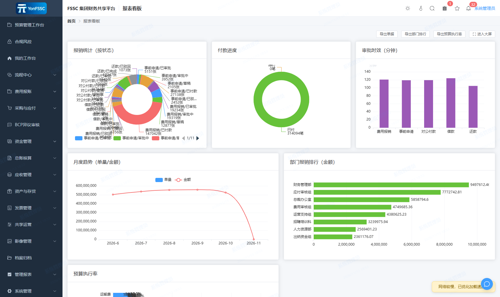
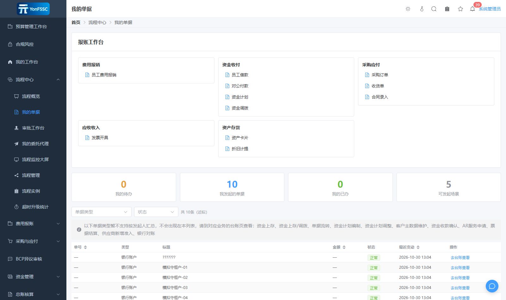
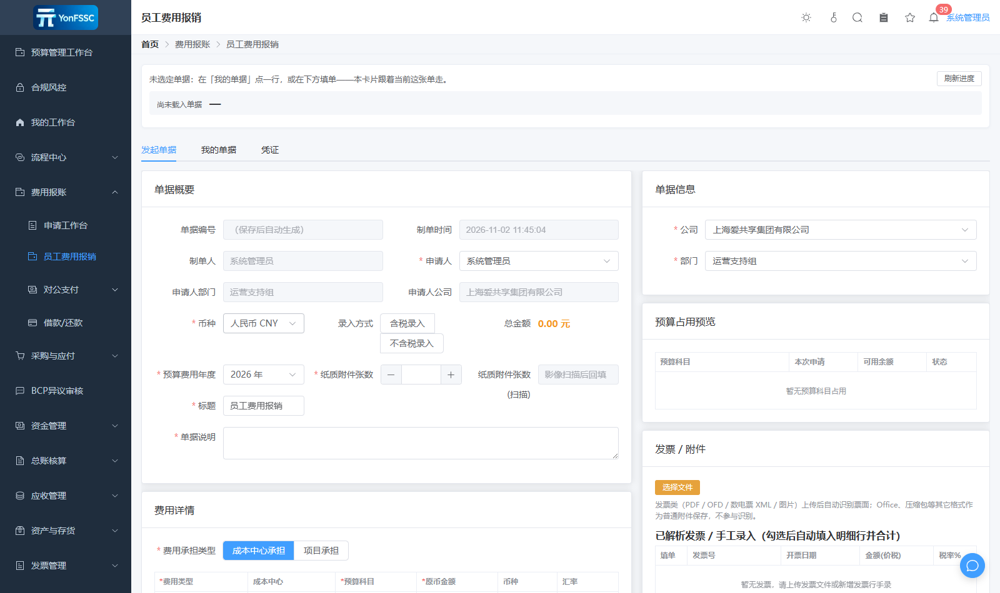
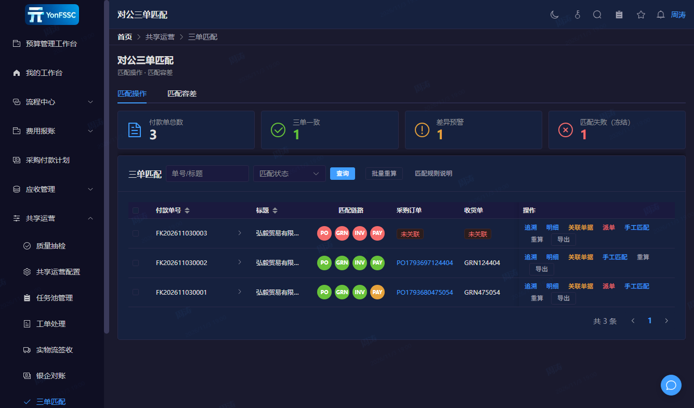
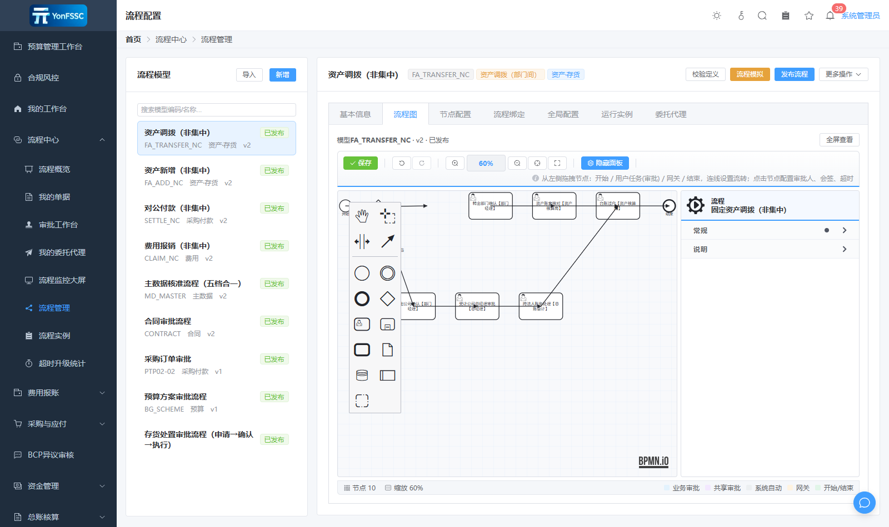
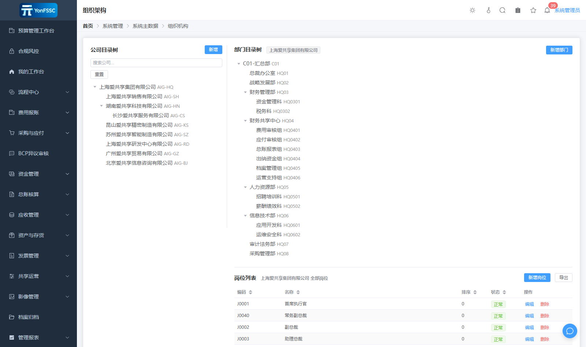

# FSSC · 集团财务共享服务平台

> 多租户 SaaS 财务共享中心（Financial Shared Service Center）——覆盖费用报账、应收应付、总账凭证、资产存货、资金票据、影像 OCR、共享作业运营与 BPMN 审批引擎的完整业务底座。
>
> 名称说明：这里的 **FSSC** 是"财务共享服务中心"这一行业通用缩写的字面含义，指本软件所服务的业务形态本身；本项目与任何同名或近名的商业软件、认证体系没有隶属或关联关系，也不包含其代码、界面素材或文档。


<details>

<summary>English 本仓库不做整篇中英对照，理由见下）</summary>

**What this is.** A multi-tenant SaaS **financial shared service center** backend: expense claims → compliance pre-check → budget control → multi-level approval (Flowable BPMN) → shared-service work queues and scheduling → invoice verification → payment → journal vouchers → image archiving, with full cross-document drill-through and row-level data scope.

**Stack.** JDK 26 + Spring Boot 4.1 + Flowable 8 + MyBatis-Plus (245 mappers, **no Mapper XML**) on MySQL 8; Vue 3.5 + Vite 6 + Element Plus + bpmn-js 16.5 for the front end and the process designer.

**Read this first.** `docs/代码阅读指南.md` (how to orient in a large codebase), then `docs/模块地图.md`, `docs/数据模型.md`, `docs/权限与多租户.md`, `docs/流程引擎技术说明.md` §9 ("I need to change something — where do I touch?"). Every `path:line` citation in the docs is checked by `_tools/cite_check.mjs` in CI.

**Honest caveats.**

- **Internationalisation is wired up and the UI text is extracted.** `fssc/fssc-web/package.json` depends on `vue-i18n`, `fssc/fssc-web/src/i18n/index.js` builds the instance, `main.js` registers it plus a global `LocaleSwitch`, and `src/i18n/locales/{zh-CN,en-US}.js` carry 4,948 keys each. Measured on this snapshot: 175 of 268 `.vue`/`.js` files under `src/` call `$t()`/`t()`/`useI18n()` (7,715 call sites) — every user-visible string in templates (labels, placeholders, table columns, button captions, dialog titles) and in the script layer (toasts, confirmations, table-column definitions) is routed through the locale files. The remaining Chinese literals are source comments, log text, data dictionaries (`enums.js`, `billStatus.js`, `permMappings.js`) and the bpmn-js canvas patch — none of which are interface copy. `scripts/i18n_check.py` gates this in CI: key-set alignment, dangling references, dynamic-key splicing, message compilation and a hard-coded-Chinese baseline that may only go down, never up.
- **Source-only release.** The front-end package keeps `"private": true`; there is no npm package and no hosted demo. You build and run it yourself — from source (`mvn spring-boot:run` on `fssc/fssc-server/fssc-start`, `npm run dev` on `fssc/fssc-web`) or as a jar (`mvn package` then `java -jar`). See "Three steps to run it" above.
- **Database bootstrap = one full database dump.** `db/Dump<导出日期>/` (326 files: 325 one-table-per-file dumps plus a routines file, ≈6.9 MB) is the supported way to create the databases; import it as `db/README.md` describes. Only one slice of incremental SQL is published: `db/upgrade/` carries the paired apply/rollback scripts for **v1.0.0 → v1.2.1** (structure, parameters, menus, seeds) — older per-version scripts stay unpublished, and there is no Flyway/Liquibase. The dump is a **clean** drill database: master data, menus, permissions and process definitions are populated, but it holds **no** business documents (`exp_bill` / `op_voucher` / `wf_instance` are empty), and the 2.2 MB in `act_ge_bytearray` is 190 BPMN definitions plus 183 diagrams, not uploaded attachments.
- The declared JDK is pinned to **26**, a non-LTS release whose end of availability has already passed; the maintainers have adjudicated a move to the current LTS line but have not run that build yet — that migration is not yet verified by a build.
- This code has been hardened through long manual business drills; treat documented behaviour as *documented*, not *guaranteed*. Each doc states which claims were measured and which were only read off the code.

</details>

---

## 本次更新（v1.2.1）

本版把「一套代码、多个交付档位」这条线接完，并补上配置化能力；同时修掉几个只在换页、审计写入时才暴露的卡点。

- **可配置表单平台**：新增单据类型注册与通用单据运行库（`md_form_config` / `md_form_field` / `md_form_validation`），表单、校验与流程路由由配置驱动，扩展单据类型无需改动代码；附一份可选样例配置说明完整链路。尚未提供页面的「表单设计」入口已先行下线，避免点进去落到通配路由。
- **租户档位引导**：`pf_tenant.op_mode` 记录企业选择的能力集合，首次登录引导据此决定跳转；费用报销版／费控版／共享版三档共用同一套代码与业务数据。已上线系统有专用回填脚本，新部署保持未选择状态由管理员自行决定。
- **流程设置归位**：流程模型、节点配置与流程绑定的维护能力从共享运营能力码中拆出，「流程设置」归入系统管理，管理类角色获得完整维护权限；预设流程补齐 BPMN 图形布局，节点与执行语义不变。
- **开放接口幂等修正**：审计表生成列改为只对「成功且幂等键非空」生成值，查询类请求不再撞唯一约束，审计写入不再掩盖业务结果。
- **界面修复**：侧栏菜单图标补齐（按 `path` 定位、只填空值）；报表菜单分组后的手册跟进；错误边界改为按顶层布局复用并按页复位，换页不再重建侧栏。
- **文档与数据**：整库 dump 刷新为 `db/Dump20261109/`，结构、菜单与主数据已含本期变更；`docs/真实场景测试/` 收敛为五本手册（三档逐步版 + 其它业务流程 + 系统管理员与流程配置），修掉互引死链；`db/upgrade/` 补入本期增量脚本说明；后端三个模块与前端版本统一为 **1.2.1**（此前工程文件仍停留在 `1.1.1`，与发布标注不一致，本版一并修正）。

> 数据库提醒：`db/Dump20261109/` 已含本期全部结构、菜单与主数据变更（含 `pf_tenant.op_mode`、`FC_WF_CONFIG` 与表单平台配置），新建库导入这一份即可直接换上 1.2.1 的 jar。`db/upgrade/` 只用于**已经在跑、不能重导库**的环境，按其中的顺序补跑 v1.0.0 → v1.2.1 增量。

逐条变更见 [`CHANGELOG.md`](CHANGELOG.md) 的 1.2.1 条目。

## 30 秒看懂：这是什么

假设你是一家有 20 家分子公司、每天 3,000 张报销单的企业集团。员工在手机上提单，单据要经过**预算控制 → 合规预检 → 多级审批 → 共享中心作业排班 → 发票查验 → 出纳付款 → 自动生成凭证 → 影像归档**，还要保证 A 公司的人看不见 B 公司的单据。

FSSC 就是为这条完整链路准备的系统：


**为什么值得看**：市面上开源 OA 很多、ERP 不少，但把「财务共享中心全业务共享 + 财务共享中心的作业运营 +业/财/税/金全流程打通+ 单据全链路联查 + 可配置审批引擎 + 多租户 SaaS 底座」一起做成的开源实现没有。这个仓库可以直接读到这套业务的表设计、状态机和引擎接入方式。

## 能力地图（真实数字，来自源码扫描）

|            |                    数量 | 说明                                          |
| ---------- | --------------------: | ------------------------------------------- |
| 后端 Java 文件 |                 1,123 | `fssc/fssc-server/fssc-start/src/main/java` |
| 后端代码行      |               163,759 | 不含测试与前端                                     |
| REST 控制器   |                   173 | `@RestController`                           |
| HTTP 端点    |                 1,365 | `@*Mapping` 计数                              |
| 业务域包       |                    36 | `com.fssc.<domain>`                         |
| 实体映射表      |                   259 | `@TableName` 计数；库内实际表数更多                    |
| 前端页面组件     |                   141 | `fssc/fssc-web/src/views/**/*.vue`          |
| 流程模型（BPMN） | 见 `bpmn-repo/publish` | 审批流模板库                                      |

> 数字由 `_tools/emit_facts.mjs` 从源码抽取，落在 `docs/_facts/facts.json`（本表与其同源，改代码后重跑该脚本即可刷新）。

按域看规模（代码行排序，前 12）：

`workflow` 33.9k · `sharing` 16.4k · `masterdata` 9.3k · `expense` 8.8k · `compliance` 8.6k · `system` 8.1k · `arflow` 6.3k · `framework` 6.1k · `glex` 6.1k · `ai` 5.5k · `image` 4.1k · `document` 3.7k

另见：逐域职责、API 前缀与对应表 → **[`docs/模块地图.md`](docs/模块地图.md)**

### 功能域一览

| 分类 | 域                                                                                         | 一句话                                              |
| -- | ----------------------------------------------------------------------------------------- | ------------------------------------------------ |
| 底座 | `framework` `platform` `auth` `system`                                                    | 多租户隔离、JWT 鉴权、平台开租户、用户/角色/菜单/参数/编号规则              |
| 主线 | `expense` `document` `invoice` `image` `compliance` `budget`                              | 报销提单 → 合规预检 → 预算占用 → 发票查验 → 影像调阅                 |
| 审批 | `workflow` `collab`                                                                       | Flowable BPMN + 自研 `wf_*` 台账：会签/票签/加签/转办/委托/超时升级 |
| 财务 | `glex` `gl` `arflow` `apflow` `receivable` `treasury` `payplan` `bank` `purchase` `asset` | 凭证自动生成、应收应付、资金计划、批量付款、银企直联、采购、资产折旧与存货            |
| 运营 | `sharing` `report` `audit` `tracing` `match`                                              | 共享作业池/派工/SLA/绩效、报表看板、操作留痕、单据全链路联查、三单匹配           |
| 扩展 | `ai` `contract` `customer` `returns`                                                      | AI 动作网关、合同、客户、退单                                 |

## 快速开始

本仓是**完整源码**（后端 Java + 前端 Vue3 + 流程模型 BPMN + 建库 dump），两种启动方式都支持：

| 方式                     | 适用                | 后端启动命令                        |
| ---------------------- | ----------------- | ----------------------------- |
| **A. 源码调试**（推荐开发用）     | 改代码即时生效、断点调试、热改前端 | `mvn spring-boot:run`（不起 jar） |
| **B. 打 jar 运行**（推荐部署用） | 交付一份可执行产物、部署到服务器  | `mvn package` 后 `java -jar`   |

> 后端源码在 `fssc/fssc-server/`（Maven 父工程 `fssc-server` + 模块 `fssc-common` / `fssc-start`），  
> 可执行主类是 `com.fssc.FsscApplication`。前端源码在 `fssc/fssc-web/`。

### 前置（版本必须对齐）

| 依赖    | 版本                                          | 校验命令              |
| ----- | ------------------------------------------- | ----------------- |
| JDK   | **26.0.1**（`maven.compiler.release=26`）     | `java -version`   |
| Maven | 3.9.x                                       | `mvn -v`          |
| MySQL | 8.x，字符集 `utf8mb4`，排序规则 `utf8mb4_general_ci` | `mysql --version` |
| Node  | **24.x**（Vite 6）                            | `node -v`         |
| Redis | 可选，单机部署不需要                                  | —                 |

> 后端依赖 MySQL 8 的窗口函数与 `utf8mb4`，且 MyBatis-Plus 走 JSqlParser 做租户条件注入。用 MariaDB 或 5.7 未经验证。

### 三步跑起来

```bash
# ── ① 建库：导入整库 dump（结构 + 演示数据，建库入口只有这一条）
bash db/import.sh          # 脚本自动选最新的 db/Dump<日期>/ 并逐文件导入（Windows 用 db\import.bat）
# 等价手工命令：
for f in db/Dump*/fssc_*.sql; do mysql --default-character-set=utf8mb4 -uroot -p < "$f"; done
# 每个文件自带 CREATE DATABASE + USE，主库 fssc 与影像库 fssc_image 一起建好；
# 都是 DROP TABLE IF EXISTS + CREATE + INSERT，可重复执行，文件顺序不影响成败（各自关掉外键检查）
# Flowable 的 ACT_* / FLW_* 表已在 dump 内，首启时 database-schema-update=true 会补齐缺项

# ── ② 配环境：复制 .env.example 并填两个必填项
cp .env.example .env
#   FSSC_DB_PASSWORD = MySQL 口令
#   FSSC_JWT_SECRET  = ≥32 字节随机串（openssl rand -base64 48）
# 【注意】.env 是**纯文本文件**，本仓不内置 dotenv 加载器 ⇒ 必须靠下面的
#    --spring.config.import 参数把它读进来（或自己 export 成环境变量）。

# ── ③ 起后端 + 前端
```

#### ③-A 源码调试（不起 jar，改代码即时生效）

```bash
# 后端：直接在 fssc-start 模块跑主类，Spring Boot 会用 target/classes 而非 jar
cd fssc/fssc-server/fssc-start
mvn spring-boot:run \
  -Dspring-boot.run.arguments="--spring.config.import=optional:file:../../../../.env"
# → http://localhost:8089

# 前端：Vite dev server，改 .vue 即时热更新
cd fssc/fssc-web && npm install && npm run dev
# → http://localhost:8080
```

> **IDEA / VS Code 直接调试**：用 IDE 打开 `fssc/fssc-server/` 目录（作为 Maven 工程导入），  
> 运行 `com.fssc.FsscApplication` 即可。断点、热改、Profiler 都能用，比 `mvn spring-boot:run` 更顺手。  
> 建议把 `.env` 的内容配进 Run Configuration 的环境变量，或在 VM options 里加  
> `-Dspring.config.import=optional:file:<仓库绝对路径>/.env`。  
> 注意 `fssc-server` 是**父工程**（`packaging=pom`），`mvn spring-boot:run` 要在 `fssc-start` 目录跑，  
> 或在父目录用 `mvn -pl fssc-start -am spring-boot:run`。

#### ③-B 打 jar 运行（交付 / 部署用）

```bash
cd fssc/fssc-server
mvn -q clean package -DskipTests        # 产出 fssc-start/target/fssc-server.jar（约 90MB fat jar）

# 把 .env 里的变量导出到当前 shell，再起 jar
set -a && . ../../.env && set +a        # bash；Windows 用 PowerShell 的 Get-Content + 环境变量
java -jar fssc-start/target/fssc-server.jar
# → http://localhost:8089

cd ../fssc-web && npm install && npm run dev
# → http://localhost:8080
```

浏览器打开 `http://localhost:8080`。dump 里带着演练期间的账号、组织、菜单、参数与单据数据，导入后界面就有内容可点。登录用演示租户 **`DEMO1`**，口令统一 **`123456`**，工号即账号：`admin`（系统管理员）或 `100001`（普通员工）。

想跑完整业务链路，照 **[`docs/真实场景测试/`](docs/真实场景测试/) 的三本逐步操作手册**做——不讲概念，每步写清"谁、登哪个账号、点哪里、应该看到什么"。**同一张单不能由同一个人既提单又审批**（引擎有防自审判定），至少需要提单人（`100001` 丁宇轩）+ 部门审批人（`100005` 叶思琪）+ 共享会计（`100002` 赵勇）+ 出纳（`100003` 雷子涵）四类身份，各册 §1.2 有本册完整账号表。审批链路与状态语义以 `docs/` 各册为准，不要用截图或印象推断。

另见：端口、双库路由、数据源路由键、OCR/银企 mock 通道、启动失败排查 → **[`docs/快速上手.md`](docs/快速上手.md)**

## 技术栈

**后端**：Spring Boot 4.1.0 · Spring MVC + 自研 `JwtAuthFilter` · MyBatis-Plus 3.5.15（含 JSqlParser 租户拦截）· Flowable 8.0.0（BPMN）· jjwt 0.12.6 · Lombok 1.18.46 · commons-lang3 3.17.0 · springdoc-openapi 3.1.0（`/swagger-ui.html`）· Actuator + Micrometer/Prometheus · 多路由键数据源 HikariCP（影像分库，档案/发票/只读副本就位待开）· 可选 Redis（`com.fssc.framework.spi.DistributedState` 可插拔）

**前端**：Vue 3.5 + Vite 6 · Element Plus 2.9 · Pinia 2 · vue-router 4 · bpmn-js 16 + properties-panel（在线流程设计器）· ECharts 5 · vitest 3 + jsdom

**运维**：`fssc/docker/Dockerfile` · `fssc/docker/k8s-fssc.yaml` · 优雅停机（`server.shutdown=graceful`，30s 窗口）· 免鉴权探针 `/actuator/health/{liveness,readiness}`

## 界面

截图取自本仓源码实跑（`fssc/fssc-web` + `fssc-server`，演示租户 `DEMO1`，行政管理员视角），  
数据来自 `db/` 的整库导出。

**工作台**（待办 / 我发起的 / 已办 / 可发起场景，按角色聚合入口）



**报账工作台 · 我的单据**（费用报账、资金收付、采购应付、应收收入、资产存货五条线统一收口；  
下方单据列表带状态、操作人与"去台账查看"跳转）



**报销提单**（费用明细、预算占用预览、发票与附件；必填校验按单据类型动态下发）



**三单匹配**（订单·收货·发票自动比对，容差可配，不齐就拦下，从源头杜绝错付漏付、漏收）



**流程配置 · 流程图**（BPMN 画布，节点/网关/连线可拖拽；左侧模型列表带版本与发布状态，  
右侧七个页签覆盖节点配置、流程绑定、全局配置、运行实例、委托代理）



**组织机构**（公司目录树 + 部门目录树 + 岗位列表，多主体与多层级在同一屏可对照）



## 文档索引

| 想做什么                                                   | 读哪份                                                                 |
| ------------------------------------------------------ | ------------------------------------------------------------------- |
| 5 分钟跑起来、排查启动失败                                         | [`docs/快速上手.md`](docs/快速上手.md)                                      |
| 找一个功能在哪改                                               | [`docs/模块地图.md`](docs/模块地图.md)                                      |
| 理解分层与请求生命周期                                            | [`docs/架构总览.md`](docs/架构总览.md)                                      |
| **第一次接手这个库、不知从哪读起**                                    | [`docs/代码阅读指南.md`](docs/代码阅读指南.md)                                  |
| 查表 / 写 SQL / 加字段                                       | [`docs/数据模型.md`](docs/数据模型.md)                                      |
| 看不懂业务黑话（会签、核销、联查…）                                     | [`docs/术语表.md`](docs/术语表.md)                                        |
| 搞清审批引擎能配什么、不能配什么                                       | [`docs/流程引擎技术说明.md`](docs/流程引擎技术说明.md)                              |
| **第一次动手改代码，不知道要动哪几处**（加查询条件 / 加字段 / 加权限 / 改节点 / 改状态文案） | [`docs/流程引擎技术说明.md`](docs/流程引擎技术说明.md) §9                           |
| 权限怎么加、为什么 403 显示"暂无数据"                                 | [`docs/权限与多租户.md`](docs/权限与多租户.md)                                  |
| 业务故事：这张单据是谁提的、谁审的、钱怎么出去                                | [`docs/business-flows/`](docs/business-flows/)                      |
| 部署到生产                                                  | [`docs/部署手册.md`](docs/部署手册.md) · [`docs/部署运维.md`](docs/部署运维.md)     |
| 想知道这系统解决什么问题、给谁用                                       | [`docs/系统介绍.md`](docs/系统介绍.md) · [`docs/系统特点.md`](docs/系统特点.md)     |
| 演示环境该登哪个账号、照着一步步跑通业务                                   | [`docs/真实场景测试/`](docs/真实场景测试/)（3 本逐步操作手册，每步写明账号与预期状态）               |
| 全部文档一览                                                 | [`docs/README.md`](docs/README.md)（每篇散文文档另有同名 `.docx`）              |
| 提 PR 前必读                                               | [`CONTRIBUTING.md`](CONTRIBUTING.md) · [`SECURITY.md`](SECURITY.md) |

## 成熟度声明

| 状态            | 内容                                                                                                                                                                                                                                                                                                                         |
| ------------- | -------------------------------------------------------------------------------------------------------------------------------------------------------------------------------------------------------------------------------------------------------------------------------------------------------------------------- |
| 已实现且真实运行验证    | 费用报账全流程（事前申请→提单→多级审批→共享作业审核→发票查验→付款批次与执行→凭证生成与过账→归档联查，含差旅、借款核销、费用分摊、超标自动升级审批链与大额档）；合同、采购与应付三单匹配、应收对账开票与坏账、资金与付款、资产与存货、共享作业派工与 SLA、影像与发票、总账核算与月结、预算、管理报表共 **上百个页面**；系统管理员与流程配置。机制面：多级审批与会签／加签／转办／委托、凭证由业务单据自动生成并过账、多租户＋RBAC＋数据范围三层权限、单据全链路联查、影像采集与可插拔 OCR 通道框架、BPMN 在线设计器改完发布即生效、界面文案国际化（zh-CN / en-US 双语，4,948 键，含 CI ）  |
| 已实现，需结合客户业务定制 | 税务链、预算链、SaaS 多租户、资产折旧与存货、资金计划与银企（内置 mock 通道）、预算控制细则、合规规则引擎多数规则、AI 动作网关——功能与界面都在，但科目口径、审批链、规则阈值与单据类型要按你自己的组织、政策和流程配一遍才算「能上线」                                                                                                                                                                                                |
| 需要自行扩展才能生产    | 真实 OCR/发票查验/认证抵扣/申报通道接入、银企直联真实实现、对象存储、SSO/LDAP、短信渠道                                                                                                                                                                                                                                                                        |
| 明确不具备         | 生产级高可用验证（经大规模压测，但需要根据客户业务进行重新优化）、财务报表准则级审计背书                                                                                                                                                                                                                                                                               |

本项目内置脱敏后的真实系统数据，**不适合**直接当生产财务系统上线，适合作为二次开发底座、教学参考或同类系统能力研究。

## 开源许可：AGPL-3.0 与商业许可（双许可）

> 本项目以**双许可（Dual Licensing）**&#x65B9;式发布：默认按 AGPL-3.0 开源；需要闭源或免予 copyleft / 网络条款义务的场景，另行取得商业许可。

| 通道          | 许可文件                          | 适用场景                                  | 主要义务                                                |
| :---------- | :---------------------------- | :------------------------------------ | :-------------------------------------------------- |
| **开源默认**    | [AGPL-3.0](LICENSE)           | 学习、自部署、修改后自用或再分发                      | 强 copyleft + **网络条款**：修改后作为网络服务（SaaS）对外提供，须公开你的修改源码 |
| **商业许可**    | [商业许可](LICENSE-COMMERCIAL.md) | 闭源分发、去除 copyleft / 网络条款义务、获取商业支持与 SLA | 取得商业许可后免予上述义务；条款与采购见该文件                             |

【注意】**重点提醒（使用前务必读完）**

1. **AGPL-3.0 含「网络条款」**：只要你修改本程序并**作为网络服务向他人提供**（含私有部署但对外多租户），就必须以 AGPL-3.0 公开你的**修改源码**。是否触发以 AGPL-3.0 原文及你的具体部署形态为准。
2. **商业许可目前为占位文件**：`LICENSE-COMMERCIAL.md` 的**条款尚未拟定**，当前没有可据以主张的商业授权。在正文就绪前，任何"已取得商业许可"的说法均不成立——现阶段**实际可用的只有 AGPL-3.0**。
3. **分发须保留 `NOTICE`**：其中的第三方组件许可清单（含 MySQL Connector/J 的 FOSS Exception 说明）独立于本项目许可，须逐条核对兼容性。
4. **选型本意**：AGPL-3.0 的专利授权与网络条款，对含自研流程引擎接入的企业软件是必要的；如需更宽松的闭源路径，请待商业许可正文就绪后取得授权，而非改用其它开源许可。

**一句话选型**：能接受开源你的修改 → 直接按 AGPL-3.0 使用；要闭源商用 → 等 `LICENSE-COMMERCIAL.md` 条款就绪并取得商业许可。

## 免责声明

开源通道（AGPL-3.0）下本仓库不提供任何形式的商业支持或 SLA；商业支持与 SLA 以 [`LICENSE-COMMERCIAL.md`](LICENSE-COMMERCIAL.md) 约定的商业许可为准。财务与税务处理请以你所在司法辖区的法规与准则为准。
