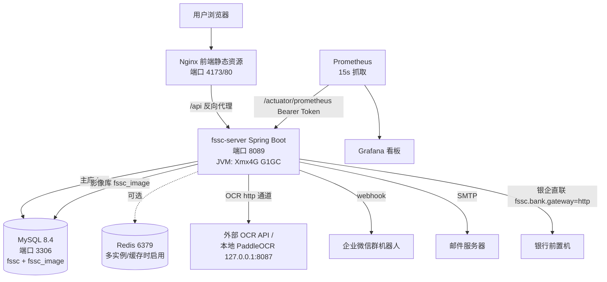

# 39-部署架构与网络拓扑

> 版本 v1.0 ｜ 2026-09-16 ｜ 维度9 任务 DOC-03 ｜ 配套 36-上线运维手册

---

## 一、系统组件关系图（单机演示形态）



## 二、端口规划

| 组件 | 端口 | 协议 | 访问控制 |
|---|---|---|---|
| fssc-server | 8089 | HTTP | 生产经 Nginx 反代，仅内网/网关暴露；8089 不对公网 |
| Nginx（前端） | 80 / 4173 | HTTP(S) | 生产启用 TLS 1.2+（443） |
| MySQL | 3306 | TCP | 仅应用服务器内网访问，bind 内网地址 |
| Redis | 6379 | TCP | 内网 + requirepass |
| PaddleOCR（可选） | 8087 | HTTP | 本机回环 |
| Prometheus 抓取 | 9090 | HTTP | 运维网段 |
| Grafana | 3000 | HTTP | 运维网段 + 账号鉴权 |

## 三、单机部署 vs 多实例部署

| 维度 | 单机（演示/UAT） | 多实例（生产） |
|---|---|---|
| 应用 | 1 × fssc-server | N × fssc-server（Nginx/K8s 负载均衡） |
| 会话 | JWT 无状态（天然水平扩展） | 相同；启用 Redis（fssc.redis.enabled=true）做多实例分布式锁/缓存 |
| 定时任务 | 本机执行 | JobHeartbeatService 分布式锁保证单实例执行 |
| 数据库 | 单实例 MySQL | 主从 + 每日全量/binlog 小时增量（STAB-04） |
| 升级 | 停机窗口滚动 | K8s 滚动更新（maxSurge=1, maxUnavailable=0）+ 优雅停机 30s |
| 探针 | /api/health | liveness/readiness（36 手册 K8s 配置） |

## 四、K8s 部署形态（生产可选）

```yaml
# 见 docker/k8s-fssc.yaml：Deployment 2 副本 + Service
# livenessProbe: /actuator/health/liveness（初始延迟 60s）
# readinessProbe: /actuator/health/readiness（初始延迟 40s）
# resources: requests 2C4G / limits 4C8G
# 密钥: fssc-secrets（FSSC_DB_PASSWORD / FSSC_JWT_SECRET）
```

## 五、安全边界

1. 生产入口统一 HTTPS（443），`FSSC_OPENAPI_ENABLED=false` 关闭 Swagger。
2. CORS 白名单 `fssc.cors.allowed-origin-patterns` 配置真实前端域名；Origin 校验白名单 `fssc.security.allowed-origins`。
3. Actuator 仅暴露 health+prometheus，且 metrics/prometheus 需 Bearer Token（JwtAuthFilter 非白名单）。
4. 平台端接口 `@PlatformOnly` + platform:* 权限双重控制；多租户 tenant_id 拦截器隔离。
