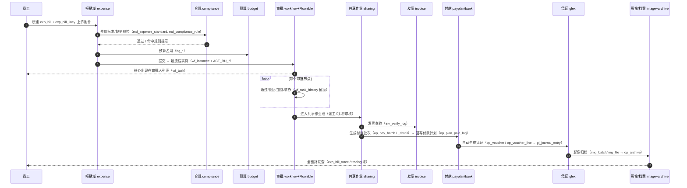

# 业务流程目录与业务故事

> **校准状态**：下方 78 个流程编码是从 `bpmn-repo/publish/` 目录**实测列出**（每个子目录是一个已发布模型）。流程的**中文名与业务含义多数由编码推断，标  的尚未逐个确认**——请维护者补正，这也正是本目录最需要的贡献。
>
> 本目录当前只有这份索引。每篇流程故事文档都还没写，模板见文末。

## 为什么需要"业务故事"文档

代码能告诉你 `exp_bill.status='APPROVING'`，但不会告诉你**这张单为什么停在这个状态、下一个点它的人是谁、他看到什么界面、他为什么可能驳回**。财务共享系统的复杂度几乎全在这种人-状态-界面三方对齐上。新人（尤其非财务背景的贡献者）缺的就是这一层。

**每篇流程故事的验收标准**：一个不懂财务的人读完，能自己在演示环境里把这条流程走通，并说出每一步落在哪张表。

## 78 个已发布流程模型（按业务族分组）

### 报销与借款（费用域 `expense` + 审批 `workflow`）
`CLAIM` 费用报销主流程 · `CLAIM_G1` 报销变体G1  · `CLAIM_TRAVEL` 差旅报销 · `TRAVEL` 差旅  · `LOAN` 借款申请 · `REPAY` 还款 · `PREPAY` 预付 · `SETTLE` 结清  · `MEETING` 会议费  · `TRAIN` 培训费 

### 应收（`arflow` / `receivable`）
`RECEIVABLE` 应收确认 · `RECEIVABLE_COLLECT` 收款/催收  · `AR_RECON` 应收对账 · `AR_REPORT` 应收报表  · `RECON_ACTIVE` 主动对账 · `RECON_PASSIVE` 被动对账 · `BAD_DEBT_CONFIRM` 坏账确认 · `BAD_DEBT_PROV` 坏账计提

### 应付与付款（`apflow` / `payplan` / `sharing` / `bank`）
`PAY_PLAN_BASE` 付款计划基础 · `PAY_PLAN_PLATE` 付款计划板  · `SUPPLIER_ADD` 供应商新增 · `CONTRACT` 合同

### 资金与票据（`treasury` / `bank`）
`TR_PAY` 付款 · `TR_PAY_FAIL` 付款失败处理  · `TR_PLAN` 资金计划 · `TR_PLAN_ADJUST` 计划调整 · `TR_RECEIPT` 到账与核销 · `TR_TRANSFER` 内部划转 · `TR_UPLOAD` 上传  · `TR_BILL` 票据 · `TR_BANK_MASTER` 银行主数据 · `TR_BANK_RECON` 银行对账 · `TR01-02` 资金子流程 

### 发票（`invoice`）
`INVOICE_ISSUE` 开票 · `INVOICE_MATCH` 发票匹配 · `INVOICE_MATCH_MANUAL` 人工匹配 · `INV_ISSUE_PROJECT` 项目开票 · `INV_ISSUE_NONPROJECT` 非项目开票 · `INV_DEVAL` 发票降级/作废  · `INV_DISPOSE` / `INV_DISPOSAL_APPLY` / `INV_DISPOSAL_CHECK` / `INV_DISPOSAL_EXEC` 发票处置三段 · `INV_INTERNAL_SALE` 内部销售 · `INV_PHYSICAL_CHECK` 实物查验

### 固定资产与在建工程（`asset`）
`FA_ADD` 资产新增 · `FA_DEPRECIATION` 折旧 · `FA_VALUE_ADJUST` 价值调整 · `FA_IMPAIRMENT` 减值 · `FA_DISPOSE` 处置 · `FA_TRANSFER` 转移 · `FA_TRANSFER_CROSS` 跨主体转移 · `FA_ALIENATE` 出让  · `FA_CHECK_DIFF` 盘点差异 · `FA_CER` 资产证书  · `FA_CIP_TO_ASSET` 在建转固 · `FA11-01` / `FA11-04` 资产子流程 

### 总账与月结（`glex` / `gl`）
`GL_MANUAL_VOUCHER` 手工凭证 · `GL_ACCRUAL` 计提 · `GL_DEFER` 待摊/递延 · `GL_OFFSET` 内部往来对冲 · `GL_MERGE` 合并 · `GL_MONTH_CLOSE` 月末结账 · `GL_SHARED_MASTER` 共享主数据  · `GL_OTHER_RECEIPT` 其他收款  · `GL_SALARY_PROV` 薪酬计提 · `GL_SALARY_PAY` 薪酬发放 · `GL_TAX_PROV` 税金计提 · `GL_TAX_PAY` 税金缴纳 · `GL_TAX_REFUND` 退税

### 会计档案（`compliance` / `document`）
`FM_ARCHIVE` 归档 · `FM_BORROW` 借阅 · `FM_DESTROY` 销毁 · `FM_DOC_FLOW` 单据流转

### 主数据与协同
`MD_MASTER` 主数据变更 · `CUSTOMER_MAINT` 客户维护

> **模型规模三个口径**（别混用）：`publish/` **77** 个已发布模型目录｜`models/` **83** 个模型编码、**289** 个版本 XML 快照｜库内 `wf_model` 的有效模型数**需以数据库为准**（`bpmn-repo` 只是文件侧快照，二者可能不同步，见 `docs/快速上手.md` 坑 9）。

## 主线：一张报销单的完整故事（示例，其余待写）



涉及的表、状态值、账号角色与界面入口，见本目录计划中的 `mainline-expense.md`（**待写，这是第一篇该写的文档**）。

## 每篇文档的模板

```markdown
# 流程：<中文名>（<编码>）

## 谁在什么场景用它
一个真实业务片段，两三句话。参与者角色（不要用人名）。

## 前置条件
需要哪些主数据/参数/角色，缺了会怎样（报什么错）。

## 界面路径
账号 → 菜单入口 → 页面 → 按钮，逐步骤，配 1 张截图。

## 系统做了什么
Mermaid 时序图 + 每步的 Controller/Service 位置（file:line）与落库表。

## 状态机
单据状态与流程状态的对应，标注终态与可恢复态。

## 异常分支
驳回 / 撤回 / 作废 / 超时 / 付款失败 各自走什么路径、留什么痕。

## 关联能力
凭证模板、预算占用释放、影像归档、联查展示。

## 已知限制与坑
实测过的边界条件。没有就写"未做异常演练"。

## 怎么自测
演示账号 + 5 步内可复现的验证清单。
```

## 建议写作顺序（性价比排序）

1. `mainline-expense.md` —— 主线一条，覆盖 8 个域，性价比最高
2. `pay-and-voucher.md` —— 付款→凭证→归档（财务系统的心脏）
3. `workflow-actions.md` —— 审批动作逐个（会签/加签/转办/委托/超时），配合 `docs/流程引擎技术说明.md`
4. `ar-collection.md` / `ap-plan.md` / `invoice-verify.md`
5. `month-close.md` —— 月结检查项（`gl_close_check_item`）
6. `asset-lifecycle.md` / `archive.md` / `masterdata-change.md`
