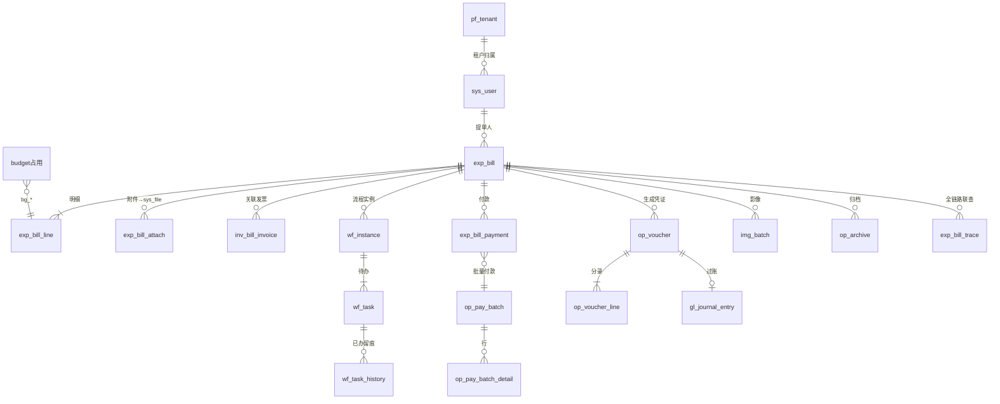

# 数据模型

> **校准状态**：243 张表名与所属域由脚本从源码 `@TableName` 注解**实测抽取**（完整清单 `docs/_facts/tables.txt`）。列级信息取自实体注解与 MyBatis XML，**未经与真实库 `INFORMATION_SCHEMA` 逐列比对**；表注释与实际注释可能有偏差。字段含义中带  的为推断。

## 1. 两个库，一类引擎表

| 库 | 内容 | 建立方式 |
|---|---|---|
| `fssc` | 全部业务表（243+）+ 平台表 + Flowable 引擎表 | 业务表需**基线脚本**；`ACT_*`/`FLW_*` 由 Flowable `database-schema-update=true` 首启自动建 |
| `fssc_image` | 影像域 5 张 + `ocr_record`：`img_batch` `img_file` `img_setting` `image_exception` `image_review` `ocr_record` | 独立数据源，`@FsscDataSource("image")` + AOP 路由 |

字符集统一 `utf8mb4` / `utf8mb4_general_ci`，时区参数 `serverTimezone=Asia/Shanghai`。

>  **`@TableName` 只覆盖有实体的表**。库里还存在无实体映射的表/视图/临时表，真实表数 > 243。发布基线时以 `mysqldump --no-data` 的结果为准，不要用这份清单当 schema。

## 2. 表名前缀 → 域图例

| 前缀 | 张数 | 归属域 | 代表表 |
|---|---:|---|---|
| `md_` | 45 | `masterdata` 主数据 | `md_supplier` `md_cost_center` `md_subject` `md_period` `md_expense_standard` `md_exchange_rate` |
| `op_` | 27 | `sharing` 共享作业 + `glex` 凭证 | `op_voucher` `op_voucher_line` `op_voucher_template` `op_pay_batch(_detail)` `op_dispatch_rule` `op_sla_config` `op_archive` `op_job` |
| `sys_` | 23 | `system` 租户内系统管理 | `sys_user` `sys_role` `sys_menu` `sys_role_menu` `sys_user_role` `sys_config` `sys_dict_data` `sys_number_rule` `sys_oper_log` `sys_login_log` `sys_file` |
| `wf_` | 17 | `workflow` 审批引擎台账 | `wf_model` `wf_instance` `wf_task` `wf_task_history` `wf_node_config` `wf_assignee_scheme` `wf_add_sign` `wf_delegate` `wf_cc` `wf_process_log` `wf_process_outbox` |
| `pf_` | 13 | `platform` 平台运营 | `pf_tenant` `pf_tenant_package` `pf_package` `pf_package_feature` `pf_feature` `pf_user` `pf_order` `pf_bill` `pf_config` |
| `ar_` | 12 | `arflow` 应收流程 | `ar_claim` `ar_note` `ar_statement` `ar_recon_record` `ar_writeoff_record` `ar_writeoff_fund` `ar_month_close` |
| `exp_` | 11 | `expense` 报销主线 | `exp_bill` `exp_bill_line` `exp_bill_attach` `exp_bill_payment` `exp_bill_receipt` `exp_bill_trace` `exp_bill_share` `exp_travel` `exp_loan_offset` |
| `gl_` | 10 | `glex` 总账扩展 | `gl_journal_entry` `gl_month_close` `gl_close_check_item` `gl_consolidate` `gl_fx_revaluation` `gl_inter_offset` `gl_tax_provision` |
| `bg_` | 5 | `budget` 预算 | 预算编制/占用类 |
| `inv_` | 5 | `invoice` 发票 | `inv_invoice` `inv_invoice_line` `inv_bill_invoice` `inv_invoice_global` `inv_verify_log` |
| `rc_` | 5 | `receivable` 应收 | `rc_receivable` `rc_receipt` `rc_receipt_line` `rc_bad_debt` `rc_collect_todo` |
| `img_` / `image_` | 3+2 | `image` |  **在 `fssc_image` 库**；同域两前缀并存 |
| `collab_` | 4 | `collab` 消息协同 | |
| `tax_` | 4 | `glex` 税务 | |
| `tr_` | 4 | `treasury` 资金 | `tr_fund_plan` `tr_transfer` `tr_credit_bill` `tr_bill_settle` |
| `ai_` | 3 | `ai` 网关 | |
| `ap_` | 3 | `apflow` 应付流程 | `ap_service_request` `ap_month_close` `ap_dispatch_rule` |
| `archive_` | 3 | `compliance`/`document` 会计档案 | |
| `bank_` | 3 | `bank` 银企 | |
| `cont_` | 3 | `contract` 合同 | |
| `expense_` | 3 |  与 `exp_` 并存 |  同域两前缀 |
| `po_` | 3 | `purchase` 采购 | |
| `rpt_` | 3 | `report` 报表 | |
| `supplier_` | 3 | `masterdata` 供应商扩展 |  语义与 `md_supplier` 重叠 |
| 各 2 张 | 12 组 | `audit` `image` `purchase`(`pur_`/`sale_`) `stock` `sod_` | |
| 各 1 张 | 15 组 | `asset` `fa_` `crm` `dispatch` `employee` `ext` `cip`? `fraud` `integration` `linku` `match` `ocr` `pay` `precheck` `reviewer` `satisfaction` `service` | |

**同域多前缀并存**（新人最容易懵，也是提问高频点）：

| 并存对 | 观察事实 | 处理建议 |
|---|---|---|
| `exp_` ↔ `expense_` | 前者是报销单主体族，后者 3 张  | 新表统一用 `exp_`；动 `expense_` 前先确认它被谁读 |
| `gl_` ↔ `op_voucher*` ↔ `glex` 域 ↔ `gl` 域 | 凭证主数据在 `op_voucher(_line)`，总账扩展在 `gl_*`；代码里 `gl`（4 文件）与 `glex`（53 文件）两个包并存 | 找"凭证"先看 `op_voucher`，找"月结/合并/重估"看 `gl_*` + `glex` |
| `ar_` ↔ `arflow` 域 ↔ `rc_` | `arflow` 是流程动作族，`receivable` 域用 `rc_` 台账族 | 应收问题两处都要查 |
| `ap_` ↔ `apflow` ↔ `pay`/`op_pay_batch` | 应付申请 / 付款批次 / 计划回写分属三处 | 沿"申请→批次→回写"顺序查 |
| `img_` ↔ `image_` | 影像主档 `img_*`，异常与复核 `image_exception` / `image_review` | 分库内，注意数据源注解 |
| `md_supplier` ↔ `supplier_*` | 主数据供应商 + 供应商扩展三张 | 新增供应商属性先定归属 |

## 3. 核心表：一条报销单的旅程



按顺序读这 8 组表，等于读完整条主线：

| 阶段 | 表 | 关键字段要看什么 |
|---|---|---|
| ① 提单 | `exp_bill` + `exp_bill_line` + `exp_bill_attach` | 单据状态、金额合计、费用项（`md_expense_item`）、成本中心、预算占用结果 |
| ② 合规/预算 | `md_compliance_rule`、`md_expense_standard`、`bg_*` | 命中了哪条规则、占用与释放 |
| ③ 审批 | `wf_instance` `wf_task` `wf_task_history` `wf_node_config` `wf_add_sign` `wf_delegate` `wf_cc` + Flowable `ACT_RU_*`/`ACT_HI_*` | **两套账**：引擎态在 `ACT_`，业务台账在 `wf_`，不一致就是缺陷 |
| ④ 发票 | `inv_invoice` `inv_invoice_line` `inv_verify_log` | 查验结果与来源通道 |
| ⑤ 付款 | `exp_bill_payment` → `op_pay_batch(_detail)` → `op_plan_paid_log` | 批次状态、收款账户（`md_bank_account`）、计划回写幂等键 |
| ⑥ 凭证 | `op_voucher` `op_voucher_line` `op_voucher_template` → `gl_journal_entry` | 模板驱动的分录生成；`DRAFT` → 过账 |
| ⑦ 影像 | `fssc_image`.`img_batch/img_file` | 与 `sys_file` 的关系、原件存储区（temp/business/archive） |
| ⑧ 归档与联查 | `op_archive`、`archive_*`、`exp_bill_trace` | 归档后不可变更；联查是"这单每一环"的聚合视图 |

## 4. 通用列约定

绝大多数业务表共享下列列（由实体基类 / MyBatis-Plus 自动填充实现）：

| 列 | 含义 | 注意事项 |
|---|---|---|
| `id` | 主键 | 部分表为自增 `bigint`，部分为 `uuid`/雪花 —— **不要假设统一**，跨表传 id 前先确认类型（曾出现 uuid 传给 bigint 参数被静默截断） |
| `tenant_id` | 租户隔离列 | 由拦截器自动注入 WHERE。**裸 JDBC/原生 SQL 不受保护** |
| `del_flag` | 逻辑删除 | 查询冷数据/统计时必须补 `del_flag=0`，否则数字对不上 |
| `create_by` / `create_time` | 创建人/时间 | **两种机理**：带 `@TableField(fill=...)` 的字段无登录态时落 0/当前时间；**裸字段无注解则该列根本不进 INSERT，落库为 NULL**。写批量造数脚本前先确认字段有无 fill 注解 |
| `update_by` / `update_time` | 修改人/时间 | 同上 |
| `status` | 状态 |  同名不同义很常见：`sys_oper_log.status` 在租户口径与平台口径下**含义相反**（一处 1=失败，另一处 1=成功）。跨域统计前先读该表定义 |
| `remark` / `ext_json` | 备注/扩展 | 扩展信息常塞 JSON 串，别指望它是列 |

### 取数时会踩的列名坑（工程事实，非猜测）

1. **不能凭直觉猜列名**。`SHOW COLUMNS` 是免费的，猜错一次浪费的时间更多。
2. MySQL **保留字**：`groups` 之类做列名必须反引号，否则报错信息会误导你怀疑表不存在。
3. `sys_menu.perms` 是**逗号分隔多权限串**，用整串等值比较会得出"权限不存在"的假阴性；要用 `FIND_IN_SET` 或应用侧解析。
4. 全角空格/不可见字符会让 `WHERE` 条件**静默不匹配**（数据来自历史 Excel/文档导入时高发）。
5. 跨库/跨域 `UNION` 时逐列 `CAST(... AS CHAR)`，否则列类型不一致直接报错。
6. `INFORMATION_SCHEMA` 查询**必须钉 `TABLE_SCHEMA`**，否则多个同名库（`fssc` 与演练库）会造成"幻影列"。
7. 中文列内容用 CLI 查时须 `--default-character-set=utf8mb4`，否则乱码让你误判数据有问题。
8. `@OperLog.desc` 之类的描述不落独立列，检索操作日志要靠 `title` 与 `oper_url`。

## 5. Flowable 引擎表与业务表的分工

```
ACT_RE_*   流程定义/部署      ←→  wf_model（本项目自己的模型台账 + bpmn_xml 快照 + 版本）
ACT_RU_*   运行时实例/任务/定时器/作业  ←→  wf_instance / wf_task（业务视图与待办）
ACT_HI_*   历史（含 DELETE_REASON_ 等）  ←→  wf_task_history / wf_process_log（业务留痕）
```

- **真相源是 BPMN 定义 + 引擎**，但业务侧列表页读的是 `wf_*`。两者不同步时表现为"待办列表有、进详情报错"或反之。
- `ACT_HI_*` 保留 6 个月（`fssc.wf.history-retention-months`），每周日 03:00 清理；`wf_*` **永不清理**。做历史报表要意识到这个口径差异。

## 6. 库结构从哪来（整库 dump 为准）

发布面里的建库入口是一份整库导出：`db/Dump<导出日期>/`，323 个文件＝一表一文件（主库 `fssc` 317 枚、影像库 `fssc_image` 6 枚），每个文件自带 `CREATE DATABASE IF NOT EXISTS`＋`USE`、`SET FOREIGN_KEY_CHECKS=0` 与 `DROP TABLE IF EXISTS + CREATE + INSERT`，因此可重复执行、文件顺序不影响成败。历史那份按施工顺序累积的增量脚本目录 `fssc-server/sql/`（205 枚）已退出发布面——项目未引入 Flyway/Liquibase，外人无法定序，它只在源码树里作为施工记录保留。要更新这份 dump：

```bash
# 重新产出一份"一表一文件"的整库 dump，覆盖 db/Dump<日期>/，并同步更新 db/README.md 里的日期。
# 与仓内这一份对齐的两条硬要求（都是逐枚实测过的）：
#   · 每个文件自带 CREATE DATABASE IF NOT EXISTS + USE（主库与影像库都靠它自路由，无需预先建库）
#   · 每个文件带 SET FOREIGN_KEY_CHECKS=0 与 DROP TABLE IF EXISTS + CREATE + INSERT（⇒ 顺序无关、可重复执行）
mysql -N -e "SHOW TABLES FROM fssc" | while read -r t; do
  mysqldump -uroot -p --no-tablespaces --default-character-set=utf8mb4 \
            --databases fssc --tables "$t" > "db/Dump<日期>/fssc_${t}.sql"
done
mysql -N -e "SHOW TABLES FROM fssc_image" | while read -r t; do
  mysqldump -uroot -p --no-tablespaces --default-character-set=utf8mb4 \
            --databases fssc_image --tables "$t" > "db/Dump<日期>/fssc_image_${t}.sql"
done
```

**验收标准**：一台全新机器 → 按 `db/README.md` 导入 dump → 启动后端 → 能登录并提出单据。做不到就不要发布（此链目前**尚未**在空环境复验）。

> 后续结构变更怎么办：发布面的口径是"重新导出一份整库 dump 覆盖 `db/Dump<日期>/`"（历史脚本目录 `fssc-server/sql/` 已在 2026-11-01 退出发布面，源码树里仍作施工记录保留）；更根本的一条是引入 **Flyway**（Boot 4 用 `flyway-core` + `flyway-mysql`），命名 `V2.0.0__xxx.sql` 起，让"空库→目标结构"变成可重放的事而不是靠人记住顺序。这是本项目工程化最该补的一课。

## 7. 表清单

完整 243 张表名（按字母序）见 [`_facts/tables.txt`](_facts/tables.txt)；按域分组见 [`_facts/tables-by-domain.md`](_facts/tables-by-domain.md)。
