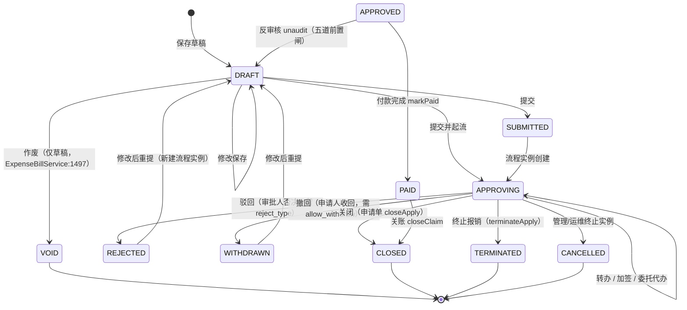

# 术语表 · Glossary（中英对照）

## 这份表怎么用

1. **看不懂报错文案时**：报错里出现的英文大写值（`APPROVING`、`VOID`、`WRITTEN_OFF`…）→ 直接查 [第 2 节 状态枚举速查](#2-代码与状态枚举术语)。
2. **看不懂业务动作时**：（会签、加签、核销、联查、期初…）→ 查 [第 1 节 业务术语](#1-财务共享业务术语)，每个词条都给"一句话解释 + 本项目落点 + 常见误解"。
3. **看不懂表名时**：`bg_occupy` 里 `bg_` 是什么、为什么同域有 `exp_` 又有 `expense_` → 查 [第 3 节 前缀与命名约定](#3-表名前缀与命名约定)。
4. **只想先活下去**：直接背 [第 4 节 新人 20 个必知词条](#4-新人-20-个必知词条)。
5. **易混概念**（驳回/撤回/作废/终止、会签/票签/加签/转办/委托）在 §1.1、§1.2 各有一张对照表，§1.1 后还配了单据生命周期 Mermaid 状态图。

### 路径缩写（本文所有证据路径都按此展开）

| 缩写 | 展开（相对仓库根 `Ashare/`） |
|---|---|
| `J/` | `fssc/fssc-server/fssc-start/src/main/java/com/fssc/` |
| `C/` | `fssc/fssc-server/fssc-common/src/main/java/com/fssc/common/` |
| `RES/` | `fssc/fssc-server/fssc-start/src/main/resources/` |
| `SQL/` | 停用：该缩写在文档史上指向 `fssc/sql/`，而这个层级从未存在过；一律改用 `SQL2/` |
| `SQL2/` | `fssc/fssc-server/sql/`（不在本仓库内，只作历史留存；文档不应再以它作建库入口） |
| `V/` | `fssc/fssc-web/src/views/` |
| `FACTS/` | `docs/_facts/`（259 张表清单 `tables.txt`、域指标 `facts.json`） |

### 分类索引

| 分类 | 锚点 | 条数（表格数据行） |
|---|---|---:|
| 1.1 单据与生命周期 | [#11-单据与生命周期](#11-单据与生命周期) | 18 |
| 1.2 审批动作与流程配置 | [#12-审批动作与流程配置](#12-审批动作与流程配置) | 20 |
| 1.3 财务链路 | [#13-财务链路](#13-财务链路) | 26 |
| 1.4 共享作业运营 | [#14-共享作业运营](#14-共享作业运营) | 22 |
| 1.5 控制类 | [#15-控制类预算合规匹配付款计划](#15-控制类预算合规匹配付款计划) | 19 |
| 1.6 平台与底座 | [#16-平台与底座](#16-平台与底座) | 21 |
| 1.7 影像·档案·发票 | [#17-影像档案发票](#17-影像档案发票) | 16 |
| 1.8 bizType 单据类型速查 | [#18-单据类型-biztype-速查](#18-单据类型-biztype-速查) | 13 |
| 2. 状态枚举 | [#2-代码与状态枚举术语](#2-代码与状态枚举术语) | 63 |
| 3. 前缀与命名约定 | [#3-表名前缀与命名约定](#3-表名前缀与命名约定) | 35 |
| **合计** | | **253** |

> **这两个数字怎么复算**（口径必须写死，否则每轮统计都会不一样）：以 `^###? [0-9]` 分节，节内以 `|` 开头的行计为数据行，**再剔除**表头行（下一行是 `|---|` 分隔线者）与分隔线本身。§3.4 是编号列表不是表格，所以贡献 0 行——它照样是正文内容。

---

## 1. 财务共享业务术语

格式：**中文 ｜ English ｜ 一句话解释（写给完全不懂财务的人）｜ 在本项目里的落点 ｜ 常见误解**

### 1.1 单据与生命周期

| 中文 | English | 一句话解释 | 本项目落点 | 常见误解 |
|---|---|---|---|---|
| 单据 | Document / Bill | 系统里每一件"要办事"的一张纸：报销单、付款单、申请单… | 统一主表 `exp_bill`（`J/expense/entity/ExpBill.java:26` 起）；跨域路由登记在 `J/workflow/service/BillRouteRegistry.java` | 不是"文件"。文件叫附件/影像（`sys_file`、`img_file`）。 |
| 单号 | Bill No. / Document Number | 单据的人类可读编号，如 `BX20260918001` | 由各域 `bill_no`/`po_no`/`entry_no` 列承载；生成规则在 `sys_number_rule`+`sys_number_seq`（`J/system/entity/SysNumberRule.java:20-34`） | 误以为是数据库主键 `id`。`id` 是自增主键、单号是可重复口径的业务号，两者不同。 |
| 单据类型 | Bill Type | 这张单是报销、借款还是申请 | `exp_bill.bill_type`＝`APPLY/CLAIM/LOAN/REPAY/PAY`（`J/expense/entity/ExpBill.java:27`） | 与流程侧 `bizType` 不是一回事（见 §1.8）。 |
| 状态 | Status | 这张单现在走到哪一步了 | 几乎每张业务表都有 `status` 列 | 状态值**不是全局字典**，同名字段在不同表里词表不同（见 §2.1）。 |
| 生命周期 | Lifecycle | 草稿 → 提交 → 审批中 → 通过 → 付款 → 关账 这条线 | 报销单：`DRAFT→SUBMITTED/APPROVING→APPROVED→PAID→CLOSED`（`J/expense/service/ExpenseBillService.java:64`、`ExpBill.java:81`） | 不是所有单都走完整条线；事前申请单走 `CLOSED`/`TERMINATED` 支线（`ExpenseBillService.java:1629/1652`）。 |
| 提单 / 提交 | Submit | 把草稿交给审批人 | `submit`；流程侧留痕 `action='SUBMIT'`（`J/workflow/service/WfEngineFacade.java:659`） | 提交≠审批通过；提交的同时才做预算占用与校验和落库。 |
| **驳回** | Reject / Send back | **审批人**说"不行"，单子被打回 | 报销单落 `status='REJECTED'`＋`reject_type`（`J/expense/service/ExpenseWfEventListener.java:630-638`）；引擎侧 `terminateAsRejected()`（`J/workflow/service/WfEngineFacade.java:2290`） | 【注意】触发者＝**审批人**；【注意】常见误解："驳回一定能改完重提"——本项目驳回同时会终止当前流程实例，重提要新建实例（`ExpenseBillService.java:1530` 注释所述"与驳回/撤回重提同轨"）。 |
| **撤回** | Withdraw | **提单人自己**反悔，把还在审批路上的单收回来 | 报销单落 `status='WITHDRAWN'`（`J/expense/service/ExpenseWfEventListener.java:630`）；入口 `ExpenseBillService.withdraw()`（`J/expense/service/ExpenseBillService.java:1490`）→ `WfEngineFacade.withdraw()`（`J/workflow/service/WfEngineFacade.java:5866`）；历史留痕 `action='WITHDRAW'`（`WfEngineFacade.java:5962`）；结束类型常量 `END_WITHDRAWN`（`J/workflow/event/WfProcessEndedEvent.java:76`） | 【注意】触发者＝**申请人**；【注意】只有 `APPROVING` 才允许（`ExpenseBillService.java:1494`），且还要看 `wf_model.allow_withdraw`（`J/workflow/entity/WfModel.java:34`）与开关 `sys_config.wf.withdraw.done.enabled`（`WfEngineFacade.java:5839`，缺省关闭）。撤回与驳回在代码里用 `event.withdrawn()` 分流，日志文案分开写（`J/workflow/action/GlBizAction.java:164-175`）。 |
| **作废** | Void / Invalidate | 这张单**当作没发生过**，但记录留在库里 | 报销单：仅 `DRAFT` 可作废→`VOID`（`J/expense/service/ExpenseBillService.java:1500-1509`）；凭证：仅 `DRAFT` 可作废→`VOID`（`J/sharing/service/VoucherService.java:1334`）；付款计划→`VOID`（`J/payplan/service/PayPlanService.java:186`）；AP 服务申请单→`VOIDED`（`J/apflow/service/ApRequestService.java:379-400`，原因必填） | 【注意】作废≠删除，也不等于冲销：已过账的凭证不能作废，只能红字冲销（`ApRequestService.java:385`"已过账，不可作废"；`VoucherService.java:1387`）。 |
| **终止** | Terminate | 流程/单据**后续不再办了**，比作废更重（单子已走完审批） | 报销侧：事前申请单"终止报销"→`status='TERMINATED'`（`J/expense/service/ExpenseBillService.java:1655-1669`）；流程侧：审批项类别 `CAT_TERMINATE='TERMINATE'`（`J/workflow/entity/WfApprovalItem.java:49`）、历史动作 `TERMINATE`（`J/workflow/entity/WfTaskHistory.java:39`）、实例态 `TERMINATED`（`J/workflow/entity/WfInstance.java:59`） | 【注意】四兄弟对照：**触发者**——驳回=审批人／撤回=申请人／作废=经办人或制单人／终止=审批配置或管理员；**能否恢复**——驳回·撤回可改后重提，作废需重拉（`ApRequestService.java:114`"重拉覆盖、单号不变"），终止不可恢复；**是否留痕**——四者都写 `wf_task_history`/`audit_trail`，`WITHDRAW`/`CANCEL` 是实例级行（`task_id` 为 NULL，`J/workflow/service/WfQueryService.java:991`）。 |
| 反审核 | Un-audit / Undo approval | 已审批通过的单据退回草稿，让人改 | `ExpenseBillService.unaudit()`：`APPROVED→DRAFT`，前置五道闸（已制证/已付款/在批次/有发票勾稽则拒绝）（`J/expense/service/ExpenseBillService.java:1530-1623`） | 与撤回不同：反审核针对**已办结**的单；撤回针对**在途**的单。 |
| 红字冲销 | Reversal (negative entry) | 账已记上了，不能再抹，于是补一张方向相反、金额相等的"红字"账 | `VoucherService.reverseVoucher()` 基于 `POSTED` 原凭证生成红字凭证并**直接过账**（`J/sharing/service/VoucherService.java:1387-1440`）；发票侧红冲→`anomaly_flag='RED_FLUSH'`、原票`RED_FLUSHED`（`J/invoice/entity/InvInvoice.java:39`、`J/invoice/service/InvoiceService.java:989/1003`） | 误解："冲销=删凭证"。库里不删行，只增负数腿；重复冲销被拦（`VoucherService.java:1418`）。 |
| 关账 / 结账 | Close (the period) | 一个月的账定稿，之后不许再往里记 | 期间 `md_period.status='CLOSED'`（`J/masterdata/service/PeriodService.java:23-24`）；总账月结单 `gl_month_close` `RUNNING→CLOSED`（`J/glex/service/GlMonthCloseService.java:44`、`J/glex/controller/GlPeriodOpsController.java`） | 【注意】本项目口径：**发起月结只建在途单**（`md_period` 保持 `NORMAL`），真正关账后置到末节点审批通过回写（`J/glex/service/GlMonthCloseService.java:32-36`）。 |
| 反关账 / 反结账 | Re-open / Unclose | 把已关的期间重新打开 | `ap_month_close` 的重开接口 `POST /{id}/reopen`，`reopen_time` 非空即发生过反关账（`J/apflow/controller/ApMonthCloseController.java:81-85`、`J/apflow/entity/ApMonthClose.java:47-48`）；期间侧 `md_period` 恢复开账 | 属红线动作：AI 网关侧把它列为永不开放（`J/ai/AiGatewayService.java:188`），中文口语"反关账/反结账/期间重开"映射到 `unclose`/`reopen`（`J/ai/AiAskService.java:404-405`）。 |
| 在途 | In flight / Pending approval | 单子已经交出去、还没走完审批 | 合同侧互斥闸 `assertNotInFlow()`（`J/contract/service/ContractService.java:340-344`，引擎查询异常按"在途"处置＝fail-closed）；资产台账 `md_asset_change_log.status='APPROVING'` 注释为"在途"（`J/asset/entity/MdAssetChangeLog.java:51`） | "在途"不是状态值字面量（字面量是 `APPROVING`/`RUNNING`），它是业务口径。 |
| 联查 / 全链路追溯 | Drill-through / End-to-end tracing | 从一张单一路点下去：审批→发票→凭证→付款→批次→档案 | 端点 `/api/tenant/doc-tracing/trace`（`J/tracing/controller/DocTracingController.java:29`）；六段聚合 `bill/payments/batches/vouchers/archives/traces`（`J/expense/controller/BillTraceChainController.java:51-62`） | 【注意】`billId` 语义**随 bizType 而变**，跨域同 id 不同单，必须带 bizType 才能防串号（`BillTraceChainController.java:64-73`）。 |
| 留痕 | Audit trail | 谁在什么时候把什么改成了什么，都留下记 | 表 `audit_trail`（`C/`+`J/audit/entity/AuditTrail.java:37` 动作 `INSERT/UPDATE/APPROVE/PAY/REJECT/CHECKSUM/WITHDRAW`）；`wf_task_history` 为审批历史 | 误解："留痕=能看到所有改动"。`audit_trail` 只在业务写点显式调用；`exp_bill_trace` 已**停用零写入点**，联查改读 `wf_task_history`（`J/expense/entity/ExpBillTrace.java:21-22`）。 |
| 台账 | Ledger / Register | 一类业务逐笔登记的本子，用来对数 | 代码里高频词：借款台账（`J/expense/service/ExpenseBillService.java:1603` 附近 `rollbackLoanLedgerOnUnaudit`）、预算占用台账 `bg_occupy`、凭证台账（`J/sharing/service/VoucherService.java` 台账读侧富化） | 台账 ≠ 报表：台账是逐笔流水，报表是聚合。 |

#### 单据生命周期状态图（报销单 `exp_bill`，边标签为动作）

> 图注：`DRAFT/SUBMITTED/APPROVING/APPROVED/PAID/REJECTED/WITHDRAWN/CLOSED/VOID` 取自 `J/expense/entity/ExpBill.java:81` 的词表；`TERMINATED` 由 `ExpenseBillService.java:1667` 写入，**不在**该 javadoc 词表里（词表本身不完整，是本项目的一个已知口径漂移）；`CANCELLED` 是**流程实例**状态（`J/workflow/entity/WfInstance.java:59`），单据侧不写这个值——画在图上是提醒"实例被运维终止时单据状态不会自动同步"。所有跃迁****。

### 1.2 审批动作与流程配置

| 中文 | English | 一句话解释 | 本项目落点 | 常见误解 |
|---|---|---|---|---|
| 会签 | Countersign (ALL) | 几个审批人**都要**签，一个都不能少 | `wf_node_config.multi_type='ALL'`（`J/workflow/entity/WfNodeConfig.java:36,42`）；生成 BPMN 多实例环 | 误解："会签＝几个人里挑一个"。那是 `ANY`（或签）。 |
| 或签 / 任一通过 | Any-approves (ANY) | 候选人里**任何一人**同意就往下走 | `multi_type='ANY'`（`WfNodeConfig.java:39`）；注释明确"仅 ANY 与单办理人模型一致" | 代码里没写"或签"两个字，字面量是 `ANY`。 |
| 顺序审批 | Sequential (SEQ) | 按名单顺序一个一个签 | `multi_type='SEQ'`（`WfNodeConfig.java:39`） | 与"加签"无关：SEQ 是配置期定好的顺序。 |
| 票签 | Voting (VOTE) | 按比例/按票数过，不要求全员 | `multi_type='VOTE'`＋`vote_ratio`（`WfNodeConfig.java:36,44`）；新口径 `vote_mode='RATIO'/'COUNT'`＋`vote_value`（`WfNodeConfig.java:123-126`）；分母口径 `vote_basis='BY_PERSON'`（`WfNodeConfig.java:132`）；不达票兜底 `vote_fallback`（`WfNodeConfig.java:142`）；进度只读接口（`J/workflow/controller/WfTaskController.java:779`） | 【注意】票签"未达票"不会报错卡死：落兜底审批项让流程继续（`WfNodeConfig.java:135`），留痕动作 `VOTE_NOT_REACHED`（`WfEngineFacade.java:2262`）。 |
| 加签 | Add signer (ADDSIGN) | 中途临时插一道审 | 表 `wf_add_sign`；`position='BEFORE'` 前加签／`'AFTER'` 后加签（`J/workflow/entity/WfAddSign.java:52-55`）；入口 `/add-sign`（`WfTaskController.java:916`）；状态机 `PENDING/ACTIVE/DONE/CANCELLED/FAILED`（`WfAddSign.java:42-50`） | 【注意】本项目加签是**"临时改派＋回跳"等价语义**，不是真的动态插 BPMN 节点（引擎不支持，`WfAddSign.java:16-31`）；加签人点"同意"只代表加签这道审完，**不推进流程**（`WfTaskController.java:909-911,307-313`）。 |
| 转办 | Transfer | 把待办**永久**换给另一个人办 | `/transfer`（`J/workflow/controller/WfTaskController.java:899-900`）；留痕 `action='TRANSFER'`；开关 `wf_node_config.allow_transfer=0` 时人工转办被拒（`WfNodeConfig.java:49`），**超时自动转办不受该开关约束** | 【注意】与加签区别：转办＝受理人永久变更；加签＝临时插一道（`WfTaskController.java:912`）。 |
| 委托代理 | Delegate (out-of-office) | 休假期间授权别人代我审 | 表 `wf_delegate`（`from_user_id`/`to_user_id`/`biz_types`/时间区间，`J/workflow/entity/WfDelegate.java`）；配置入口 `J/workflow/controller/WfConfigController.java:213`；到期回收 `J/workflow/job/WfDelegateExpireJob.java:91`；页面 `V/common/MyDelegate.vue`、路由 `my/delegate` | 【注意】生效判据是**时间区间** `begin_time<=now<=end_time`，**不看** `status` 列（`WfDelegate.java:33-40`）；`status` 只用于展示与审计。 |
| 传阅 / 抄送 | CC / Circulate | 审批完顺手给某人看一下，不需要他签 | 表 `wf_cc`（`J/workflow/entity/WfCc.java`，含 `is_read`/`read_time`）；节点配置 `cc_users`/`cc_roles`（`WfNodeConfig.java:76` 与后一列）＋运行时入参 `ccUserIds`，两者取**并集**（`WfTaskController.java:756`）；页面 `V/workflow/MyCc.vue` | 误解："抄送人也要办"。抄送行不进待办，只进"我的抄送"。 |
| 批量审批 | Bulk approval | 一次勾选多条一起同意/驳回 | `J/workflow/controller/WfTaskBatchController.java`；单次硬上限 `MAX_BATCH_SIZE=100`（:43）；通过缺省意见补"批量审批"，**驳回意见绝不由后端代填**（:61-64） | 与"抢单"无关；批量审批走的是与单条 `/wf/approve` 完全同一条链路与同一自审禁止（:28）。 |
| 认领 / 签收任务 | Claim a task | 从任务池把待办拿到我名下 | `action='CLAIM'`／`UNCLAIM`／`ASSIGN`（`WfEngineFacade.java` 写痕）；池视图 `CLAIMABLE`/`MY_CLAIMED`（`J/workflow/ops/service/TaskPoolQueryService.java:61-62`） | 误解：认领＝办结。认领只改受理人。 |
| 催办 | Urge / Reminder | 提单人问"我这单卡在哪了" | `action='URGE'`（`WfTaskHistory.java:39`）；发起人催办入口（`WfTaskController.java:1027`，并行/会签时返回数>1）；超时催办共用同一发信通道（:53） | 有**限频**：命中限频以业务异常返回，不是"点了没反应"。 |
| 改派 | Reassign | 管理员/流程中心把别人的待办换人 | `action='REASSIGN'`；批量移交入口 `/api/tenant/wf/handover/execute`（`J/workflow/controller/WfHandoverController.java:52-55`）；日志 `op_transfer_log.failed_detail` | 【注意】操作人＝原办理人时走**转办**通道，否则走**改派**通道（`WfHandoverController.java:49`）；权限 `wf:manage:intervene`（旧码 `wf:task:reassign` 并行保留）。 |
| 交接（离职/换岗） | Handover | 把人走了之后名下积压一次性交出去 | 同上 `WfHandoverController`；页面 `V/workflow/Handover.vue` | 逐单独立成败，失败明细照实返回，不是"要么全成要么全回滚"。 |
| 超时处置 | Timeout action | 到期没人办怎么办 | `wf_node_config.timeout_hours`+`timeout_action='NOTIFY'/'AUTO_PASS'/'AUTO_TRANSFER'`（`WfNodeConfig.java:66`）；BPMN 边界定时器＋`J/workflow/delegate/WfTimeoutBoundaryDelegate.java:28`；异步执行器必须开启（`RES/application-dev.yml:8-18`） | 【注意】旧实现是 60 秒轮询、与执行器无关，掩盖了"执行器关着定时器永不触发"的问题（配置注释 :6-12）。 |
| 自动通过 | Auto pass | 机器替你签了 | `action='AUTO_PASS'`（`WfTaskHistory.java:39`）；`wf_node_config.auto_pass_self`（审批人＝发起人时）（`WfNodeConfig.java:62`）；首节点"提单即完成" `first_node_auto_pass`（`WfNodeConfig.java:103` 前后） | 与"自审回避"方向相反，别混：前者放行、后者剔除提单人。 |
| 自审拦截 | Self-approval guard | 自己不能批自己的单 | `deny_self` 闸（`J/workflow/service/NodeOrgResolver.java:301,328,526-531`）；凭证侧"制审分离"强校验（`J/sharing/service/VoucherService.java:1324` 注释） | 【注意】作业池（POOL）模式**不走** `deny_self`（`WfTaskController.java:267`，2026-09-26 裁决，不得回退）。 |
| 审批项 | Approval item | 把"审批结果"从同意/驳回二值扩成可自定义的按钮 | 表 `wf_approval_item`，类别 `POSITIVE`/`REJECT`/`TERMINATE`（`J/workflow/entity/WfApprovalItem.java:45-49`）；`target_node` 决定驳回去向 | 【注意】`wf_task_history.action` 是 `varchar(20)` 且有代码按 `"REJECT".equals(action)` 反推实例状态，所以审批项名称**不能**写进 action（`WfApprovalItem.java:32-35`）。 |
| 驳回至指定节点 | Reject to node | 不整条流程终止，只退回某个已完成环节 | `wf_node_config.reject_scope='NONE'/'PREV_ONE'/'ANY_DONE'`（`WfNodeConfig.java:107`）＋总闸 `wf.reject.free.enabled`；运行时入参 `rejectToNodeKey`；跳回 `resubmit_jump_back`→实例变量 `rejectOriginNode` | 【注意】生效条件＝`reject_scope≠NONE` **且** 总闸=1；闸门不放行则落回"终止本流程"（`WfApprovalItem.java:22-26`）。 |
| 取人策略 | Assignment strategy | 一个角色有多个人时派给谁 | `J/workflow/service/AssignStrategy.java:20-29`＝`FIRST_ID`（缺省，按用户 id 升序取首个）／`LEAST_LOADED`（待办最少）／`ROUND_ROBIN`（轮询）；配置 `sys_config.wf.assign.strategy`＋灰度清单 `wf.assign.strategy.models`（清单为空＝全库不生效） | 误解：改策略会改资格。它**只改派给谁，不改谁有资格办**（`AssignStrategy.java:13-14`）。 |
| 取人方式 | Assign type / handling mode | 从哪个范围取人 × 怎么定到人 | `assign_type='USER'/'ROLE'/'POST'/'DEPT_LEADER'/'DEPT_LEADER_UP'/'INITIATOR'/'SHARE_POOL'/'EXPRESSION'`（`WfNodeConfig.java:26`）；正交的 `handling_mode='AUTO'/'PICK'/'POOL'`（:32） | 【注意】`POOL` 尚无实现（依赖 `op_audit_task` 与流程实例打通），配置页暂不开放（:28-31）。 |

### 1.3 财务链路

| 中文 | English | 一句话解释 | 本项目落点 | 常见误解 |
|---|---|---|---|---|
| 制证 | Voucher generation | 把业务单据翻译成会计分录（先生成草稿凭证） | `op_voucher`/`op_voucher_line` 建 `status='DRAFT'`（`J/sharing/entity/OpVoucher.java:38`、写入点散见 `J/sharing/service/VoucherService.java`）；模板 `op_voucher_template`；分录规则 `md_gl_config` | 误解："制证＝记账完成"。DRAFT 还没进账本。 |
| 过账 | Post / Posting | 草稿凭证正式记进账，之后只能冲销不能改 | `DRAFT→POSTED`（`J/sharing/service/VoucherService.java:1177/1241`）；批量过账同样逐条强校验（:1321-1324）；AP 侧"过账"生成付款凭证（`J/apflow/service/ApRequestService.java:323-354`） | 【注意】过账后单据不可作废（`ApRequestService.java:385`）；过账要过期间关账闸（`ApRequestService.java:337`）。 |
| 凭证 | Voucher / Journal entry | 会计意义上的"记账依据"，有借贷两腿 | `op_voucher`（业务凭证）+ `gl_journal_entry`（一般总账记账）+ `op_gl_entry`（落账分录） | 【注意】本项目有**三处**"凭证/分录"：`op_voucher`（共享制证）、`gl_journal_entry`（总账手工/计提）、`op_gl_entry`（余额账）——不是一张表。 |
| 借贷平衡 | Debit = Credit | 借方合计必须等于贷方合计 | `op_voucher.is_balanced`（`OpVoucher.java:36` "1 借贷平衡"）、`debit_total`/`credit_total` | 平衡标志由写侧计算；`OpVoucherLine` 逐行列方向 `DEBIT`/`CREDIT`。 |
| 科目 | GL Account / Subject | 账本里的分类：费用、资产、负债… | `md_subject`（树形，`subject_code`/`subject_level`/`is_leaf`，`J/masterdata/entity/MdSubject.java:11-31`）；类型 `COST/ASSET/LIABILITY/EQUITY/REVENUE`；方向 `DEBIT/CREDIT` | 误解：科目可以随便挂。过账校验要求**末级科目**且辅助核算齐（`VoucherService.java:1324`）。 |
| 辅助核算 | Sub-analysis / Auxiliary dimension | 科目之外还要按部门/项目再切一刀 | `md_subject.aux_items`＝逗号分隔 `company,dept,project`（`MdSubject.java:29`） | 辅助核算缺项会挡住过账，不是"少填一个标签"。 |
| 会计期间 | Accounting period | 一个月为一个记账窗口 | `md_period`（`company_id`+`period_year`+`period_month`，`J/masterdata/entity/MdPeriod.java`）；状态 `NORMAL 开账 / CLOSED 已结账 / DISABLED 停用`（`J/masterdata/service/PeriodService.java:23`） | 期间是**按公司**的，不是全局的：A 公司关了 B 公司可能还开着。 |
| 期初 | Opening balance | 本期开始前已经欠/有多少 | 存货 `md_inventory` 期初数量/金额（`J/asset/entity/MdInventory.java:44-46`），断言"结存＝期初＋入−出"（`J/asset/service/MdInventoryService.java:301-322`）；总账余额表"期初＝本期之前的全部发生合计"（`J/gl/service/GlService.java:157-174`）；借款期初导入表 `md_loan_initial`（`J/masterdata/entity/MdLoanInitial.java:15`）；预算期初结转由迁移脚本 `V1.4.17_bg_occupy_opening_carryover` 补记 | 【注意】期初不是"随便填的起点"：`INIT_CARRY` 走的是**补流水**而不是改历史单据。 |
| 期末结转 | Period-end carry-forward | 把收入费用类科目的余额归到"本年利润" | `J/glex/service/GlProfitCarryService.java:35-48`：损益科目（编码前缀 6）按 `net=借−贷` 生成结转凭证，对方科目 4103；数据源 `op_gl_entry` 且**仅结转已过账发生额** | 误解：草稿凭证也会被结转。不会——只走 POSTED。幂等：同公司同期间已有 `source_type='PROFIT_CARRY'`（VOID 除外）则拒绝（:45）。 |
| 试算平衡 | Trial balance | 关账前所有科目借合计＝贷合计 | `gl_month_close` + `gl_close_check_item`；月结服务描述（`J/glex/service/GlMonthCloseService.java:29-36`） | 不平就不会起流，不会自动"调平"。 |
| 应收 | Accounts receivable (AR) | 别人欠我们的钱 | 表 `rc_receivable`/`rc_receipt`/`rc_bad_debt`/`rc_collect_todo`（receivable 域）+ `ar_*`（arflow 域） | 【注意】本项目 AR 分两个包：`receivable`（应收主线）与 `arflow`（应收**流程**：认领、开票、票据、核销、月结）——见 §3.4。 |
| 应付 | Accounts payable (AP) | 我们欠别人的钱 | 表 `ap_service_request`/`ap_month_close`/`ap_dispatch_rule`（`J/apflow/`）；路由 `/api/tenant/ap-request`、`/api/tenant/ap-month-close` | 没有独立 `ap` 包：应付是 **`apflow`（应付流程）**，与 `payplan`（付款计划）、`sharing`（付款批次）分开。 |
| 核销 | Write-off / Settlement matching | 把"欠"和"还"两笔对上，两边同时勾掉 | 预算核销 `bg_occupy.oper_type='WRITE_OFF'`（`J/budget/entity/BgOccupy.java:37`，`BudgetService.writeOff()` :1093）；应收核销 `ar_writeoff_record`/`ar_writeoff_fund`、状态 `WRITTEN_OFF`（`J/receivable/service/RcReceiptService.java:71`、`J/arflow/entity/ArPreInvoice.java:79`）；SCP 对账核销（`J/collab/service/ScpReconService.java:222`） | 【注意】"核销"在本仓库是**四个不同东西**：预算执行核销 / 收款核销 / 票据核销 / 对冲核销（`ar_writeoff_record.writeoff_type='RECEIPT'/'NOTE'/'OFFSET'`）。看域再理解。 |
| 反核销 | Reverse write-off | 把已对上的两笔拆开 | `BudgetService.reverseWriteOff()`（`J/budget/service/BudgetService.java:1141`）；发票勾稽解除在单据反审核前置闸里（`ExpenseBillService.java:1549-1553`"请先在发票池解除关联（反核销）"） | 误解："反核销=释放占用"。占用/已用是两态，走过 `writeOff` 的单要回冲**已用**而不是释放占用（`ExpenseBillService.java:1522-1525`）。 |
| 账龄 | Aging | 这笔欠款已经拖了多少天 | 应收逾期→`rc_receivable.status='OVERDUE'`（`J/receivable/service/RcReceivableService.java:310`）；坏账计提按账龄分档 `baddebt.rate.{365|180|90|30|0}`（`J/receivable/service/RcBadDebtService.java:53-56,102`）；报表 `GET /api/tenant/report/ap-aging`、`/ar-aging`（`J/report/controller/ReportQueryController.java:111-124`）；日终批处理 `J/receivable/job/RcOverdueJob.java:34-40` | 账龄报表数字为 0，多半是 `OVERDUE` 没被打上——`RcOverdueJob` 此前只能人工触发（:37）。 |
| 对账 | Reconciliation | 两边的账目核对一致 | 银行 `bank_reconcile`/`bank_recon_item`（`OPEN 未清 / CLEARED 已清结`，`J/bank/entity/BankReconItem.java`，清结写痕 `J/bank/service/BankReconcileService.java:644`）；供应商对账 `supplier_recon` 五态 `DRAFT/SENT/CONFIRMED/DIFF/RESOLVED`（`J/sharing/entity/SupplierRecon.java:82`）；应收对账单 `ar_statement`（`IMPORTED/RECONCILED/ABNORMAL`） | 对账≠轧平差额：有差异要落 `DIFF` 并留处理记录，不是把数字改成一样。 |
| 差异 | Difference / Diff | 对不上账的那部分 | `status='DIFF'`（`J/sharing/service/SupplierReconService.java:386/433/596`）；表 `supplier_recon_diff` | — |
| 催收 | Collection | 到期没还，去要 | `rc_collect_todo`（`J/receivable/`，路由 `/api/tenant/collect-todo`）；审批通过→`DONE`，部分→`PARTIAL`（`J/workflow/action/CollectBizAction.java:85-88`）；应收票据托收→`COLLECTION`（`J/treasury/service/TrBillSettleService.java:98`） | 【注意】`COLLECTION` 在票据域是"托收"（把票交给银行去收钱），在应收域是"催收"，同词不同义。 |
| 坏账 | Bad debt | 收不回来的应收 | `rc_bad_debt`；计提 `PROVISIONED`（`J/receivable/service/RcBadDebtService.java:115`）→ 冲销/转回 `REVERSED`（:171）→ 核销 `WRITTEN_OFF`（:352）；bizType `BAD_DEBT`/`BAD_DEBT_PROV`/`BAD_DEBT_CONFIRM`（`J/workflow/service/BillRouteRegistry.java:261-264`） | 误解：计提＝核销。计提只是准备，核销才是从账上抹掉。 |
| 计提 / 待摊 | Accrual / Deferral | 钱没动但账要先记（计提）；钱已付但账要分期摊（待摊） | `gl_journal_entry.entry_type='ACCRUAL'/'DEFER'/'MANUAL'/'OTHER_RECEIPT'`（`J/glex/entity/GlJournalEntry.java:10,20`）；bizType `GL_ACCRUAL`/`GL_DEFER`；薪酬计提 `gl_salary_run`（`J/workflow/action/GlBizAction.java:338-386`） | 【注意】计提链通过但出证失败→回 `APPROVED`（已审批·未入账），**不冒充** `POSTED`（`GlBizAction.java:220-221`）。 |
| 预提税金 / 留抵退税 | Tax provision / Refund | 该交的税先记上；多交的税要回来 | `gl_tax_provision`（`DRAFT→POSTED`，`J/glex/service/GlTaxProvisionService.java:109`）；`tax_refund` `DRAFT/APPLYING/APPROVED/REFUNDING/REFUNDED/REJECTED`（`J/glex/entity/TaxRefund.java:42`）；申报 `tax_declaration` `DRAFT/PENDING/APPROVED/FILED/PAID/CANCELLED`（:行 52/85/106/127） | `FILED`＝已申报（不是"已归档"）；`REFUNDING/REFUNDED` 是终态、不被驳回回写覆盖（`J/workflow/action/GlBizAction.java:571`）。 |
| 合并抵消 | Consolidation / Intercompany offset | 集团报表合并时把内部往来抵掉 | `gl_consolidate` `DRAFT→CONSOLIDATED`（`J/glex/service/GlConsolidateService.java:57/75`）；`gl_inter_offset` 成对行→`OFFSET`（`J/glex/service/GlInterOffsetService.java:127/210`）；驳回时成对行一并回收（`J/workflow/action/GlBizAction.java:492-531`） | 【注意】"自动对生成即 `OFFSET`"——驳回后会出现"无凭证却顶着已抵消态"，所以驳回腿要把本行与成对行一起回退（`GlBizAction.java:492-528`）。 |
| 汇率重估 | FX revaluation | 外币账按新汇率重算一遍 | `gl_fx_revaluation`，`GENERATED 已生成凭证 / SKIPPED 未生成`（`J/glex/entity/GlFxRevaluation.java`）；方向枚举 `J/glex/service/FxRevaluationService.java:103` `FxDirection{GAIN,LOSS,SKIP}` | — |
| 付款批次 | Payment batch | 很多笔付款打包成一次出款指令 | `op_pay_batch`/`op_pay_batch_detail`；批次态 `DRAFT/CONFIRMED/APPROVED/PAID/FAILED/CLOSED/ARCHIVED`（`J/sharing/entity/OpPayBatch.java:62`）；明细态 `WAITING/SUCCESS/FAILED`（`OpPayBatchDetail.java`）；付款记录 `exp_bill_payment.pay_status='WAITING'→'PAID'/'FAILED'`（`J/expense/entity/ExpBillPayment.java:15,42`） | 批次 `FAILED` 可重试（`OpPayBatch.java:69` 注释"支付失败原因（FAILED 后可重试）"）。 |
| 出纳 | Cashier | 真正去银行点付款的人 | 代码里以"由出纳作废批次"表述（`J/expense/service/ExpenseBillService.java:1543`）；付款批次域 `J/sharing/service/PayBatchService.java` | — |
| 银企直联 | Bank direct connection | 系统直接把付款指令发给银行、把回单和对账单拉回来 | `bank_balance`/`bank_reconcile`/`bank_recon_item`；网关 `fssc.bank.gateway: mock`（`RES/application-dev.yml:53-55`，默认模拟，生产实现后切换）；`op_bank_statement` | 【注意】**默认是 mock**，未配凭据时不会真出款；别把"批次 PAID"当"银行已付"。 |

### 1.4 共享作业运营

| 中文 | English | 一句话解释 | 本项目落点 | 常见误解 |
|---|---|---|---|---|
| 共享中心 | Shared Service Center (SSC) | 把各分公司的重复财务活集中到一个中心办 | 域 `sharing`；页面 `V/sharing/SharedOpsConsole.vue`；路由 `/api/tenant/sharing/**`、`/api/shared-ops` | — |
| 作业 / 工单 | Job / Work order | 中心里一件可被排队、认领、考核的活 | `op_job`（`J/sharing/entity/ShJob.java:18`）、派工单 `op_audit_task`（`J/sharing/entity/OpAuditTask.java:20`） | 与定时任务（quartz/`op_job_heartbeat`）不是一个 `job`。 |
| 作业链 | Job chain | 一张单审批通过后要连着过的几道作业：先审核、再付款、最后记账归档 | `op_audit_task.task_type='AUDIT'/'PAY'/'BOOKKEEP'`（`J/sharing/entity/OpAuditTask.java:40`）、`chain_seq`/`chain_total`（:42-45）、`active_flag`（前序未完成＝`N`，前序完成自动激活＝`Y`，:46-47）；链定义见 `J/sharing/service/SharingService.java:37-46` | 不是 BPMN 流程。作业链是**审批通过之后**的干活排队，BPMN 是审批本身。 |
| 不进共享中心 | Out of shared scope | 有些单审完就结束，不需要中心排队作业 | 事前申请、合同订立、预算调整等不进池（`SharingService.java:37-46` 注释明确列出）；借款/还款各有独立链 | 看到某类单在池里查不到，先确认它是否本来就不该进池，别当 bug。 |
| 作业池 / 待办池 | Job pool | 所有等着被认领的作业堆在一起的那个池子 | 视图枚举 `VIEWS = ["MY_TODO","CLAIMABLE","LOCKED_BY_OTHERS","MY_CLAIMED","POOL_ALL"]`（`J/workflow/ops/service/TaskPoolQueryService.java:61-62`，上限 500 行）；池状态 `op_audit_task.pool_status='WAITING'`；页面 `V/sharing/TaskPool.vue`、`V/sharing/SharedPool.vue` | 池里"能看到"≠"能做"。`CLAIMABLE` 只是可抢，`MY_TODO` 才是已派到你名下。 |
| 派工 / 自动分配 | Dispatch / Assignment | 系统替你把活分下去 | 规则派发 `dispatch_task`＋`J/compliance/service/DispatchService.java:96/158/279`（`status='ASSIGNED'`）、`:129`（`PENDING`）、`:218`（`ESCALATED` 升级）；策略表 `op_dispatch_policy`（表名声明 `J/workflow/ops/entity/OpDispatchPolicy.java:26`，字段含策略值 `:34`）；流程侧派单策略 `AssignStrategy`＝`FIRST_ID`/`LEAST_LOADED`/`ROUND_ROBIN`（`J/workflow/service/AssignStrategy.java:20-29`） | 【注意】`AssignStrategy` 只改**派给谁**，不改**谁有资格**（`AssignStrategy.java:13-14` 注释）；解析失败静默回退 `FIRST_ID`（:29-40）。 |
| 抢单 | Claim / Pick | 不从上面派，作业人员自己去池里抓活 | 策略值 `op_dispatch_policy.strategy='PICK'`（`OpDispatchPolicy.java:37`，另有 `BALANCE_TIME`/`BALANCE_VOLUME`/`SMART`）；认领 `receive()` → `pool_status='RECEIVED'`（`SharingService.java:318/330`）；流程侧节点处置模式 `handling_mode='PICK'`（`J/workflow/entity/WfNodeConfig.java:31-35`） | 三种 `POOL` 语义不同：`WfNodeConfig.java:31-35` 的 `POOL` 注释标明**尚未实现**；`op_audit_task` 的池是已实现的；`TaskPoolQueryService` 的 `POOL_ALL` 只是查询视图。 |
| 释放 / 撤回任务 | Release / Withdraw task | 抢到后发现做不了，退回池子 | `withdraw()`：`RECEIVED → WAITING`（`SharingService.java:418`） | 与单据"撤回"（`WITHDRAWN`）不同词同字，这里只动池状态，单据状态不变。 |
| 退单 | Return task | 把这件活退回给上游（补材料、错派等） | `returnTask()`（`SharingService.java:450`，注释标注需求号 8.2.3），留痕备注固定前缀 `"退单: "`；作业侧 `pool_status` 回到 `WAITING`；单据侧对应 `REJECTED`（见 §1.1 驳回） | 【注意】退单≠驳回：退单是**作业侧**动作，驳回是**审批侧**动作，两者审计位置不同（`op_audit_task` vs `wf_task_history`）。 |
| 重新分配 | Reassign | 管理员把已认领的活换个人 | `reassign()`（`SharingService.java:434`）；流程侧干预入口 `J/workflow/controller/WfHandoverController.java:49`（操作人＝经办人走转办通道，否则走改派通道）、`:47-52`（`/execute`，权限 `wf:manage:intervene` 或旧 `wf:task:reassign`）、失败明细 `op_transfer_log.failed_detail` | 批量改派会逐条留痕，失败只写 `failed_detail`，不整批回滚。 |
| SLA / 时效 | Service Level Agreement | 这类单要在多少小时里办完，超了算违约 | 配置 `op_sla_config.bill_type`+`target_hours`+`warning_hours`+`escalation_*`（`J/compliance/entity/OpSlaConfig.java:16-26`）；违约 `op_sla_breach`（`J/compliance/entity/OpSlaBreach.java:22`，含 `breach_type`/`escalated_to`/`resolved`，:34-41）；任务时限 `op_task_time_limit.priority='NORMAL'/'URGENT'`（`J/workflow/ops/entity/OpTaskTimeLimit.java:35`）；`dispatch_task.sla_status`/`sla_due_time`（`J/compliance/entity/DispatchTask.java:37-38`） | 【注意】`escalation_enabled` 是开关字段，是否真升级由定时任务决定；本文未运行验证（待核实）。 |
| 催办 | Urge / Remind | 提单人在旁边戳一下审批人 | `wf_task.urged_count`（`J/workflow/entity/WfTask.java:58`）、历史动作 `action='URGE'`（`WfTaskHistory.java:39`）；发起人催办入口 `J/workflow/controller/WfTaskController.java:1018-1027`（有频率限制） | 催办不改变状态、不改变优先级，只加计数与消息。 |
| 绩效 / 看板 | Performance / KPI board | 谁干了多少、多久干完、有没有超时 | 只读统计控制器 `/api/tenant/wf/perf`：`overview`/`paths`/`node-dwell`/`backlog`/`handler-top`/`ledger-reconcile`/`archive-preview`（`J/workflow/controller/WfPerfController.java:21,38,45,52,59,66,73,80`）；作业人员侧 `reviewer.avg_review_time_min`/`accuracy_rate`/`max_daily_tasks`/`current_pending`/`completed_today`/`shift_start`/`shift_end`（`J/compliance/entity/Reviewer.java:13,21-29`） | 【注意】`/ledger-reconcile` 是"账账核对"报表入口，不是修复入口；投影与引擎不一致时**只报不修**（判据：`J/workflow/service/WfHistoryArchiveService.java:140-170` 只读聚合）。 |
| 质检 / 抽检 | Quality check | 干完的活被抽查或全检一遍 | `op_quality.check_type='RANDOM'抽检/'FULL'全检/'KEY'关键`（`J/sharing/entity/OpQuality.java:41`）、`score` 百分制（:40）、`result='PASS'合格/'BACK'退回整改`（:44）；页面 `V/sharing/SharingQuality.vue`、`V/sharing/TaskQualityReport.vue`；作业维度 `dispatch_task.quality_score`（`DispatchTask.java:40`） | `BACK` 是质检结论，不是单据状态；被打回不意味着单据变 `REJECTED`。 |
| 信用分 / 免审额度 | Credit score / Auto-approve limit | 员工历史表现折算成分数，分数决定哪些单可以不人工审 | `employee_credit.credit_score`/`credit_level`/`auto_approve_limit`/`violation_count`（`J/compliance/entity/EmployeeCredit.java:22,27-33`），等级与额度口径见同类 :12-19 注释（A/B/C/D 四档）；`dispatch_task.credit_score`（`DispatchTask.java:39`） | 【注意】免审＝跳过人工审核环节，不等于预算/合规校验也跳过（合规见 §1.5）。等级区间来自代码注释，（待核实）。 |
| 服务目录 | Service catalog | 共享中心对外承诺"我提供这几种服务，每种多少小时" | `service_catalog.service_code`/`category`/`process_type`/`handle_sla_hours`/`response_sla_hours`/`owner_role`（`J/compliance/entity/ServiceCatalog.java:13,19-43`） | 服务目录的 SLA 与 `op_sla_config` 的 SLA 是两套配置，粒度不同（服务 vs 单据类型）。 |
| 满意度 | Satisfaction | 提单人对这次服务打几分 | `satisfaction_survey.bill_id`/`service_code`/`score`/`comment`/`survey_user_id`（`J/compliance/entity/SatisfactionSurvey.java:13,19-37`）；`dispatch_task.satisfaction_score`（`DispatchTask.java:41`） | 打分的 `survey_user_id` 是系统用户 ID，不是外部客户身份。 |
| 影像调阅 | Image retrieval / viewing | 审单时把扫描件/发票影像翻出来看 | 批次 `img_batch`、文件 `img_file`（`J/image/entity/ImgBatch.java`、`ImgFile.java`）；临时看片令牌 `sys_file_token`；单据关联 `exp_bill.image_status='NONE'/'PARTIAL'/'COMPLETE'`（`J/expense/entity/ExpBill.java:96-101`）；页面 `V/image/ImageManager.vue`、`V/image/ImageTask.vue` | 影像是**另一个库**（`fssc_image`），主库查不到 `img_*` 明细；见 §3.4。 |
| 实物交接 / 签收 | Physical delivery / Signing | 纸质单据装袋送到中心，中心签收 | `op_physical_delivery.status='PENDING'待签收/'SIGNED'已签收/'REJECTED'已拒签`（`J/sharing/entity/OpPhysicalDelivery.java:59-60`；写入 `J/sharing/service/DeliveryService.java:82,107,291`）；条码扫描 `op_barcode` → `status='SCANNED'`（`J/sharing/service/BarcodeService.java:96`、`DeliveryService.java:259`）；单据侧 `exp_bill.delivery_status='NOT_REQUIRED'/'UNSIGNED'/'SIGNED'`（`ExpBill.java:136-139`）；页面 `V/sharing/DeliveryPage.vue` | 【注意】双到达：电子流走完了、实物没签收，共享会计的待办**不显示**这条审核任务（`OpPhysicalDelivery.java:11-14` 注释）。这是"为什么我没待办"的高频原因。 |
| 归档 | Archiving | 办完的单连同影像一起封存，之后只能查不能改 | `op_archive.archive_status='PENDING'/'ARCHIVING'/'ARCHIVED'/'DISPOSED'`（`J/document/entity/OpArchive.java:128`）、`archive_flow_status`（:87，读侧富化）、`integrity_status='VERIFIED'/'MISMATCH'/'UNKNOWN'`（:114-115）；单据侧 `exp_bill.archive_status='UNARCHIVED'/'ARCHIVED'`（`ExpBill.java:96-101`）；页面 `V/sharing/ArchivePage.vue`、`V/archive/ArchiveBoard.vue` | 【注意】`op_archive` 有 `archive_status` 与 `status` 两列并存，`status='FILED'/'EXPIRED'/'DESTROYED'` 是由 `ArchiveService.dispositionOf()` 推导出来的**冗余镜像**（`J/document/entity/OpArchive.java:135-157`、`J/document/service/ArchiveService.java:892`，调用点 :299/366/432/695/726）。读代码时以 `archive_status` 为准。 |
| 会计档案 | Accounting archive | 法规要求保存的凭证/账簿/报表及其保管期限与销毁审批 | 档案域 `J/document/`；借阅与销毁走流程：`bizType` 见 `FM_ARCHIVE`/`FM_BORROW`/`FM_DOC_FLOW`/`FM_DESTROY`（`J/workflow/service/BillRouteRegistry.java:183-403`）；销毁审批表 `archive_destroy_approval`、访问留痕 `archive_access_log`、附件 `archive_attachment` | 【注意】这四条链的表**没有** `company_id`/`create_by` 列，因此"按公司/按本人"的数据范围过滤用不上（`BillRouteRegistry.java:183-403` 注释）——表现为"某些角色看不见档案单"，属设计而非漏权限。 |
| 期末看板 / 关账总览 | Month-end board | 月末把在池、超时、未归档的一次看完 | 页面 `V/sharing/MonthEndBoard.vue`；关账本身见 §1.3 期末结转 | 看板是聚合展示，不产生状态；别在看板里找"按钮"。 |

### 1.5 控制类（预算 / 合规 / 匹配 / 付款计划）

| 中文 | English | 一句话解释 | 本项目落点 | 常见误解 |
|---|---|---|---|---|
| 预算占用 | Budget occupancy | 单子一提交，就把这笔额度"预定"住，别人不能用 | `bg_occupy`（`J/budget/entity/BgOccupy.java`）＋`occupy()`（`J/budget/service/BudgetService.java:762,777`）；占用只认 `bg_scheme.status IN ('ACTIVE','ISSUED')` 的方案（`J/budget/entity/BgScheme.java:32-36`） | 【注意】"已占用"≠"已花掉"。占用是预扣，核销才算用；见 `bg_item.occupy_amount` vs `used_amount`。 |
| 预算核销 | Budget write-off | 钱真的付出去了，把预扣转成实耗 | `bg_occupy.op_type='WRITE_OFF'`（`BgOccupy.java:37`）、`writeOff()`（`BudgetService.java:1096`）、`hasWriteOff()`（:1242） | 【注意】冲销核销 ≠ 释放占用：`reverseWriteOff()`（:1138）把实耗退回占用，`release()`（:828）是直接取消预扣，两条流水方向不同。 |
| 释放占用 | Release occupancy | 单子死了（驳回/作废/撤回），把预扣的额度还回去 | `release()`（`BudgetService.java:831`）、`op_type='RELEASE'`（`BgOccupy.java:37`）；报销侧 `releaseOccupy()`（`J/expense/service/ExpenseBillService.java`）与 `CLAIM` 驳回释放（`J/expense/service/ExpenseWfEventListener.java:625`） | 释放是**追加一条反向流水**，不是删掉原来那条 `OCCUPY`；流水表只增不改。 |
| 占用三值 | Total / occupy / used | 一个预算项同时记三个数 | `bg_item.total_amount`/`adjust_amount`/`occupy_amount`(已占用未核销)/`used_amount`(已核销已使用)（`J/budget/entity/BgItem.java:36-42`）；可用额＝前两者之和减后两者 | 想直接找 `available_amount` 列——没有这个列，是算出来的。 |
| 预算维度 | Dimension key | 额度是按"部门×费用项"这种组合切的 | `bg_item.dim_key`，形如 `DEPT:1_ITEM:5`（`BgItem.java:34`）；维度主数据 `md_budget_org`/`md_budget_category`/`md_budget_period`/`md_budget_type`；映射表 `md_item_budget_map` | 【注意】维度串是字符串键，改主数据编码会让历史 `dim_key` 对不上（判据：`BgItem.java:34` 为 varchar 语义，非外键）。 |
| 预算控制强度 | Control type | 超预算时是提示、软控还是硬拦 | `bg_scheme.control_type='WARN'预警/'HARD'硬控/'SOFT'软控`（`J/budget/entity/BgScheme.java:28`）；`bg_item.control_type` 是同值镜像，**真相在方案表**（`BgItem.java:53` 注释） | 【注意】调预算行为请改 `bg_scheme`，改 `bg_item.control_type` 不生效。 |
| 预算调整 | Budget adjust | 年中把额度重新分一遍 | `bg_adjust`＋`bg_adjust_line`，走审批链（`bizType` 中预算调整不进共享中心，见 `SharingService.java:37-46`） | 调整不追溯历史单据；历史单据看的是当时那条 `bg_occupy`。 |
| 期初结转 | Opening carry-over | 上线首年把旧系统的已占用/已用一次性灌进来 | 迁移脚本 `V1.4.17_bg_occupy_opening_carryover`：`biz_type='INIT_CARRY'`、`biz_id=0` 作哨兵值 | 【注意】看到 `biz_id=0` 不要以为数据坏了，那是期初专用；普通业务流水的 `biz_id` 是真单据 ID。 |
| 合规预检 | Compliance pre-check | 提交前系统先自己查一遍规矩 | `precheck_result`：`status='PASS'/'FAIL'/'WARNING'/'SKIP'`（`J/compliance/entity/PrecheckResult.java:37`）、级别 `ERROR/WARNING/INFO`（:39）、批次 `precheck_batch_id`（:50）、`final_status`（:72）、`submitted`（:76） | 【注意】预检不阻断提交流程本身，阻断与否由规则 `action` 决定（见下一行）。 |
| 合规规则 | Compliance rule | 那些"规矩"本身 | `md_compliance_rule.rule_type='DUPLICATE_INVOICE'/'EXPENSE_MISMATCH'/'OVER_STANDARD'/'BLACKLIST'`（`J/compliance/entity/MdComplianceRule.java:34`）、`risk_level='LOW'/'MEDIUM'/'HIGH'/'CRITICAL'`（:34）、`action='BLOCK'/'WARN'/'REVIEW'/'PASS'`（:37）、条件写在 `match_expression`（:40） | 规则表达式是**字符串**（`match_expression`），不是数据库约束；改错了不会报错，只会静默放行。 |
| 黑名单 | Blacklist | 供应商/收款人/员工被拉黑，单子直接卡住 | 规则类型 `md_compliance_rule.rule_type='BLACKLIST'`（`MdComplianceRule.java:34`）；销方黑名单落在发票 `inv_invoice.anomaly_flag='SELLER_BLACK'`（`J/invoice/entity/InvInvoice.java:39-40`） | 【注意】黑名单有两个位置：事前拦截（规则）与事后标记（发票异常标记），互相不自动同步。 |
| 三单匹配 | Three-way match | 付款前核对"订单—收货—发票—付款单"对不对得上 | `J/sharing/service/ThreeWayMatchService.java:48-59`（含规则 1-5：付款≤发票合计、发票≤收货、收货≤订单余量、`NO_PO`/`NO_CONTRACT` 提示、数量链对比 `po_order_line` vs `stock_move`(`RECEIVE`)）；容差 `match_tolerance`（包 `match`）与 `md_match_tolerance`（包 `masterdata`）并存；页面 `V/pay/MatchList.vue`、`V/pay/MatchTolerance.vue`、`V/pay/PayMatchRoute.vue` | 【注意】`PAYEE_NOT_SUPPLIER`（收款人不是合同供应商）**只告警不拦截**；匹配通过才会把单据推到 `INVOICED`（`ThreeWayMatchService.java:501`）。 |
| 付款计划 | Payment plan | 合同约定"3-3-4"这种分期该付多少、什么时候付 | `pay_plan.status='APPROVING'/'APPROVED'/'REJECTED'`（`J/payplan/entity/PayPlan.java:56`）＋回写后 `DONE`（:140 写入见下条）、作废 `VOID`（:183）；条件与实付 `cont_pay_condition`/`cont_pay_record` | 计划审批状态与执行状态混在同一列：`APPROVED` 是"批下来了"，`DONE` 是"钱付清了"，缺 `PENDING` 这类中间值（判据：`PayPlan.java:56`）。 |
| 付款计划回写 | Plan write-back | 实际付了钱，自动把计划行标成已付 | `J/payplan/service/PlanWritebackService.java:32-41`：先按 `supplier_id` 匹配、匹配不上退回名称；`paid_amount ≥ amount → status='DONE'`；幂等靠 `op_plan_paid_log(batch_no, plan_id)` 唯一约束；开关 `fssc.plan-writeback.enabled` 默认 `true` | 【注意】回写口径是"付款批次实付额"，与发票金额无关；关掉开关就不回写（判据：同类 :29-38）。 |
| 智能审核 | Smart / auto review | 规则引擎自己判定"直接过 / 直接拒 / 转人工" | `op_review_rule.action='AUTO_PASS'/'AUTO_REJECT'/'MANUAL_REVIEW'`（`J/compliance/entity/ReviewRule.java:22,28`）、`op_review_log`（`J/compliance/entity/ReviewLog.java:34,52`，`final_status='PASS'/'REJECT'/'PENDING'`） | 兜底是 `MANUAL_REVIEW`（判据：`J/sharing/service/SharingService.java:178` 取该值），规则没命中不会自动通过。 |
| 反舞弊 | Fraud detection | 事后找异常模式（拆单、同一人反复、夜间提交…） | `fraud_detection_log.detection_type`/`detection_result`/`risk_score`/`action_taken`/`reviewed_by`（`J/compliance/entity/FraudDetectionLog.java:16,32-46`）；页面 `V/compliance/FraudBoard.vue` | 它是**日志型**表：命中只记录，不改单据状态；别指望它在提交时拦你。 |
| 金额校验和 / 防篡改 | Amount checksum / tamper guard | 把金额算个哈希存下来，事后被改过就露出来 | `exp_bill.amount_checksum`（SHA-256，`J/expense/entity/ExpBill.java:77`）；校验失败走 `TAMPER_REJECT` 且 **fail-closed**（`J/expense/service/ExpenseWfEventListener.java:157,161`） | 【注意】校验失败是"直接驳回"而不是"提示"；手工改库里的金额一定会被打回。 |
| 职责分离 | Segregation of Duties (SoD) | 同一个人不能既提单又审批又付款 | 冲突配置表 `sod_perm_conflict`/`sod_role_conflict`（包 `system`；两表在租户忽略名单外、属全局表，见 `J/framework/tenant/FsscTenantLineHandler.java` 全局清单） | 冲突是**配置出来**的（表里有哪些行才检哪些），不是系统内置全量矩阵。 |
| 费用政策 / 费用标准 | Expense policy / standard | "出差住宿每晚多少以内"这类尺子 | `expense_policy.max_amount`/`need_invoice`/`submit_days`/`approve_above_amount`/`effective_start`/`effective_end`/`priority`（`J/compliance/entity/ExpensePolicy.java:14-16,36-48`）；标准与项目主数据 `md_expense_standard`、`md_expense_item`；版本表 `expense_policy_version`＋明细 `expense_policy_standard` | 【注意】政策表 `status` 是 **Integer**（1 启用/0 停用），不是字符串枚举（`ExpensePolicy.java:18`）；政策有生效区间，同一费用项多条政策按 `priority` 取。 |

### 1.6 平台与底座

| 中文 | English | 一句话解释 | 本项目落点 | 常见误解 |
|---|---|---|---|---|
| 租户 | Tenant | 一家企业（或一群企业）在系统里的独立空间 | `pf_tenant`（平台库表，包 `platform`）＋几乎每张业务表的 `tenant_id` 列；自动过滤见 `J/framework/tenant/FsscTenantLineHandler.java:17` | 【注意】租户不是数据库：全系统只有 `fssc` 与 `fssc_image` 两个库，租户靠**行级列**隔离（判据：`RES/application-dev.yml:34`）。 |
| 平台侧 / 租户侧 | Platform side / Tenant side | 一个卖套餐开租户，一个用系统办业务 | 平台接口与表统一 `pf_` 前缀且在租户过滤之外（`FsscTenantLineHandler.java:71-73`）；租户侧接口前缀 `/api/tenant/**`（清单见 `FACTS/facts.json` 各域 `apiBases`） | 【注意】`pf_*` 表没有 `tenant_id`，直接写 SQL 查它不会自动加租户条件。 |
| 行级多租户 | Shared-schema multi-tenancy | 大家同住一个库，各看各的行 | MyBatis-Plus `TenantLineHandler` 注入 `WHERE tenant_id = ?`（`FsscTenantLineHandler.java:52-57,59-78`）；`INSERT` 的 `tenant_id` 由 `MetaObjectHandler` 填、拦截器不重复注入（:80-86） | 【注意】`getTenantId()` 无上下文时 fail-closed 抛异常（:54 注释）——"租户上下文缺失"多半是异步线程没传递上下文，不是数据问题。 |
| 全局表 | Global table | 故意不分租户、全平台共用或被排除的表 | 显式登记在 `GLOBAL_DEF_TABLES`：`sys_menu`、`sys_dict_type_def`、`sys_dict_data_def`、`inv_invoice_global`、`op_job_heartbeat`、`sod_role_conflict`、`sod_perm_conflict`、`linku_sync_log`、`sys_schema_version`（`FsscTenantLineHandler.java:50-53`，逐条理由见 :30-45） | 【注意】登记规则写明"凡无 `tenant_id` 列的表必须在此登记"（:44-45），漏登记由巡检脚本 `scripts/health/check_tenant_coverage.sql` 暴露——新表上线记得跑它。 |
| 法人主体 / 公司 | Legal entity / Company | 法律上独立承担责任的纳税主体，凭证、发票、账都挂在它身上 | `sys_company`（`J/system/entity/SysCompany.java:11` 注释表述为"纳税主体/公司"，含 `parent_id`/`ancestors`/`credit_code`/`tax_no`）；单据侧四套主体 `exp_bill.company_id`(费用承担)/`settle_company`/`pay_company`/`loan_company`（`J/expense/entity/ExpBill.java:31-38`） | 【注意】一张报销单可能"承担公司 A、付款公司 B"，数据范围按 `company_id` 过滤时看不到 B 侧的付款视图。 |
| 集团 | Group | 母公司带一堆子公司的整棵树 | `sys_company.parent_id`/`ancestors` 树；角色组织范围 `sys_role.org_scope='COMPANY'/'GROUP'`（`J/system/entity/SysRole.java:19-22`）；数据范围 `TENANT(1)`＝本租户全部（`C/enums/DataScope.java:13-19`）；作业班组 `op_group`（`J/sharing/entity/ShGroup.java`） | 【注意】"集团"在三处不同义：角色可见范围、租户级统计、共享中心的班组（`op_group` 是**人**的小组，不是法人）。 |
| 组织架构 | Organization / Department tree | 部门上下级，决定单据默认流向哪个领导 | `sys_dept`＋`md_org_type`（组织类型主数据）；人员任职 `sys_post`/`sys_user_group`/`sys_user_group_rel`；员工主数据 `md_employee_level`、`employee_credit` | 部门树不等于审批树：审批人是节点配置算出来的（`J/workflow/entity/WfNodeConfig.java:26` 的 `assign_type` 8 种），不是自动顺着 `sys_dept` 上来的。 |
| 数据范围 | Data scope | 同一个菜单，不同人看到不同行 | 5 级枚举 `TENANT(1)/COMPANY(2)/DEPT_AND_CHILD(3)/DEPT(4)/SELF(5)`（`C/enums/DataScope.java:13-19`），多角色取最宽 `widest()=min`、查不到角色默认最窄 `SELF`（:18,41-49 判据）；拼装工具 `J/framework/security/DataScopeKit.java:13-30` | 【注意】`DataScopeKit` 需要**显式调用**才生效（同类注释即写明该设计选择），不是所有查询自动带范围——手写 Mapper 忘调就是越权风险。 |
| 权限点 | Permission code | 一个按钮/一个接口对应的一串码 | `sys_menu.perms`（如 `exp:claim:submit`，`J/system/entity/SysMenu.java:37`），菜单类型 `menu_type='M'目录/'C'菜单/'F'按钮`（:31）；注解校验 `@RequiresPerm`（`J/framework/security/annotation/RequiresPerm.java:9,23-24`，`String[] value()` 多码"或"关系） | 权限点缺失的表现是"按钮不显示/接口 403"，与数据范围（能看多少行）是两回事。 |
| 功能码 / 套餐 | Feature code / Package | 租户买的版本决定哪些功能可用 | `pf_package`/`pf_feature`/`pf_package_feature`/`pf_tenant_package`；菜单侧 `sys_menu.feature_code`（`SysMenu.java:41`）；接口注解 `@RequiresFeature`，值如 `F_EXPENSE_CLAIM`（`J/framework/security/annotation/RequiresFeature.java:9,14-15`） | 【注意】有权限点也可能被套餐挡掉；反之开通套餐没授权限点，页面照样点不动。 |
| 主数据 | Master data | 大家都要复用的那批基础档案 | `md_` 前缀 45 张表（清单 `FACTS/tables.txt`）；包 `masterdata` 39 张、`asset` 5 张、`compliance` 1 张（`md_compliance_rule`） | 【注意】主数据不是"只读"：`md_*` 用 `del_flag` 逻辑删除（`C/entity/TenantAuditBase.java`），删掉的历史行仍在库里且被旧单据引用。 |
| 编号规则 | Numbering rule | 单号怎么拼：前缀＋日期＋流水 | `sys_number_rule`（`J/system/entity/SysNumberRule.java:20-34`：`prefix`/`dateFormat`/`seqLength`/`resetCycle='NONE'/'DAY'/'MONTH'/'YEAR'`/`step`）＋号池 `sys_number_seq` | 【注意】`reset_cycle='DAY'` 意味着流水每天从 1 开始，跨天单号可能重复出现在不同日期；唯一性口径是"前缀＋日期＋序号"。 |
| 参数字典 / 系统参数 | Dictionary / System config | 下拉框的候选值，和一组可调的开关 | 字典 `sys_dict_type`＋`sys_dict_data`；全局字典定义 `sys_dict_type_def`/`sys_dict_data_def`（在租户忽略名单，`FsscTenantLineHandler.java:51`；代码里没有这两张表的实体类，结构以 `db/Dump<导出日期>/` 里的建表语句为准）；开关值 `sys_config`（例：`sys_config` 键 `wf.withdraw.done.enabled` 默认 `0`，见 `J/workflow/service/WfEngineFacade.java:5839-5855`）；平台侧参数 `pf_config` | 【注意】`sys_config`（租户可用参数）与 `pf_config`（平台参数）两张表并存；写代码取错表会读到别人家的值。 |
| 表单配置 | Form config | 某类单据有哪些字段、必填什么 | `md_form_config`（包 `masterdata`）；页面侧 `V/expense/` 模板与 `exp_mobile_template`（移动端） | 配置改完对**已提交**的单据不回溯，历史单据看的是当时存的值。 |
| 操作日志 / 登录日志 | Oper log / Login log | 谁在什么时候点了什么 | 租户侧 `sys_oper_log`/`sys_login_log`；平台侧 `pf_oper_log`/`pf_login_log`；业务级留痕另有 `audit_trail.action='INSERT'/'UPDATE'/'APPROVE'/'PAY'/'REJECT'/'CHECKSUM'/'WITHDRAW'`（`J/audit/entity/AuditTrail.java:37`） | 【注意】四张日志表两套前缀＋审计表三种用途不同：排障先看 `audit_trail`（业务），再看 `sys_oper_log`（接口），别看错。 |
| 消息 / 公告 | Message / Notice | 站内信和全员公告 | `sys_message`/`sys_notice`；模板 `pf_notice_template`；流程抄送另走 `wf_cc`（见 §1.2 传阅） | 抄送不是公告：`wf_cc` 与审批任务绑定，`sys_notice` 与业务单据无关。 |
| 附件 / 文件 | Attachment / File | 单据上挂的 PDF、图片 | 主库 `sys_file`＋临时授权 `sys_file_token`；单据关联 `exp_bill_attach`；影像件在 `fssc_image` 库的 `img_file` | 【注意】"附件在 `sys_file`、影像在 `img_file`"是两套存储两套表，`ExpBill.java:134-139` 的无纸化开关只作用于影像侧。 |
| 查询方案 | Query variant | 同一列表页存多套筛选条件 | `sys_query_variant.page_key`/`filters_json`/`is_default` | 方案存的是**筛选项文本**，字段改名后旧方案会静默失效（判据：`filters_json` 为 JSON 字符串，无外键约束）。 |
| 外部接口登记 | Interface registry | 跟外部系统对接的开关与台账 | `ext_interface_config`、`integration_call_log`（均在包 `system`，2 张）；外部协同回函日志 `linku_sync_log`（包 `sharing`，全局表，理由见 `FsscTenantLineHandler.java:39-43`） | 【注意】`linku_sync_log` **无 `tenant_id` 列**，租户归属靠 `linku_recon_id` 反查业务单据推导（同类注释），别试着给它加过滤条件。 |
| 心跳 / 迁移版本台账 | Heartbeat / Schema version | 调度活没活、库结构升到哪一版 | 全局表 `op_job_heartbeat`（包 `framework`）、`sys_schema_version`（无实体类，运维脚本读写，`FsscTenantLineHandler.java:41-42,49-50`） | 这两张表查不到 `tenant_id` 是正常的，不是漏建。 |
| 用户状态 | User status | 账号能不能用 | `sys_user.status='NORMAL'正常/'DISABLED'停用/'LOCKED'锁定`（`J/system/entity/SysUser.java:40-41`） | 【注意】锁定（多为密码失败次数触发）与停用（人为）不同来源，解锁入口也不应混用；具体解锁逻辑（待核实）。 |

### 1.7 影像 · 档案 · 发票

| 中文 | English | 一句话解释 | 本项目落点 | 常见误解 |
|---|---|---|---|---|
| 影像批次 | Image batch | 一次扫描/上传得到的整包文件 | `img_batch.status='UPLOADED'已上传/'CHECKED'已质检`（`J/image/entity/ImgBatch.java:39-40`）；表在 `fssc_image` 库（见 §3.4） | 批次不是单据：一个单据可能对应多个批次，跨库联查要自己拼。 |
| 封单 | Seal batch | 这一批不再加页了，锁死 | `img_batch.seal_status='SEALED'已封单/'UNSEALED'未封单`（`ImgBatch.java:41-42` | 封单只锁影像包，不锁单据状态；两者互不触发。 |
| 影像调阅 | Image retrieval approval | 已封的包要看，得先申请批准 | `img_batch.review_status='PENDING'待审核/'OK'已审核/'REJECTED'已拒绝`（`ImgBatch.java:43-44`） | 调阅审批**不是** BPMN 流程，是批次上的一个状态列（判据：无 `proc_inst_id` 字段，`ImgBatch.java` 全文无该列）。 |
| 影像文件 / 封面页 | Image file / Cover page | 每一张扫描图 | `img_file.page_type='NORMAL'/'COVER'封面`、`ocr_status='NONE'/'PENDING'/'SUCCESS'/'FAILED'`、`verify_status='NONE'/'PASS'/'REJECT'`（`J/image/entity/ImgFile.java:30,33-34,38-39`） | 【注意】`verify_status`（人工核验）与 `ocr_status`（机器识别）各自独立，OCR 成功不代表人工已核验。 |
| 影像审核结论 | Image review verdict | 中心对这批影像给的处置意见 | `image_review.review_status='PENDING'待评价/'OK'通过/'RE_COLLECT'整单重采集/'RESCAN'补采集/'REJECT'整单作废`（`J/image/entity/ImgReview.java:15,25-26`） | 【注意】这里的"整单作废"是**影像侧结论**，不等于单据 `status='VOID'`（单据作废见 §1.1，判据 `ExpenseBillService.java:1500-1503`）。表名也不同于前缀：`image_review` 而非常见 `img_`。 |
| 影像异常 | Image exception | 缺页、糊了、对不上等问题的登记 | `image_exception`（`J/image/entity/ImgException.java:18`）含 `status`（:27，取值 `OPEN`/`FIXED` 由服务层写入） | 【注意】`OPEN` 表示未处理，不影响单据继续审批；看到红点不代表流程卡住。 |
| OCR 识别 | OCR recognition | 机器读发票上的字 | `ocr_record`（包 `image`）＋配置 `fssc.ocr.provider: mock`（`RES/application-dev.yml:48`）；页面 `V/image/OcrRecords.vue` | 【注意】默认 `mock`：识别结果不是真读出来的，别拿它做上线验收依据。 |
| 发票 | Invoice | 买卖的税务凭证 | `inv_invoice`＋行表 `inv_invoice_line`＋单据关联 `inv_bill_invoice`＋查验日志 `inv_verify_log`（均包 `invoice`）；页面 `V/invoice/` | 发票与"发票影像"是两回事：结构化数据在 `inv_invoice`，图片在 `fssc_image` 库。 |
| 蓝票 / 红票 | Blue invoice / Red (credit) invoice | 正常开的是蓝票；开错了要冲减，就开一张金额为负的红票 | `inv_invoice.invoice_nature='BLUE'/'RED'`（`J/invoice/entity/InvInvoice.java:29`）；跨月红冲会**生成一张负数新票**并用 `original_id` 关联原票（`J/invoice/controller/InvoiceController.java:68`） | 【注意】红票不是"删除蓝票"，蓝票仍在、金额为正；两票并存时合计才是净额。 |
| 红冲状态 | Red-flush status | 这张票被冲减到哪一步了 | `anomaly_flag='RED_FLUSH'`（`InvInvoice.java:39-40`）；服务层同时出现 `RED_FLUSH`（`J/invoice/service/InvoiceService.java:992`）与 `RED_FLUSHED`（:1003）；作废 `VOID`（:934）、开票中 `ISSUING`（:251） | 【注意】`RED_FLUSH` 与 `RED_FLUSHED` 是**两个不同字面值**（前者标记异常类型、后者表示已冲完成），写查询时不能只认一个。 |
| 发票异常标记 | Anomaly flag | 这张票本身有问题 | `inv_invoice.anomaly_flag='NORMAL'/'RED_FLUSH'/'SELLER_BLACK'销方黑名单/'INVALID'`（`InvInvoice.java:39-40`）；`lock_status='NONE'/'LOCKED_IN_USE'`（:34-35，防同一票被两张单重复使用） | 【注意】`LOCKED_IN_USE` 是占用锁：查得到但改不动；解锁靠释放而非手工删标记。 |
| 进项认证 | Input-tax certification | 买进来的税能不能抵扣 | `inv_invoice.certify_status='NOT_CERTIFIED'/'CERTIFIED'/'REVERSED'进项转出`（`InvInvoice.java:61-62`）；税务侧 `tax_input_certify`、`tax_declaration`、`tax_refund`、`tax_risk_indicator`（4 张表，包 `glex`） | 【注意】`REVERSED`＝进项转出，是把已抵扣的税吐回去，与发票红冲不是同一动作。 |
| 全电发票 | Fully-digital invoice | 新式电子发票，没有"发票代码"只有号码 | 代码注释明确：`invoice_code` 对全电发票存**空字符串**而非 `NULL`（`J/invoice/entity/InvInvoice.java:12-13`） | 【注意】用 `IS NULL` 判"无代码"会漏掉全部全电票；要判空串。 |
| 跨租户查重 | Global duplicate check | 同一张发票号在别的公司是不是也被报销过 | `inv_invoice_global`（全局表，无 `tenant_id`，理由见 `J/framework/tenant/FsscTenantLineHandler.java:22,48`） | 【注意】这是**唯一**一张故意跨租户的发票表，其他数据一律按租户隔离。 |
| 无纸化 | Paperless | 这家单位不用送纸质单 | `exp_bill.paperless_flag='Y'/'N'`＋实物投递状态 `delivery_status='NOT_REQUIRED'/'UNSIGNED'/'SIGNED'`（`J/expense/entity/ExpBill.java:136-139`） | 【注意】`NOT_REQUIRED` 是"无需投递"，`UNSIGNED` 才是"该送没送"；两者含义相反，混用会导致待办消失（见 §1.4 双到达）。 |
| 档案完整性 | Archive integrity | 归档时核对影像与数据是否齐 | `op_archive.integrity_status='VERIFIED'/'MISMATCH'/'UNKNOWN'`（`J/document/entity/OpArchive.java:117-118`）；来源单 `proc_inst_id`（:54） | 【注意】`UNKNOWN` 是"没核过"，不是"核过没问题"；报表里别把 `UNKNOWN` 当合格。 |

### 1.8 单据类型（bizType）速查

`bizType` 是**流程侧**的单据类型码（`wf_instance.biz_type`），与 `exp_bill.bill_type`（单据侧）不同；唯一真值表是 `J/workflow/service/BillRouteRegistry.java`（下称"登记表"）。

| bizType | 中文 | 载体表 | 本项目落点 / 注意 |
|---|---|---|---|
| `CLAIM`、`LOAN`、`REPAY`、`PAY`、`TRAVEL`、`TRAIN`、`PREPAY`、`SETTLE`、`APPLY`、`MEETING`、`CLAIM_TRAVEL` | 报销族（费用Claim/借款/还款/对公付款/差旅/火车/预付/核销/事前申请/会议） | `exp_bill` | 登记表 `BillRouteRegistry.java:328-342`；`APPLY` 不参与待办回填（`f(...,null)`，:337）、`MEETING` 只起流取单号不回填（`bizNoOnly`，:338，差异说明见 :334-336）；这 11 项列在 `EXP_BILL_FILLED`（:357-359） |
| `EXP_CLAIM`、`EXP_LOAN`、`EXP_REPAY`、`EXP_APPLY`、`EXP_PAY` | 报销族带前缀的**运行期真值** | `exp_bill` | 登记表 :340-353；提交时按 `bill_type` 映射出带前缀值（:342-343 注释）；`EXP_REPAY`/`EXP_APPLY` 必须在登记表里，缺了 `wf_instance.biz_no` 就取不到号（:342-350） |
| `INVOICE_MATCH`、`INVOICE_MATCH_MANUAL`、`PTP03` | 三单匹配异常派单链 / 发票校验人工复审链 | `exp_bill` | 定义见 `SUB_CHAIN_ON_BILL`（:376-377），说明见 :361-375：它们是**围绕同一张单的另一枚实例**，联查"这单批完没"必须排除它们 |
| `GL_ACCRUAL`、`GL_DEFER`、`GL_MANUAL_VOUCHER`、`GL_OTHER_RECEIPT`、`GL_CHECK_DIFF` | 计提 / 待摊 / 手工凭证 / 其他收入 / 对账差异（五合一） | `gl_journal_entry` | 五个 `bizType` 共用同一张表与同一套取数列（:283-292）——按 `biz_type` 分不开这五类，要看 `entry_type`/摘要；这是"流程细、数据粗"的典型 |
| `GL_OFFSET`、`GL_MONTH_CLOSE`、`GL_MERGE`、`GL_SHARED_MASTER`、`GL_TAX_PROV`、`GL_TAX_PAY`、`GL_SALARY_PROV`、`GL_SALARY_PAY`、`GL_TAX_REFUND` | 内部往来抵消 / 月末关账 / 合并 / 共享主数据申请 / 税金计提与缴纳 / 工资计提与发放 / 退税 | `gl_inter_offset`、`gl_month_close`、`gl_consolidate`、`gl_shared_master`、`gl_journal_entry`、`gl_tax_provision`、`gl_salary_run`、`tax_refund` | :279-298；`gl_` 表由包 `glex` 持有而 `gl` 包只持有 `op_gl_entry`（见 §3.5） |
| `TR_TRANSFER`、`TR_UPLOAD`、`TR_PAY`、`TR_PAY_FAIL`、`TR_RECEIPT`、`TR_BILL`、`TR_PLAN`、`TR_PLAN_ADJUST`、`TR_BANK_RECON`、`TR_BANK_MASTER`、`TR_SEAL_CHANGE` | 资金族：划转 / 上传 / 付款批次（含失败重付）/ 回单 / 票据 / 资金计划（含调整）/ 银行对账 / 账户主数据 / 印鉴变更 | `tr_transfer`、`op_pay_batch`、`tr_credit_bill`、`tr_bill_settle`、`tr_fund_plan`、`bank_reconcile`、`md_bank_account` | :217-233；`TR_UPLOAD` 与 `TR_TRANSFER` 同表同列但取人腿未启用（:218-221 注释"取人未启用"） |
| `TREASURY`、`ASSET` | 历史死映射（资金 / 资产卡片） | 目标表 `treasury_transfer`、`asset_card` **查无此表** | :213-216：注释写明这两枚 bizType 刻意不映射目标表 ⇒ 潜伏状态。**这是排查"某类单联查为空"时的第一个要看点** |
| `CONTRACT`、`CONTRACT_APPROVE` | 合同（族）审批 | `cont_contract` | :241-242 两值并存；凭证写侧只用 `CONTRACT`，故别名表补臂 `CONTRACT_APPROVE → CONTRACT`（:392-395） |
| `FA_CER`、`FA_DEPRECIATION` | 固定资产建卡凭证申请 / 折旧批次 | `fa_cer_request`、`asset_depr_batch` | :270-274；折旧同样存在写侧别名 `FA_DEPRECIATION → ASSET_DEPRECIATION`（:394，现库实证） |
| `PURCHASE`、`PURCHASE_ORDER_REVIEW` | 采购订单 / 订单复核 | `po_order` | :239-240；`PO_RECEIPT` 属"无审批流、只以凭证配对存在"的域（`NO_FLOW_VOUCHER_DOMAINS`，:416） |
| `BUDGET`、`BG_SCHEME`、`BG_APPROVE` | 预算调整 / 预算方案（含审批） | `bg_adjust`、`bg_scheme` | :244-246 |
| `RECEIVABLE`、`RECEIVABLE_COLLECT`、`AR_CLAIM`、`AR_RECON`、`AR_REPORT`、`BAD_DEBT`、`BAD_DEBT_PROV`、`BAD_DEBT_CONFIRM`、`RECON_ACTIVE`、`INVOICE_ISSUE` | 应收 / 催收 / 认领 / 对账 / 对账报告 / 坏账（计提、确认）/ 供应商对账 / 开票 | `rc_receivable`、`ar_claim`、`ar_recon_record`、`rc_bad_debt`、`supplier_recon`、`inv_invoice` | :249-267；`BAD_DEBT` 走"只取人＋只起流取单号"的混合行（:265 `new Route(...)`） |
| `CUSTOMER_MAINT`、`SUPPLIER_ADD` | 客户维护 / 供应商新增（主数据类审批） | `crm_customer`、`md_supplier` | :311-312 用 `companyOnly`——只为算审批人而存在，既不回填也不取单号（:205-208） |

> 读法提醒：`Route` 的五个位置含义见 :195-208（`f`＝待办回填＋取人、`bizNoOnly`＝只起流单号、`companyOnly`＝只取人）。同一 `bizType` 在三种构造方式下"能显示什么"差别很大，**联查页面某列为空**通常是登记方式问题，而不是数据丢失。

---

## 2. 代码与状态枚举术语

### 2.0 先记住三句话

1. **本项目几乎不用 Java `enum` 表达业务状态**：全 `J/`（32 个域包）里 `public enum` 只有 4 处（`J/framework/mask/SensitiveType.java:7`、`J/framework/security/ReportDomain.java:29`、`J/glex/service/FxRevaluationService.java:103`＝`GAIN/LOSS/SKIP`、`J/workflow/service/AssignStrategy.java:20`），另有公共层 3 处（`C/enums/DataScope.java:13`、`C/enums/SubjectType.java:17`、`C/core/ErrorCode.java:14`）。状态一律是**字符串列**。
2. **没有全局状态字典**：`status='DRAFT'` 在 13 个域里各写各的转移规则；判据是"这张表的 service 里 `setStatus("…")` 写了什么"，不是"字典里有什么"（见 §2.1 分布）。
3. **动作与状态分家**：状态在业务表列上（会被覆盖），动作在历史/审计表里（只增不改），排查时两边都要看（§2.3）。

### 2.1 高频状态字面值

统计方法：在 `J/` 全量 grep `setStatus("大写串")`，**命中 327 处、去重 77 个值**；下表按出现次数排序（次数＝字面值出现次数，不是数据行数）。"主要出现域"取该字面值所在代码的包名。

| 字面值 | 次数 | 主要出现域（次数） | 中文 | 是否终态 / 判据 |
|---|---:|---|---|---|
| `DRAFT` | 68 | `sharing`(33)、`glex`(8)、`treasury`(5)、`arflow`/`budget`/`contract`/`expense`/`workflow`(各 3) | 草稿 | 否；可编辑、可作废（`ExpenseBillService.java:1500-1503` 仅草稿可作废） |
| `NORMAL` | 36 | `masterdata`(14)、`compliance`(6)、`workflow`(5)、`system`(4)、`platform`(3) | 正常/有效 | 主数据多为档案态；发票侧 `anomaly_flag='NORMAL'` 是"无异常"不是流程状态（`InvInvoice.java:39-40`） |
| `APPROVED` | 20 | `expense`(6)、`workflow`(6)、`asset`/`glex`(2) | 已审批 | 否；后面还有付款/记账（`markPaid()` APPROVED→PAID，`ExpenseBillService.java:1675`） |
| `REJECTED` | 14 | `workflow`(8)、`asset`/`sharing`(2)、`expense`/`platform`(1) | 已驳回 | 视配置可重提：`wf_model.reject_strategy='TO_INITIATOR'/'TO_PREV'`（`J/workflow/entity/WfModel.java:36`）、节点 `reject_scope`（`WfNodeConfig.java:107`） |
| `PENDING` | 13 | `sharing`(3)、`ai`/`glex`/`workflow`(2) | 待处理 | 无统一语义：投递待签收（`OpPhysicalDelivery.java:59`）与评审待办（`ReviewLog.java:55`）各有各的 |
| `PAID` | 11 | `expense`/`purchase`/`sharing`/`treasury`(2) | 已付款 | 报销族可再 `CLOSED`（`closeClaim()` PAID→CLOSED，`ExpenseBillService.java:1695`）；【注意】批次 `PAID` ≠ 银行已出款（网关默认 mock，`RES/application-dev.yml:53-55`） |
| `APPROVING` | 9 | `payplan`(3)、`asset`/`glex`(2)、`budget`/`expense`(1) | 审批中 | 否；唯一可撤回窗口（`ExpenseBillService.java:1494` 注释"仅审批中可撤回"） |
| `DONE` | 9 | `receivable`(3)、`asset`/`workflow`(2)、`bank`/`payplan`(1) | 已完成 | 三处不同义：任务已办（`WfTask.java:59`）、付款计划已付清（`PlanWritebackService.java:143`）、催收办结 |
| `CLOSED` | 9 | `expense`(2)、`masterdata`(2)，`glex`/`purchase`/`sharing`/`system`/`treasury`(1) | 已关闭 | 是（关账类）；`closeApply()`→CLOSED（`ExpenseBillService.java:1632`）、预算方案 `CLOSED`（`BgScheme.java:32-36`） |
| `VOID` | 7 | `purchase`/`sharing`(2)、`expense`/`invoice`/`payplan`(1) | 已作废 | 是且**不可逆**：凭证仅草稿可作废（`VoucherService.java:1331,1340`）；付款计划 `VOID`（`J/payplan/service/PayPlanService.java:186`） |
| `CONFIRMED` | 6 | `sharing`(4)、`ai`/`workflow`(1) | 已确认 | 付款批次 `DRAFT→CONFIRMED→APPROVED→PAID`（`J/sharing/entity/OpPayBatch.java:62`）；供应商对账里同名词另有含义（`SupplierRecon.java:82`） |
| `ACTIVE` | 6 | `workflow`(3)、`budget`/`customer`/`masterdata`(1) | 生效中 | 预算占用只认 `ACTIVE`+`ISSUED`（`BgScheme.java:32-36`）；加签 `ACTIVE` 是任务态（`WfAddSign.java:42-50`），两域不通用 |
| `OPEN` | 5 | `image`(2)、`purchase`(2)、`audit`(1) | 未关闭/待处理 | 影像异常未处理（`ImgException.java:30`）；对账差异未结 |
| `RESOLVED` | 5 | `sharing`(3)、`audit`/`receivable`(1) | 已解决 | 对账链闭环（`SupplierRecon.java:82`） |
| `DISABLED` | 5 | `compliance`(3)、`system`/`workflow`(1) | 已停用 | 与数字型 `status=0` 不是一回事（见 §2.5）；流程模型停用见 `WfModel.java:52` |
| `EXPIRED` | 5 | `ai`(3)、`workflow`(1)、其余 1 | 已过期 | 委托 `NORMAL/DISABLED/EXPIRED` 三值仅展示，**生效与否按时间区间判**（`J/workflow/entity/WfDelegate.java:32-40`） |
| `WRITTEN_OFF` | 4 | `receivable`(3)、`collab`(1) | 已核销 | 应收核销（`rc_*`）；预算核销用 `bg_occupy.op_type='WRITE_OFF'`，两套词表（`BgOccupy.java:37`） |
| `USING` | 4 | `asset`(4) | 使用中 | 资产族另有 `SCRAP`(2) 报废、`CIP`(2) 在建、`INIT`(1) |
| `APPLYING` | 4 | `platform`(2)、`asset`/`glex`(1) | 申请中 | — |
| `ARCHIVED` | 4 | `compliance`/`purchase`/`sharing`/`treasury`(1) | 已归档 | 报销侧另有 `exp_bill.archive_status='ARCHIVED'`（`ExpBill.java:96-101`）；档案侧用 `archive_status`（`OpArchive.java:128`） |
| `RUNNING` | 4 | `receivable`(2)、`workflow`(2) | 运行中 | 流程实例唯一非终态值：`RUNNING/APPROVED/REJECTED/CANCELLED/TERMINATED`，"除 RUNNING 外这单都已经死了"（`WfQueryService.java:392`） |
| `ASSIGNED` | 3 | `compliance`(3) | 已派工 | 派工族 `PENDING`(:129)→`ASSIGNED`(:96/158/279)→`ESCALATED`(:218)（`DispatchService.java`） |
| `COMPLETED` | 3 | `compliance`/`expense`/`treasury`(1) | 已完成 | 各域独立：票据 `ST_COMPLETED`（`ArNote.java:80`）、服务请求（`ApServiceRequest.java:115`） |
| `REVERSED` | 3 | `glex`(2)、`receivable`(1) | 已冲销 | 进项转出（`InvInvoice.java:61-62`）与凭证红字冲销（`VoucherService.java:1387`）都叫"冲"，是两个动作 |
| `CANCELLED` | 3 | `workflow`(2)、`platform`(1) | 已撤销 | 终态；运维强制撤单 `cancelInstance()`（`WfEngineFacade.java:3285,3292,3299`） |
| `DIFF` | 3 | `sharing`(3) | 有差异 | 对账链 `DRAFT→SENT→CONFIRMED/DIFF→RESOLVED`（`SupplierRecon.java:82`），差异明细另表 `supplier_recon_diff` |
| `RECONCILED` | 3 | `treasury`(2)、`workflow`(1) | 已对平 | 应收月结 `ST_RECONCILED`（`ArMonthClose.java:71`）同名词不同表 |
| `POSTED` | 2 | `sharing`(2) | 已过账 | "已过账不可作废"，只能红字冲销（`VoucherService.java:1241,1331-1340,1384-1404`）；认领/服务请求的 `POSTED` 是各自族的"已入账"（`ArClaim.java:105`、`ApServiceRequest.java:112`） |
| `RECEIVED` | 2 | `purchase`/`sharing`(1) | 已认领/已收货 | 池态 `pool_status='RECEIVED'`（`SharingService.java:333`），可 `withdraw()` 退回 `WAITING`（:415）；采购侧同名词是入库语义 |
| `WAITING` | 1 | `sharing`(1) | 待认领 | 池初始态（`SharingService.java:201`）；付款明细另用 `WAITING/SUCCESS/FAILED`（`OpPayBatchDetail`） |
| `WITHDRAWN` | 计 0（走事件回写） | `expense`(经监听器) | 已撤回 | `upd.setStatus(withdrawn ? "WITHDRAWN" : "REJECTED")`（`ExpenseWfEventListener.java:630`）；实例侧 `CANCELLED`＋历史 `WITHDRAW`（`WfEngineFacade.java:5931-5935,5959`） |
| `TERMINATED` | 1 | `expense`(1) | 已终止 | `terminateApply()`→`TERMINATED`（`ExpenseBillService.java:1652,1664`）；实例族同名词（`WfQueryService.java:392`） |
| `TAMPER_REJECT` | — | `expense` 校验分支 | 篡改驳回 | `ExpenseWfEventListener.java:157,161`，fail-closed（金额校验和不一致直接驳回） |

其余低频值（各 1-2 次）按域自成词表：`SCANNED`/`SIGNED`/`SENT`/`SHELVED`/`SUCCESS`/`FAILED`（`sharing`）、`UPLOADED`/`CHECKED`/`FIXED`（`image`）、`ISSUING`/`RED_FLUSH`/`RED_FLUSHED`（`invoice`）、`ISSUED`（`budget`）、`DOING`/`OVERDUE`/`PROVISIONED`/`NONE`（`receivable`）、`CLEARED`（`bank`）、`NEGOSIATED`/`DISCOUNTED`/`COLLECTION`/`STOCK`/`SELECTED`（`treasury` 票据族）、`GENERATED`/`CONSOLIDATED`/`SKIPPED`/`UNCLOSED`/`OFFSET`（`glex`）、`TRANSFERRING`/`TRANSFERRED`（`masterdata`）、`EFFECTIVE`（`contract`）、`SUBMITTED`（`expense`）、`PUBLISHED`（`system`）、`FROZEN`/`UNPAID`（`platform`）、`DEPLOYED`/`PARTIAL`（`workflow`）、`ESCALATED`/`ACTIVATED`/`ENABLED`（`compliance`）、`INIT`（`asset`）。

### 2.2 实体自带的状态常量（`public static final String ST_*`）

这类"表自带词表"最容易被漏：判据写在实体类里而不是 service 里。全 `J/` 里 `ST_/STATUS_/STATE_` 常量共 **98 处、分布在 20 个文件**；下表是常量最多的几个。

| 实体 | 位置 | 状态集合 |
|---|---|---|
| 应收票据 | `J/arflow/entity/ArNote.java:74-81` | `REGISTERED` 登记 / `IN_ACCOUNT` 入账 / `CUSTODY` 保管 / `ENDORSED` 背书 / `DISCOUNTED` 贴现 / `COLLECTING` 托收 / `COMPLETED` 结清 / `VOIDED` 作废（8 值） |
| 应收认领 | `J/arflow/entity/ArClaim.java:102-107` | `EKP_REVIEW` 外部协同 OA 复核（字面值含外部系统缩写）/ `PENDING_DISPATCH` 待派工 / `DISPATCHED` 已派工 / `POSTED` 已入账 / `REJECTED` / `COMPLETED` |
| 预开票 | `J/arflow/entity/ArPreInvoice.java:72-79` | `TO_INVOICE` 待开 / `BIZ_CONFIRMING` 业务确认 / `PUSHED` 已推送 / `INVOICED` 已开 / `VOIDED` / `RED_INVOICED` 已红冲 / `WRITTEN_OFF` 已核销 |
| 应收月结 | `J/arflow/entity/ArMonthClose.java:66-72` | `INIT` → `INTERFACE_CLEARED` → `DATA_PULLED` → `ADJUSTED` → `GL_POSTED` → `RECONCILED` → `CLOSED`（7 段流水线，**顺序即步骤**） |
| 应付服务请求 | `J/apflow/entity/ApServiceRequest.java:109-115` | `PENDING_DISPATCH`/`DISPATCHED`/`GROUP_REVIEW`/`POSTED`/`PAID`/`VOIDED`/`COMPLETED` |
| 应付月结 | `J/apflow/entity/ApMonthClose.java:61-64` | `INIT`/`DISPATCHED`/`CHECKING`/`CLOSED` |
| 供应链协同单 | `J/collab/entity/ScpBill.java:95-106` | `WAIT_MATCH`/`WAIT_SEND`/`MATCH_FAILED`/`WAIT_SIGN`/`WAIT_SCAN`/`CHECKING`/`CHECK_OK`/`CHECK_FAILED`/`POSTED`/`CERTIFIED`/`FORCE_PENDING`/`VOIDED`（12 值，全仓最多） |
| 采购 / 销售退货 | `J/returns/entity/PurReturn.java:67-71`、`J/returns/entity/SaleReturn.java:66-70` | `DRAFT`/`PENDING`/`APPROVED`/`REJECTED`/`VOIDED`（两表同词表；注意用 `VOIDED` 而非 `VOID`） |
| 加签单 | `J/workflow/entity/WfAddSign.java:42-50` | `STATUS_PENDING`/`ACTIVE`/`DONE`/`CANCELLED`/`FAILED`；位置 `POSITION_BEFORE`/`POSITION_AFTER`（:49-52） |
| 流程外发箱 | `J/workflow/service/WfProcessOutboxService.java:55-57` | `PENDING`/`CONSUMED`/`DEAD`（`DEAD`＝重试耗尽，需人工介入） |

### 2.3 流程侧"动作"字面值（与状态分家）

| 出处 | 字段 | 值集合 |
|---|---|---|
| `J/workflow/entity/WfTaskHistory.java:39` | `wf_task_history.action` | `SUBMIT` 提交 / `APPROVE` 同意 / `REJECT` 驳回 / `TRANSFER` 转办 / `ADDSIGN` 加签 / `CANCEL` 撤销 / `URGE` 催办 / `AUTO_PASS` 自动通过 / `TERMINATE` 终止 |
| `J/workflow/service/WfQueryService.java:991` | 实例级动作白名单 | `Set.of("APPROVED","REJECTED","WITHDRAW","CANCEL")`——节点级之外的整单动作；历史行 `task_id` 为 NULL 且各只 1 行（:599） |
| `J/expense/service/ExpenseWfEventListener.java:133-148` | 审批留痕动作 | `approved ? "APPROVE" : (withdrawn ? "WITHDRAW" : "REJECT")` |
| `J/workflow/service/WfEngineFacade.java:656,5959,3299` | 引擎门面写入 | `SUBMIT`、`WITHDRAW`（申请人撤回）、`CANCEL`（撤销）；`2259` 另有 `VOTE_NOT_REACHED`（票签未达票） |
| `J/workflow/entity/WfApprovalItem.java:42,44,46` | 审批按钮分类 | `CAT_POSITIVE` 同意类 / `CAT_REJECT` 驳回类 / `CAT_TERMINATE` 终止类；【注意】自定义按钮名**不得**写进 `wf_task_history.action`（该列 varchar(20)，且代码用 `"REJECT".equals(action)` 反推，见 :29-32） |
| `J/workflow/entity/WfNodeConfig.java:42,36` | 多人处置 | `multi_type='ANY'或签/'ALL'会签/'SEQ'依次/'VOTE'票签`（配合 `vote_ratio` :44、`vote_mode='RATIO'/'COUNT'` :120-139） |
| `J/audit/entity/AuditTrail.java:37` | `audit_trail.action` | `INSERT`/`UPDATE`/`APPROVE`/`PAY`/`REJECT`/`CHECKSUM`/`WITHDRAW` |
| `J/expense/entity/ExpBillTrace.java:41` | 旧留痕表（**已废弃、零写入**） | `SAVE`/`SUBMIT`/`APPROVE`/`REJECT`/`AUDIT`/`AUDIT_BACK`/`PAY`/`ACCOUNT`/`CANCEL`；弃用说明见 :18-19 |

### 2.4 状态相关的结构约定

| 约定 | 说明 | 证据 |
|---|---|---|
| 逻辑删除 | `del_flag`＋`@TableLogic`，查询自动带 `del_flag=0`；【注意】"删了"不是状态终态，`status` 可能仍是 `DRAFT` | `C/entity/TenantAuditBase.java` |
| 两套审计基类 | `md_*` 走 `TenantAuditBase`（`create_by` 为 bigint、列名 `create_time`），其余多走 `TenantBase`（列名 `created_at`/`updated_at`）——"同义列两种写法"的根因 | `C/entity/TenantAuditBase.java`、`C/entity/TenantBase.java` |
| 审计表不可删 | `wf_task_history` 无 `del_flag`，Mapper 不提供删除方法 | `J/workflow/entity/WfTaskHistory.java:18` |
| 引擎表 vs 业务视图 | 待办列表只查 `wf_task`，不与 `ACT_RU_TASK` 联查 | `J/workflow/entity/WfTask.java:18` |
| 只增流水 | `bg_occupy`（带符号数量）、`op_plan_paid_log`（幂等唯一键）、`op_review_log`、`fraud_detection_log` | `BgOccupy.java:37`、`PlanWritebackService.java:32-41` |
| 候选人串列 | `wf_task.candidate_ids` 存 `,1,2,3,` 前后带逗号的字符串，用 `LIKE` 匹配而非关联表 | `J/workflow/entity/WfTask.java:51` |

### 2.5 数字型与 Y/N 型状态（别按字符串去比）

| 列 | 类型 / 取值 | 证据 |
|---|---|---|
| `expense_policy.status` | **Integer**：1 启用 / 0 停用 | `J/compliance/entity/ExpensePolicy.java:18`（注释明确与 `ExpensePolicyService`/`ApprovalRuleService` 一致） |
| `reviewer.status` | Integer（作业人员启用态） | `J/compliance/entity/Reviewer.java:30` |
| `service_catalog.status` | Integer | `J/compliance/entity/ServiceCatalog.java:46` |
| `bg_scheme.status` | 字符串：`DRAFT/APPROVING/ISSUED/ACTIVE/CLOSED` | `J/budget/entity/BgScheme.java:32-36` |
| 各种 `*_flag` | 字符串 `'Y'`/`'N'`：`exp_bill.paperless_flag`、`op_audit_task.active_flag` | `ExpBill.java:136-139`、`OpAuditTask.java:49-50` |
| 优先级 | `op_audit_task.priority` 1-10 默认 5；`op_task_time_limit.priority='NORMAL'/'URGENT'` | `OpAuditTask.java:38`、`OpTaskTimeLimit.java:35` |

---

## 3. 表名前缀与命名约定

> 表清单＝`docs/_facts/tables.txt`（从 259 个 `@TableName` 注解抽取，**只含 Java 实体覆盖到的表**，数据库里还有 Flowable 的 `ACT_*` 等非实体表）；列名与注解计数取自 `fssc-start/src/main/java/com/fssc/**/entity/*.java`。

### 3.1 前缀分布：46 个前缀对应 33 个域，别指望一一对应

| 前缀 | 表数 | 归哪个域 | 代表表 | 新人最容易猜错的地方 |
|---|---:|---|---|---|
| `md_` | 45 | `masterdata` | `md_bank_account`、`md_asset`、`md_cost_center` | 最多的前缀，但**包含资产卡片主数据**（`md_asset`），不只"基础字典" |
| `op_` | 27 | `sharing`（共享作业运营） | `op_audit_task`、`op_dispatch_log`、`op_bank_statement` | 不是"操作日志"，是**作业运营**；操作日志在 `sys_oper_log` |
| `sys_` | 23 | `system` | `sys_user`、`sys_menu`、`sys_config`、`sys_oper_log` | 租户内系统管理；平台侧另有一套 `pf_` |
| `wf_` | 17 | `workflow` 自研台账 | `wf_approval_item`、`wf_business_flow`、`wf_add_sign` | 引擎运行时/历史在 Flowable 的 `ACT_*`，`wf_*` 是**业务留痕副本** |
| `pf_` | 13 | `platform`（平台运营端） | `pf_config`、`pf_oper_log`、`pf_login_log` | SaaS 平台方自己的表，**不带 `tenant_id`** |
| `ar_` | 12 | `arflow`（应收流程） | `ar_claim`、`ar_month_close`、`ar_dispatch_rule` | 与 `receivable` 域的 `rc_` 前缀并存，见 3.2 |
| `exp_` | 11 | `expense`（报销） | `exp_bill`、`exp_bill_line`、`exp_bill_attach` | 单数是 `bill` 不是 `expense` |
| `gl_` | 10 | `glex` / `gl`（总账） | `gl_journal_entry`、`gl_month_close`、`gl_consolidate` | 两个域共用一套前缀 |
| `bg_` | 5 | `budget` | `bg_occupy`、`bg_scheme`、`bg_adjust` | `bg` ＝ budget，不是"背景" |
| `inv_` | 5 | `invoice` | `inv_verify_log` 等 | 与影像域 `img_`/`image_` 完全不同源 |
| `rc_` | 5 | `receivable` | `rc_receipt`、`rc_receivable`、`rc_bad_debt` | **`rc` = receivable**，不是 reconcile |
| `tr_` | 4 | `treasury` | `tr_transfer`、`tr_fund_plan`、`tr_bill_settle` | 资金域，不是"翻译/传输" |
| `tax_` | 4 | `glex`（税务段） | `tax_declaration`、`tax_refund` | — |
| `collab_` | 4 | `collab` | `collab_scp_bill`、`collab_sync_log` | 与外部系统协同（SCP/CCP） |
| `ai_` | 3 | `ai` | `ai_action_confirm`、`ai_tool_call_log` | AI 网关的确认票据与调用留痕 |
| `ap_` | 3 | `apflow` | `ap_service_request`、`ap_month_close` | — |
| `archive_` | 3 | `compliance`（档案段） | `archive_destroy_approval`、`archive_access_log` | 与 `img_`/`image_` 三套前缀并存，见 3.2 |
| `bank_` | 3 | `bank` | `bank_reconcile`、`bank_balance` | 与 `op_bank_statement` 分工不同：后者是**作业侧**流水 |
| `cont_` | 3 | `contract` | `cont_contract`、`cont_pay_condition` | — |
| `expense_` | 3 | `compliance`（政策段） | `expense_policy`、`expense_policy_standard`、`expense_policy_version` | 【注意】与 `exp_` **只差一个下划线**，却是不同域 |
| `img_` | 3 | `image` | `img_batch`、`img_file`、`img_setting` | — |
| `po_` | 3 | `purchase` | `po_order`、`po_order_line`、`po_receipt` | — |
| `rpt_` | 3 | `report` | `rpt_summary` 等 | — |
| `supplier_` | 3 | `sharing`（对账） | `supplier_recon`、`supplier_recon_diff` | — |

其余 22 个前缀各 1~2 张表：`audit_`、`dispatch_`、`employee_`、`ext_`、`fa_`、`fraud_`、`image_`、`integration_`、`linku_`、`match_`、`ocr_`、`pay_`、`precheck_`、`pur_`、`reviewer`（**唯一没有下划线后缀的表名**）、`sale_`、`service_`、`satisfaction_`、`sod_`、`stock_`、`asset_`、`crm_`。

### 3.2 同一个业务用两套前缀：这是历史增补的痕迹，不是 bug

写查询/联查 SQL 时最容易踩的四组，**都真的存在**：

| 一组 | 另一组 | 差异 |
|---|---|---|
| `exp_bill*`（11 张） | `expense_policy*`（3 张） | 报销单本体 vs 费用政策；靠 `md_expense_item` 关联 |
| `md_asset`、`asset_depr_batch`、`fa_cer_request` | — | 资产主数据 / 折旧批次 / 资产处置申请，**三个前缀同属资产存货线** |
| `img_batch`、`image_exception`、`archive_*`（3 张） | — | 影像采集 / 影像异常 / 会计档案，同一链路三种前缀 |
| `rc_receipt`（收款） | `ar_claim`、`ar_invoice_rule` | `receivable` 域 vs `arflow` 域，前缀各写各的 |

**结论**：不要用"前缀＝域"来推断归属，反过来用 `docs/_facts/tables-by-domain.md`（按 `@TableName` 所在包反查的映射）才靠得住。

### 3.3 列名与主键约定

对 `**/entity/*.java` 统计（字段声明所在**文件数**，259 张表口径）：

| 约定 | 出现文件数 | 说明 |
|---|---:|---|
| `id` | 112 | 单列自增主键 |
| `tenant_id` | 102 | 租户列；**缺它的表多为平台侧 `pf_*` 与关联表** |
| `create_time` | 92 | 审计列 |
| `update_time` | 53 | — |
| `del_flag` | 26 | 逻辑删除标记（但 `@TableLogic` 只标了 48 张表，见下） |
| `create_by` | 23 | 【注意】见坑 ① |
| `update_by` | 16 | — |

注解面：

- `@TableId` **103 处，100% 是 `IdType.AUTO`**；`application-dev.yml` 的 `mybatis-plus.global-config.db-config.id-type: auto` 与之呼应。⇒ 全项目**没有**雪花/UUID 主键策略，跨库合并时不要指望 id 全局唯一。
- `@TableField(fill = ...)` 共 **306 处、分布在 87 个实体文件**；其中 `FieldFill.INSERT` 174、`FieldFill.INSERT_UPDATE` 54，填充逻辑在 `framework/config/FsscMetaObjectHandler.java`。
- `@TableLogic` 只有 **48 个实体**（且集中在资产/存货线）⇒ **其余表的软删除不会自动过滤**，手写 SQL 必须自己补 `del_flag = 0`。

### 3.4 三个会咬人的命名坑

1. **裸字段没有 `fill` 注解 ⇒ 落库是 `NULL`，不是空串。** 实体里只写 `private Long createBy;` 而没有 `@TableField(fill = FieldFill.INSERT)` 时，MyBatis-Plus 的自动填充不介入，INSERT 语句里根本不包含这一列。于是"某单据没有登记人"在库里表现为 `NULL`，界面上渲染成空白——**别去查"是谁把它改成空串"**。（对照：`create_by` 出现在 23 个实体里，但带填充注解的是另一批。）
2. **`status` 这一列名在两张日志表里语义相反。** `framework/log/OperLogAspect.java:106` 给 `pf_oper_log` 写 `status = ok ? 1 : 0`（**1＝成功**），`:123` 给 `sys_oper_log` 写 `status = ok ? 0 : 1`（**1＝失败**）。跨这两张表做统计前必须分别确认。
3. **列名不要靠推断**。本项目最常见的报错来源之一就是"想当然的列名"（`created_at`/`is_deleted`/`user_id` 这一类通用命名在这套库里大多不存在）。改名或加列前先跑 `DESC <表名>` 或查 `docs/数据模型.md` 的列名真值表。
