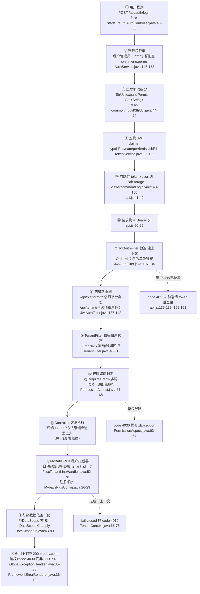
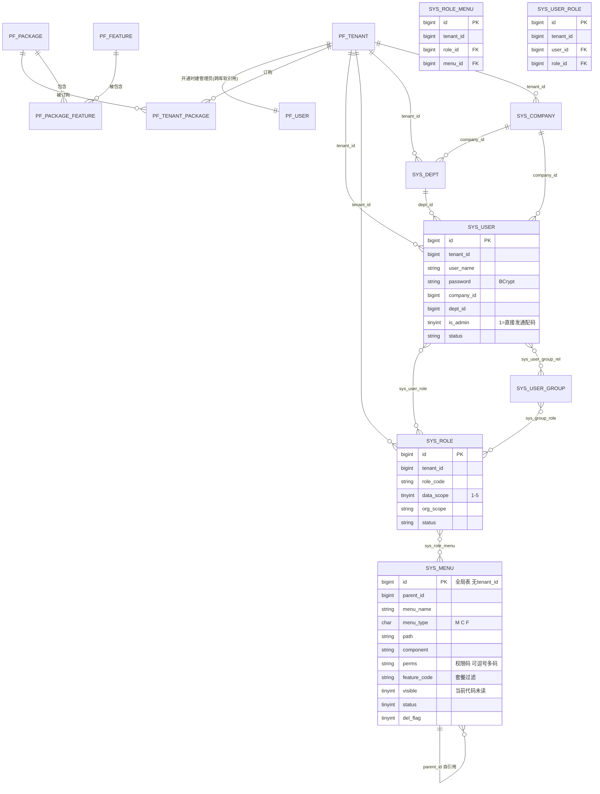

# 权限与多租户

> **路径约定**：后端 Java 相对 `fssc/fssc-server/`（如 `fssc-start/src/main/java/com/fssc/...`、`fssc-common/src/main/java/com/fssc/...`）；前端相对 `fssc/fssc-web/`；配置 `fssc-start/src/main/resources/application.yml`；库结构与数据以 `db/Dump<导出日期>/` 里的整库导出为准。

---

## 0. 先认识 6 个词

| 术语 | 一句话解释 |
|---|---|
| **多租户**（multi-tenant） | 所有企业（租户）共用一个数据库、一组表，靠每张业务表上的 `tenant_id` 列区分数据归谁。本文里"租户"=一家使用系统的企业。 |
| **权限码**（perm code） | 一个冒号分隔的字符串，代表"能做某件具体的事"，如 `exp:claim:submit`。后端写在注解里，存在 `sys_menu.perms` 列里。 |
| **通配权限** | 特殊权限码 `*:*:*`，持有它等于持有全部权限。平台超管与租户管理员在登录时被直接发放这个码。 |
| **功能码 / 套餐**（feature） | 代表"这家企业买了哪个模块"，如 `FSSC_BANK`。**权限码管"人能不能"，功能码管"公司买没买"**，两者取交集。 |
| **数据范围**（data scope，也叫行级权限） | 同一个功能权限下，允许你看到**哪些行**数据：本租户全部 / 本公司 / 本部门及以下 / 本部门 / 仅本人。 |
| **幽灵权限键** | 代码里引用了、但数据库权限表里**没有对应载体**（或载体已停用/被授权数为 0）的权限码。后果：该接口对所有人恒拒绝，除非你是通配管理员——表现为"功能点不动，也报不出为什么"。 |
| **切面 / AOP** | Spring 的一种机制：不改动业务方法本身，在它被调用前后自动插入一段校验代码。本项目 `@RequiresPerm` 的判定就写在切面里。 |
| **fail-closed**（失败即拒绝） | 拿不到关键信息时选择报错而不是放行。本项目租户上下文缺 `tenant_id` 时直接抛异常，就是这个原则。 |

---

## 1. 一张总览图：一次带权限的完整请求



**读图要点**

1. **`tenant_id` 只能来自已验签的 Token**，绝不读任何请求头（`JwtAuthFilter.java:133-137`，设计说明见同文件 `22-33`）。这是全项目最重要的一条防伪造设计。
2. **鉴权是自研 `JwtAuthFilter`，不是 Spring Security 过滤链**。项目里出现了 `spring-security-crypto` 的 `PasswordEncoder`（`AuthService.java:27, 60`）只用于 BCrypt，没有 Spring Security 过滤器；所以 Actuator 无法感知"已登录"（`application.yml:83` 明写此点）。
3. **免鉴权白名单**在 `JwtAuthFilter.java:48-65`：`/api/health`、`/actuator/health`、`/actuator/health/**`（覆盖 `liveness`/`readiness` 两个探针）、`/actuator/info`、`/api/auth/**`、文件下载 `/api/tenant/system/file/download`、5 条 LinkU 回调、`/error`、`/favicon.ico`。另外 `OPTIONS` 预检无条件放行（`JwtAuthFilter.java:91-94`）。
4. **白名单路径带有效 Token 时仍会解析身份**（`JwtAuthFilter.java:98-117`）——所以 `/api/auth/profile` 这类"登录后才能看自己"的接口能工作。
5. **响应永远是 HTTP 200**，权限失败靠 `body.code` 表达（见 §6 与踩坑 P1）。
6. 请求结束在 `finally` 清空两个 `ThreadLocal`（`JwtAuthFilter.java:153-157`；`UserContext.java:34-36`、`TenantContext.java:91-93`）。异步线程**拿不到**这些上下文，这是操作日志必须在请求线程内组装实体的原因（`OperLogAspect.java:33-41, 133-140`）。

---

## 2. 数据模型

### 2.1 相关表逐个说明

**租户侧（RBAC 主体）**

| 表 | 有 `tenant_id` | 关键列 | 作用 |
|---|---|---|---|
| `sys_user` |  | `id`、`tenant_id`、`user_name`、`nick_name`、`emp_no`、`password`(BCrypt)、`company_id`、`dept_id`、`post_id`、`phone`、`email`、`is_admin`、`status`(`NORMAL/DISABLED/LOCKED`)、`del_flag` | 租户员工账号。`is_admin=1` → 登录直接拿 `*:*:*`（`AuthService.java:150-153`）。唯一键 `uk_tenant_user_name(tenant_id,user_name)`：同一账号名可在不同租户重复。实体 `SysUser.java:14-40, 71-79` |
| `sys_role` |  | `role_code`、`role_name`、`data_scope`（1-5）、`org_scope`(`COMPANY/GROUP`)、`status`、`del_flag` | 角色。`data_scope` 是数据范围的唯一配置入口（`SysRole.java:17-25`）。唯一键 `uk_tenant_role_code` |
| `sys_menu` |  **全局表** | `id`、`parent_id`、`menu_name`、`menu_type`(`M`目录/`C`菜单/`F`按钮)、`path`、`component`、`perms`、`icon`、`feature_code`、`terminal`(`PC/H5/ALL`)、`sort`、`visible`、`status`(1启用/0停用)、`del_flag` | **同时充当菜单与权限点**（见 §2.2）。全平台共用一套定义，**没有 `tenant_id`**（`SysMenu.java:17-21`） |
| `sys_role_menu` |  | `tenant_id`、`role_id`、`menu_id` | 角色↔菜单/权限点的授权关系。**租户隔离真正落在这一张表**（唯一键 `uk_tenant_role_menu`）。`SysRoleMenu.java:23-35` |
| `sys_user_role` |  | `tenant_id`、`user_id`、`role_id` | 人↔角色。`SysUserRole.java:23-35` |
| `sys_user_group` |  | `group_code`、`group_name`、`status` | 用户组=批量授权单元 |
| `sys_group_role` |  | `group_id`、`role_id` | 组↔角色 |
| `sys_user_group_rel` |  | `user_id`、`group_id` | 人↔组。**这三张表构成"组→角色→菜单"的第二条授权通道**，取码 SQL 里用 `UNION` 并进直接角色（`SysUserMapper.java:56-66`） |
| `sys_dept` |  | `company_id`、`dept_code`、`dept_name`、`parent_id`、`ancestors`、`leader_id`、`cost_center` | 部门树，数据范围的"本部门及以下"靠它递归（`PermissionAspect.java:116-148`） |
| `sys_company` |  | `company_code`、`company_name`、`parent_id`、`ancestors`、`tax_no`、`currency` | 法人/纳税主体，数据范围的"本公司"层级 |
| `sys_post` |  | `company_id`、`dept_id`、`post_code`、`post_level` | 岗位。**未见参与鉴权判定**（全文无 `sys_post` 的权限取数） |
| `sys_oper_log` |  | 见 §6 | 租户操作留痕（按月分区，无 `del_flag`） |
| `sys_login_log` |  | `user_name`、`ipaddr`、`login_type`、`status`、`msg`、`browser`、`os` | 登录流水（`AuthService.java:267-284`） |
| `sod_role_conflict` |  可为 NULL=平台级规则 | `role_code_a`、`role_code_b`、`reason` | 职责分离互斥规则；`tenant_id IS NULL OR = 当前租户` 手工取（`FsscTenantLineHandler.java:36-38`） |
| `sod_perm_conflict` |  同上 | `rule_code`、`pattern_a`、`pattern_b`、`risk` | 权限码级互斥规则 |

**平台侧（运营方，与租户完全分离）**

| 表 | 关键列 | 作用 |
|---|---|---|
| `pf_user` | `username`、`password`、`is_super`、`status` | 平台运营账号。**只有 `is_super=1` 与非超管两态**（`AuthService.java:217-219`） |
| `pf_tenant` | `tenant_code`、`tenant_name`、`status`(`NORMAL/APPLYING/FROZEN/CANCELLING/CANCELLED/REJECTED`)、`expire_time`、`admin_user_id` | 企业台账；登录靠 `tenant_code` 反查 `tenant_id`（`AuthService.java:77-88`） |
| `pf_tenant_package` | `ref_tenant_id`、`package_id`、`status=ACTIVE`、`start_time`/`end_time` | 租户↔套餐订购关系 |
| `pf_package` / `pf_package_feature` / `pf_feature` | `package_id`、`feature_code`、`enabled` | 套餐开通的功能码集合，登录时进 Token 的 `ftr` |
| `pf_oper_log` / `pf_login_log` | — | 平台侧双轨审计 |

> **已下线**：`pf_menu` / `pf_role_menu` / `pf_user_role` 三表由迁移脚本 `V9.9.14_drop_pf_menu_rbac_tables`删除。**结论：平台端没有细粒度 RBAC**，只有"超管通配 / 非超管空权限"两态——现役代码锚见 §3.4 的 `AuthService.java:215-219`。

### 2.2 ER 片段



### 2.3 `sys_menu` 如何同时充当"菜单"和"权限点"

一张表用 `menu_type` 分三种角色：

| `menu_type` | 含义 | 典型形态 | 后果 |
|---|---|---|---|
| `M` | 目录 | 有 `menu_name`、`icon`，`path`/`component` 为空，常带一个粗码如 `md:config` | 只用于分组 |
| `C` | 页面 | `path`+`component`+`perms`（如 `exp:bill:list`） | 既渲染进左侧菜单，又是一个权限点 |
| `F` | 按钮 | 无 `path`，只有 `perms`（如 `exp:claim:submit`） | 纯权限点，`MenuTree.vue:45-48` 会把它过滤掉不渲染 |

**判定依据**：授权时 `sys_role_menu.menu_id` 指的是同一个 `sys_menu.id`，取码 SQL 不区分 `menu_type`（`SysUserMapper.java:56-66`），建树时也只按 `parent_id`/`status` 走（`MenuService.java:35-53`）。所以"给一个角色勾一个菜单"和"给它一个按钮权限"是**同一个动作**。

前端渲染时只按"有没有 `path`"决定要不要显示（`MenuTree.vue:12, 38-45`），**没有任何权限码判断**。

### 2.4 `perms` 的取值形态与解析点

**形态**：`varchar(255)`，**允许逗号分隔多码**。实体侧字段见 `fssc-start/src/main/java/com/fssc/system/entity/SysMenu.java:37`。建表列注释原文写着"权限码，可逗号多码"。真实样例：

```
md:config,md:fininst:create,md:fininst:delete,md:fininst:list,md:fininst:update
budget:item:list,system:dept:list
report:view,report:exp:view
```

**解析点全链路（5 处，缺一不可）**

| # | 位置 | 做什么 |
|---|---|---|
| 1 | `SysUserMapper.java:56-66` | 从库取 `m.perms`，返回的是**未拆分的整串** `List<String>`；同时过滤 `status=1 AND del_flag=0`，并 `UNION` 进用户组派生角色 |
| 2 | `AuthService.java:155` → `StrUtil.java:47-57`（`expandPerms`） | **逗号拆成独立码**、`trim`、去空白、去重成 `Set` |
| 3 | `TokenService.java:97` → `StrUtil.java:39-41`（`join`） | 签发时把 `Set` 用逗号拼回字符串写进 claim `per` |
| 4 | `TokenService.java:129-130` → `StrUtil.java:29-37`（`splitToSet`） | 每次请求解析时再拆成 `Set`；空串**不产生** `[""]` 伪码（`TokenService.java:127-128` 记录了这个修复） |
| 5 | `PermissionAspect.java:49, 55` | 判定用 `Set.contains(码)`，即**逐元素等值**，不是子串匹配 |

保存期同样必须拆：`RoleService.java:144-156`（`permsOf` 用 `split(",")`）、`SoDService.java:183-185`。前端也拆：`fssc-web/src/utils/perm.js:25-30`。

> 有专门的回归测试锁住"忘记拆分"这一类缺陷：`fssc-start/src/test/java/com/fssc/framework/security/MultiPermMenuTest.java:48-68`，其 `:123` 注释写明"若装载层忘记 expandPerms，逗号整串无法通过任何单码校验"。**该测试存在但未运行**（本文档禁止构建）。

---

## 3. 判定语义精确化

### 3.1 `@RequiresPerm` 多码 = **OR**（已核实）

```java
// fssc-start/src/main/java/com/fssc/framework/security/PermissionAspect.java:49-66
boolean wildcard = u.getPerms() != null && u.getPerms().contains("*:*:*");   // :49
if (!wildcard) {
    boolean ok = false;
    if (u.getPerms() != null) {
        for (String c : need) {                                             // :54
            if (c != null && !c.isBlank() && u.getPerms().contains(c)) {     // :55
                ok = true; break;                                           // :56-57
            }
        }
    }
    if (!ok) {
        throw new BizException(ErrorCode.PERMISSION_DENIED,
                "缺少权限：" + String.join(" 或 ", need));                    // :63-64
    }
}
```

- **历史审计结论成立**：多码是 OR，命中任意一个即放行。判定行 = `PermissionAspect.java:57-61`；`break`（`:57`）证明不是 AND。
- 语义变更时间戳与用途写在注解 javadoc：`framework/security/annotation/RequiresPerm.java:15-22`（专为"粗码拆细码"的过渡期，新旧码各自可通行）。
- 单码写法 `@RequiresPerm("x")` 是 Java 数组单元素简写，语义等价（`RequiresPerm.java:21-22`）。
- 报错文案把**全部**可接受码列出来（`:62-64`），所以"缺少权限：A 或 B"是正常提示，不代表你两个都没有——只要有一个就会放行。

### 3.2 通配 / 超管 / 特殊码

| 码 | 语义 | 证据 |
|---|---|---|
| `*:*:*` | 全部权限 | 常量定义 `AuthService.java:69`；判定 `PermissionAspect.java:52`；`LoginUser.isAdmin()` `LoginUser.java:59-61`；`hasPerm()` `LoginUser.java:68-70` |
| `report:audit:all` | **仅**报表域放行（内审/监督岗），**不**是全站通配 | 判定点 `ReportDomainAspect.java:20, 35`；角色保存期同一判据 `RoleService.java:108-110` |
| — | **不支持** `exp:*:*` 这类**前缀通配**。`contains` 是 `Set` 的逐元素等值，`exp:*:*` 只会被当成字面码 | `PermissionAspect.java:58`（无 `Pattern`/`startsWith` 逻辑） |

**代码里再判一次权限，只能走 `LoginUser.hasPerm(code)`**（`LoginUser.java:63-70`），它的 javadoc 明确警告：手写 `perms.contains(...)` 会漏掉通配，把超管判成无权。真实反例在 `TenantUserController.java:79-82`（`hasUserListPerm` 直接 `getPerms().contains("system:user:list")`）——**该写法对通配管理员返回 false**，因此超管打开用户列表会拿到裁剪后的最小字段集。这是"看着没生效"的一个具体成因。

### 3.3 菜单权限与接口权限：**同一套码，两个消费面**

- **同一套数据**：两者都来自 `sys_menu.perms`（`SysUserMapper.java:56-66`）。接口侧用它判 4030（`PermissionAspect.java:47-71`），菜单侧用它决定树里有没有这一项（`MenuService.java:35-53`）。
- **但裁剪口径不同**，这就是"按钮在/不在"与"接口通/不通"能不一致的原因：
  - 菜单树：还要 **∩ 套餐功能码**——`feature_code` 有值但套餐没开通就从树上摘掉（`MenuService.java:55-60`）；管理员走"全部启用菜单"分支，不看 `sys_role_menu`（`MenuService.java:37-41`）。
  - 接口：不看菜单元数据，只看 Token 里的 `per` 码集；另有独立的 `@RequiresFeature` （`PermissionAspect.java:73-80`；主源码内 71 处、分布在 9 个文件，功能码**只有 4 枚**：`FSSC_ARCHIVE` `FSSC_BANK` `FSSC_SHARED` `FSSC_TAX`）。
- **`status` vs `visible`**：取码与建树都只认 `status=1 AND del_flag=0`（`SysUserMapper.java:58`、`MenuService.java:37, 46`）。**`sys_menu.visible`（1显示0隐藏）列在全仓 Java 无任何读取**（`SysMenu.java:45-46` 定义了字段，但 `getVisible()`/`SysMenu::getVisible` 零命中，`MenuService.MenuNode` 也没带这个字段，`MenuService.java:86-111`）——**把 visible 改成 0 不会隐藏任何东西**。

### 3.4 平台管理员 vs 租户用户的边界

三道边界，粗细不同：

| 边界 | 实现 | 强度 |
|---|---|---|
| **路由前缀** | `JwtAuthFilter.java:140-145`：`/api/platform/**` 非平台身份 → `4032 PLATFORM_ONLY`；`/api/tenant/**` 非租户身份 → `4033 TENANT_ONLY` |  **硬闸**，与权限码无关，最可靠 |
| **`@PlatformOnly`** | `PermissionAspect.java:82-89` |  **当前不生效**：切点 `@annotation(platformOnly)` 只匹配**方法级**注解，而全仓 6 处 `@PlatformOnly` 全部贴在**类**上（`platform/controller/PlatformDashboardController.java:23`、`PlatformFeatureController.java:23`、`PlatformPackageController.java:28`、`PlatformTenantController.java:33`、`PlatformTenantPackageController.java:40`、`TenantExportController.java:33`），注解 `@Target` 允许 `METHOD,TYPE`（`PlatformOnly.java:14`）但切面没写 `@within`。类上那个 `PlatformTenantController.java:27` 自称"双保险"——**实际只有路由那道** |
| **数据可见面** | 平台身份 `TenantContext.setPlatform()` → `tenant_id=null`（`JwtAuthFilter.java:134`）；查业务表时 `FsscTenantLineHandler.getTenantId()` → `TenantContext.getTenantId()` **fail-closed 抛 4010**（`TenantContext.java:68-78`）。跨租户统计只能显式 `runIgnoreTenant`（`TenantContext.java:48-56`） |  硬闸 |

**平台端权限模型现状**：`AuthService.java:215-219`——超管 `*:*:*`，非超管 `Set.of()` **空权限集**，且 `features=Set.of()`、`dataScope=null`。所以 `PlatformDashboardController.java:28` 上的 `@RequiresPerm("platform:dashboard:view")` 只有通配能过；`platform:*` 种子码不在仓库内，读者侧查不到；而且**这些是 `sys_menu`（租户表语义）的种子码**，而平台身份读 `sys_menu` 走的是忽略名单，登录装载路径又根本不查 `sys_menu`（平台臂只发通配/空集）→ **`platform:*` 码是纯装饰**。

### 3.5 没有权限注解 = 只要登录就能调

**覆盖度**（静态扫描口径：遍历 `com/fssc` 下 `@RestController` 文件，取方法级 `@Get/Post/Put/Delete/Patch Mapping` 行（已剔除类级 `@RequestMapping`），然后**只吃紧邻该 mapping 之上的连续注解块**——遇空行/注释继续上溯，遇非注解行即停——在块内判 `@RequiresPerm`/`@RequiresFeature`/`@OperLog`。交叉校验用字面出现总次数：`@RequiresPerm` 1141 次、`@OperLog` 619 次；差值是注解定义文件的 javadoc、Service 层标注等非端点引用）：

| 指标 | 数 | 证据位置 |
|---|---|---|
| 方法级端点 | **1256** | 全仓 `@RestController` |
| 带 `@RequiresPerm` | **1117**（88.9%） | — |
| **不带** `@RequiresPerm` | **139** | 见下 |
| 带 `@RequiresFeature` | **69** | — |
| 带 `@OperLog` | **585**（46.6%）→ **671** 个端点无审计注解 | 见 §6.1 |
| 引用 `@RequiresPerm` 的文件数 | **148** | 全仓 `*.java` |

139 个无权限码端点的分布（前列）：`workflow/controller/WfTaskController.java` 21、`collab/controller/CollabController.java` 14、`sharing/controller/DeliveryController.java` 14、`auth/AuthController.java` 9（登录/注册/登出/refresh/profile 均在白名单或自带身份判据）、`sharing/controller/RequisitionWorkbenchController.java` 7、`ai/AiGatewayController.java` 7、`system/controller/QueryVariantController.java` 6、`report/controller/ReportCatalogController.java` 5、`sharing/controller/SupplierReconController.java` 5、`system/controller/TenantMessageController.java` 4、`workflow/controller/WfQueryController.java` 4 等。

**这些不等于漏洞**——它们换用了另外两种判定：

- **流程待办的"我是办理人"**：`/api/tenant/wf/approve`（`WfTaskController.java:753-764`）无 `@RequiresPerm`，真正的闸在引擎层 `NodeOrgResolver.canOperate(...)`（`workflow/service/NodeOrgResolver.java:190-215`，`task.getAssignee()` 逐条比对 + 委托通道 + POOL 软锁），拒绝文案见 `WfEngineFacade.java:5979-5982`；调用点在 `WfEngineFacade.java:2831, 3456, 3728, 4344, 4408, 4458`。读侧另有 `WfReadGuard.java:85, 101, 125`。
- **单据"只能改自己的"**：`ExpenseBillService.requireMine(...)`（`expense/service/ExpenseBillService.java:1937-1949`），命中抛 `4030 "无权操作他人单据"`。
- **字段级裁剪代替拒绝**：`/api/tenant/system/user/page` 故意不挂权限码（`TenantUserController.java:38-40`），改为无 `system:user:list` 时只返回下拉最小字段集（`:53-73`）。

> **给新手的一句话**：新接口**要么挂 `@RequiresPerm`，要么在代码里明确写出"我用哪种归属判定代替它"**，两者都没有就等于"任何登录用户都能调"。

### 3.6 保存期的三道配置校验（改权限时最容易撞上）

在角色保存菜单权限时（`RoleService.java:72-90` `assignMenus`，全量**删旧插新** `:76-86`）：

1. **报表域投影卡点** `RoleService.java:99-127`：给角色勾了 `path` 以 `/reports/` 开头的菜单，但未来权限集里不含该域任一判据码 → 整单拒绝（`4030`）。放行例外：持有 `report:audit:all`（`:105-107`）。
2. **权限项依赖闭合卡点** `RoleService.java:135-141` → `PermDependency.assertGrantClosure`（`framework/security/PermDependency.java:47-66`）。真值表目前**只有 1 条**（`PermDependency.java:31-33`）：`compliance:archiveaccess:approve` 必须与 `compliance:archiveaccess:list` 同批授予。运行期兜底走同一份（`PermDependency.assertHolds`，`:66-81`）。
3. **SoD 职责分离**在**分配角色**时（不是分配菜单时）：`UserService.assignRoles` 先跑 `assertNoConflict`（角色码互斥）再跑 `assertNoUserPermConflict`（用户级权限码并集），命中即抛异常拦下授权（`UserService.java:169-187`）。

### 3.7 越权会发生什么（完整后果表）

| 你的位置 | 结果 | 证据 |
|---|---|---|
| 没带 Token 调非白名单接口 | `body.code=401`，**HTTP 仍是 200** | `JwtAuthFilter.java:119-122` |
| Token 被强制下线/登出 | `401 "Token 已被强制下线"` | `JwtAuthFilter.java:125-127`；黑名单 `TokenBlacklistService.java:50, 60` |
| Token 验签失败/过期 | `401 "Token 无效或已过期"` | `TokenService.java:110-120` |
| 缺权限码 | `4030 "缺少权限：A 或 B"` | `PermissionAspect.java:66-67` |
| 套餐没买这个功能 | `4031 "未开通功能：xxx"` | `PermissionAspect.java:76-77` |
| 租户用户打 `/api/platform/**` | `4032` | `JwtAuthFilter.java:140-142` |
| 平台用户打 `/api/tenant/**` | `4033` | `JwtAuthFilter.java:143-145` |
| 业务 SQL 拿不到 `tenant_id` | `4010 "业务SQL缺少租户条件"`，**直接失败不返回数据** | `TenantContext.java:73-76` |
| 租户被冻结/过期/注销 | `403` + 具体中文原因 | `TenantFilter.java:48-54`；状态文案 `AuthService.java:232-247` |
| 改/看别人的单据 | `4030 "无权操作他人单据"` | `ExpenseBillService.java:1937-1949` |
| 用别的公司主体建单 | `403 "组织合法性校验不通过…"` | `OrgGuard.java:44-55` |
| 看别家公司单据详情 | `403 "无权查看他公司单据"`（`data_scope=1` 豁免） | `OrgGuard.java:68-82`（豁免判据 `:72`） |
| 审批不是自己待办的任务 | `403 "非当前节点办理人/候选人，无权办理此任务"` | `WfEngineFacade.java:5979-5982` + `NodeOrgResolver.java:190-215` |
| 授权违反报表域/依赖闭合 | `4030`，保存失败 | `RoleService.java:123-126`、`PermDependency.java:62-64` |
| 角色保存后前端仍看不到按钮 | **必须重新登录**，见 P4 | `AuthService.java:304`（profile 的 perms 取自 Token） |

---

## 4. 前端侧

### 4.1 路由守卫：只挡"有没有登录"，不挡权限

```js
// fssc-web/src/router.js:74-81
router.beforeEach((to) => {
  if (!to.meta.public && !store.token) return '/login'      // :75
  if (to.meta.platform && store.user?.subjectType !== 'PLATFORM') {   // :77
    return store.user ? '/workbench' : '/login'
  }
  return true
})
```

全仓只有这一处 `beforeEach`（`router.js:77`；其余 `beforeEach` 命中都在 `*.spec.js` 单测里）。**没有按权限码的路由守卫**。`router/routes/*.js` 10 个文件把所有业务页面静态注册进 `routes`（`router.js:5-14, 57-66`）。

推论：**直接改地址栏 URL 就能进任何页面**（守卫只看 token 存在与否）。进去之后是页面里的接口调用被 `4030` 挡住，而不是路由挡住。

### 4.2 权限指令 `v-permission`

注册：`main.js:30` `app.directive('permission', permissionDirective)`。实现在 `directives/permission.js:18-55`，行为是**判不过就从 DOM 移除元素**（`:49-51`）。

**可复制示例 1 — 单个按钮（最常用）**

```vue
<!-- fssc-web/src/views/system/UserManage.vue:74 的真实写法 -->
<el-button v-permission="'system:user:assignRole'" link type="primary" @click="openAssignRole(row)">
  分配角色
</el-button>
```

**可复制示例 2 — 任一满足（OR，与后端多码语义对齐）**

```vue
<!-- fssc-web/src/views/workflow/Handover.vue:31 的真实写法 -->
<el-button v-permission="['wf:manage:intervene', 'wf:task:reassign']"
           type="primary" :loading="execLoading" @click="doExecute">
  执行移交
</el-button>
```

指令内置的放行逻辑（**必须知道，否则会误删 UI**）：

- 多码是 `codes.some(...)`，即 **OR**（`permission.js:41`），与后端一致。
- **超管兜底**：`user.isAdmin === 1`、`roles` 含 `admin`、或 perms 含 `*:*:*`，任一成立即放行（`permission.js:44-50`）。
- **角色模式的数据竞态放行**：`v-permission.role` 时若 `roles` 还没就绪，**放行而非移除**（`permission.js:31-38`），注释解释原因是"登录响应不含 roles，仅 /auth/profile 注入"。
-  **`updated` 钩子是空壳**（`permission.js:58-62`）：元素一旦在 `mounted` 时被移除，**权限数据后到也回不来**。所以权限数据必须在挂载前就位（`main.js:73-76` 的先探活再挂载就是这个用途）。同一页面内动态换角色不会重新判定。

**采用率**：`v-permission` 全仓仅 **16 处命中**（含 `permission.js` 自身注释），其中真实使用点集中在 `views/sharing/SharedOpsConsole.vue`、`views/system/UserManage.vue`、`views/flow/ApMonthCloseBoard.vue`、`views/workflow/*`、`views/system/Handover.vue`。**绝大多数页面不用指令**，而是用 `hasPerm()` 做条件渲染（`utils/perm.js:44-48`）或前置拦截。

### 4.3 统一判定工具 `utils/perm.js`（新代码应该用这个）

- `permSet()` `:22-27`：把 `store.user.perms` 归一化为 `Set`，**兼容数组和逗号串**（`:26` 显式 `split(',')`）。
- `superPerm()` `:30-33`：`*:*:*` **或** `isAdmin === 1`。注释 `:10-14` 特别自纠了"本文件早期注释写'本项目不存在 `*:*:*`'，那是只查了 `sys_menu` 得出的错误结论"——**这段注释值得读**，它记录了通配码不经过菜单表、静态审计脚本看不到这一事实。
- `hasPerm/hasAnyPerm/hasAllPerms` `:41-59`；注意 **`hasAllPerms` 在前端是 AND 语义，后端 `@RequiresPerm` 是 OR**，写代码时别把两边对齐成"都 AND"。

### 4.4 菜单是后端驱动还是前端配置？—— **后端驱动，判据三条**

| 判据 | 证据 |
|---|---|
| ① 侧边栏渲染的数据来自接口 | `views/common/Layout.vue:7, 81` `<MenuTree :nodes="menuTree" />`；`:312-313` `const raw = await getMenuTree(); menuTree.value = raw`；`api.js:240` → `GET /tenant/system/menu/tree` |
| ② 后端有裁剪逻辑 | `MenuService.java:35-53`（按角色取菜单 ID + `status=1`）→ `:52-57`（按套餐 `feature_code` 过滤）→ `:60-80`（`parentId` 建树，父不可见则子提升为根） |
| ③ 前端硬编码菜单已被专项迁移删净 | 迁移脚本 `V1.2.9_menu_backend_driven` 的说明段写着这条口径："将 `Layout.vue` 前端硬编码 `MENU_REGROUP` 的 14 组逻辑迁移到 `sys_menu` 表"；现役代码侧：全仓 grep `MENU_REGROUP` **零命中** |

`MenuTree.vue` 只做"有没有 `path`"的渲染判断（`:12, 38-45`），**不做任何权限判断**。

菜单树接口本身**不挂权限码**，注释解释了原因：`TenantMenuController.java:16-20`——"越权内容根本不会出现在树里"。

### 4.5  前端隐藏 ≠ 后端放行

**这是本项目最需要记住的一条安全边界。** 前端的三种隐藏手段，全都是**纯观感**：

| 前端手段 | 代码位置 | 后端反应 |
|---|---|---|
| `v-permission` 移除按钮 | `permission.js:52-54` | 完全不知道；直接 `POST /api/tenant/...` 照样进切面 |
| `hasPerm()` 条件渲染 | `perm.js:44-48` | 同上 |
| 菜单树里没有这一项 | `MenuService.java:35-53` | 路由仍注册（`router.js:8-69`），`router.beforeEach` 不看权限（`router.js:77-84`），页面照常加载 |

因此：
- **安全性 100% 由后端决定**。前端隐藏只是避免用户点了一个注定失败的按钮。
- **反向也成立**：前端隐藏了但后端**没挂** `@RequiresPerm`（§3.5 的 139 个端点），数据照样能靠手工请求拿到。审计这类端点是发布前的必做项。
- 前端做前置拦截的正确姿势是"**双保险**"而不是"替代"：`views/sharing/ArchivePage.vue:198-200`、`views/approval/Approval.vue:705-711`（无权限就不发请求，但界面如实写"当前账号无 `wf:history:list` 权限"）。

---

## 5. 数据范围（行级权限）

> **结论先行：本项目存在行级数据范围机制**（不是"仅有租户隔离 + 功能权限"），但它**覆盖面很窄、且是显式调用式实现**。

### 5.1 五级定义与聚合口径

| 值 | 枚举 | 含义 | 过滤动作 |
|---|---|---|---|
| 1 | `TENANT` | 本租户全部 | **不加任何条件** |
| 2 | `COMPANY` | 本公司（纳税主体） | `company_id = 登录人公司` |
| 3 | `DEPT_AND_CHILD` | 本部门及以下 | `dept_id IN (本部门 + 全部下级)` |
| 4 | `DEPT` | 本部门 | `dept_id = 登录人部门` |
| 5 | `SELF` | 仅本人 | `owner 列 = 登录人` |

- 枚举定义：`fssc-common/src/main/java/com/fssc/common/enums/DataScope.java:13-53`。注释即写明"值越小权限越宽，多角色取最宽（min）；查不到角色时默认最窄的 5 —— fail-closed"（`:6-9`）。
- **多角色取最宽**：`SysUserMapper.java:27-31`（`select min(r.data_scope) ... and r.status='NORMAL'`），并集口径同 `:31-40`（直接角色 ∪ 用户组派生角色）。
- 装载进 Token：`AuthService.java:168-170`（`ds == null ? 5 : ds`），claim `dsc`（`TokenService.java:99`），解析 `:128`。
- 每请求还原：`PermissionAspect.java:91-113` → `DataScopeHolder.set(...)`（`framework/security/DataScopeHolder.java:23-25`，`ThreadLocal`），`finally` 清空（`PermissionAspect.java:110-112`）。
- **平台身份直接跳过**：`PermissionAspect.java:94-97`（跨租户聚合靠 `TenantContext.runIgnoreTenant`，不注入范围）。
- 部门树递归：`PermissionAspect.java:116-148`（按 `company_id` 取全量部门、`parentId` 邻接表、栈展开、异常吞掉返回已得集合）。

### 5.2 真实过滤点：显式调用，不是 SQL 改写

`DataScopeKit.apply(qw, companyCol, deptCol, ownerCol)`（`framework/security/DataScopeKit.java:46-83`）。**设计取舍写在注释里**（`:26-28`）："采用各列表方法显式调用而非全局 SQL 改写拦截器，避免对跨表 join 聚合查询误注入列导致 SQL 错误"。

降级行为（**很关键，容易误判成"数据范围没生效"**）：
- 载体为空（方法没标 `@DataScope`）→ **直接 return，完全不干预查询**（`:47-50`）。
- `DEPT*` 但登录人无部门 → **降级为本公司**（`:68-69`）。
- `SELF` 但该表没有 owner 列 → **降级为本公司**（`:76-78`）。
- 无 `companyCol` 或值为 null → 该分支什么都不加（`:56-58`）。

**接入点（全仓 10 处调用 / 8 个业务方法）**

| 业务 | `@DataScope` 注解 | `DataScopeKit.apply` |
|---|---|---|
| 预算方案列表 | `budget/service/BudgetService.java:79` | `:83` |
| 预算明细列表 | `BudgetService.java:312` | `:328` |
| 合同列表 | `contract/service/ContractService.java:60` | `:66` |
| 员工借款台账 | `expense/service/ExpenseBillService.java:1266` | `:1270`（三级列齐全，含 `applyUserId`） |
| 报销导出 | `report/service/ExportService.java:44` | `:50` |
| 预算导出 | `ExportService.java:107` | `:112` |
| 采购退货列表 | `returns/service/PurReturnService.java:267` | `:276` |
| 销售退货列表 | `returns/service/SaleReturnService.java:250` | `:259` |
| 凭证列表 | `sharing/service/VoucherService.java:1547`、`:1564` | `:1586` |
| 报表看板（聚合版） | `report/controller/DashboardController.java:25, 32, 40` | `DashboardService.java:254-262`（自行实现的聚合 `QueryWrapper` 版本） |
| 流程管理组织范围 | 复用载体 | `workflow/service/WfManageOrgScope.java:26, 82` |

> **绝大多数列表接口不在上表里** —— 它们只受 `tenant_id` 隔离 + 功能权限约束，同租户内跨部门/跨人数据可见。**改动任何列表接口前，先确认它该不该进这张表。**

### 5.3 与角色权限的关系

**配置位只有一个**：`sys_role.data_scope`（`SysRole.java:19-20`，DDL 默认 5）。它**不挂在菜单/权限码上**，一个角色一个值。所以"给某人加一个按钮权限"和"让他只看自己的单据"是**两件独立的事**，前者改 `sys_role_menu`，后者改 `sys_role.data_scope`。

`org_scope`（`COMPANY`/`GROUP`，`SysRole.java:21-22`）是**另一维正交概念**——审批取人的组织解析范围，不是数据可见范围，别混用。

### 5.4  两个必须知道的坑

1. **`data_scope = 6` 无实现，会 fail-open**。`sys_role.data_scope` 的建表列注释写了 `6自定义(见sys_role_dept)`（实体侧 `fssc-start/src/main/java/com/fssc/system/entity/SysRole.java:20` 只有字段声明、不带取值注释），**但**：`sys_role_dept` 表**不存在**（全仓 `*.sql` 里 `CREATE TABLE \`sys_role_dept\`` 零命中），Java 枚举 `DataScope` 只有 1-5（`fssc-common/src/main/java/com/fssc/common/enums/DataScope.java:13-19`），`DataScopeKit.apply` 的四段 `if` 覆盖 `<=1 / 2 / 3||4 / 5`（同类 `:52, :55, :61, :73`）——**值为 6 时全部不命中，函数走完不加任何条件**，效果等同最宽的 1（本租户全部）。`RoleService.create` 也不校验取值范围（`RoleService.java:49-56`，只在 null 时补 5）。
2. **`@DataScope` 挂在 Service 方法上才有效**。切点是 `@annotation(dataScope)`（`PermissionAspect.java:91`），只匹配方法级；注解 `@Target` 允许 `METHOD,TYPE`（`DataScope.java:18-20`），但**类级标注不会被拦**（与 `@PlatformOnly` 同一缺陷）。另外这是 Spring AOP，**同类内部自调用不经过代理**，`@DataScope` 会静默失效——标在 private/内部方法上等于没标。

---

## 6. 操作留痕与审计

### 6.1 记录时机：**注解驱动，逐个方法手写**

- 切点：`@Around("@annotation(operLog)")`（`framework/log/OperLogAspect.java:67-68`），注解定义 `framework/log/OperLog.java:18-30`（`@Target(METHOD)`，三个属性 `module`/`operType`/`desc`）。
- **没有全局审计过滤器**：不写 `@OperLog` 的请求**不会**产生 `sys_oper_log` 行。全仓 `@OperLog` 字面出现 **619** 次，其中贴在 `@RestController` 端点上的 **585** 处；端点总数 1256 → **671 个端点无留痕**（口径同 §3.5）。
- `finally` 里组装实体、失败只记日志不影响业务（`OperLogAspect.java:72-85`）；INSERT 交独立组件异步落专用线程池（`OperLogWriter.java:34-51`，`@Async(OPER_LOG_EXECUTOR)`），写库异常本组件内吞掉（`:44-47`）。
- **上下文必须在请求线程采集**：`sys_dept` 受租户过滤，异步线程里没有 `TenantContext`，查了会抛 `TENANT_CONTEXT_MISSING` —— 这段约束的注释在 `OperLogAspect.java:36-44` 与 `:133-140`。

### 6.2 GET 到底记录不记录？

`GET` 请求会不会写 `sys_oper_log`，取决于有没有手写标注：

> 记不记录与 HTTP 方法**无关**，只取决于那个 GET 方法上有没有手写 `@OperLog`。

证据（口径：只统计贴在 `@RestController` 端点紧邻注解块上的 `@OperLog`，共 585 处；两种口径下 `QUERY` 都是 3，故本节结论对口径不敏感）：

| `operType` | 端点数 | 备注 |
|---|---:|---|
| `UPDATE` | 292 | 最多，**与注解 javadoc（`OperLog.java:25`）列的枚举不符**——javadoc 只写 `INSERT/UPDATE/DELETE/QUERY/EXPORT/IMPORT/GRANT/OTHER`，实际还有 `ADD/APPROVE/PAY/SUBMIT/AUDIT/CONVERT/START/TRANSFER/VOID/REVERSE/PUBLISH`，且 `ADD`(24) 与 `INSERT`(145) 并存 |
| `INSERT` | 145 | |
| `DELETE` | 89 | |
| `ADD` | 24 | 与 `INSERT` 语义重叠 |
| `QUERY` | **3** | 其中 **2 个贴在 GET 上** |
| `GRANT` / `IMPORT` | 各 4 | `GRANT` 即"分配菜单权限"那类（`TenantRoleController.java:62`） |
| `VOID` 5、`APPROVE` 2、`EXPORT` 2、`OTHER` 7、`PAY`/`SUBMIT`/`AUDIT`/`CONVERT`/`START`/`TRANSFER`/`REVERSE`/`PUBLISH` 各 1 | — | 长尾 |

`operType=QUERY` 的 3 个真实点（完整路径 = 类级 `@RequestMapping` + 方法级 mapping）：
- `expense/controller/BillTraceChainController.java:149`（`@OperLog` QUERY）→ `:147` `@GetMapping("/{billId}")`；基路径同文件 `:101` = `/api/tenant/expense/bill-trace-chain` ** GET 会写**
- `treasury/controller/TreasuryPositionController.java:57`（`@OperLog` QUERY）→ `:55` `@GetMapping`（无子路径）；基路径同文件 `:45` = `/api/tenant/treasury/position` ** GET 会写**
- `expense/controller/ColdBillController.java:52`（`@OperLog` QUERY）→ `:50` `@PostMapping("/dry-run")`；基路径同文件 `:24` = `/api/tenant/expense/cold`，即 `POST /api/tenant/expense/cold/dry-run`（**POST**，不是 GET）

**所以**：这两个 GET 接口确实每次都往 `sys_oper_log` 插一行（含 `json_result` 结果快照）。**其余 GET 不写**。"翻页翻一次留一条痕"来自这类被手写标了 `@OperLog` 的查询接口，而不是"GET 自动留痕"。

### 6.3 双轨落库与**列名不一致**

| | 平台用户 | 租户用户 |
|---|---|---|
| 分支 | `OperLogAspect.java:93-110` | `:108-128` |
| 表 | `pf_oper_log` | `sys_oper_log` |
| 列名 | `module/oper_type/oper_desc/request_uri/request_param/response_data/cost_ms` | `title/business_type/method/oper_url/oper_param/json_result/cost_time` |
| **`status` 语义** | **`ok ? 1 : 0`（1=成功）** `:103` | **`ok ? 0 : 1`（0=成功）** `:123` |

 **两表的 `status` 完全相反**（`SysOperLog.java:46-47` 注释确认"0 成功 1 失败"）。写跨表统计或导出脚本时必须先确认表名，这是最容易出错的一处。

`sys_oper_log` 写入列全清单（`OperLogAspect.java:112-130` + 实体 `SysOperLog.java:19-52`）：`tenant_id`、`trace_id`（与 `ai_tool_call_log` 串人机双链路）、`title`、`business_type`、`method`、`request_method`、`oper_url`、`oper_user_id`、`oper_user_name`、`oper_dept_name`、`oper_ip`、`oper_param`(脱敏)、`json_result`(截断)、`status`、`error_msg`、`cost_time`、`oper_time`。

**留空列**：`oper_location`（IP 归属地，`SysOperLog.java:38`）在 `OperLogAspect` 的赋值序列里**没有出现** → 恒 NULL。`oper_dept_name` 按 `deptId` 反查补上（`OperLogAspect.java:121, 144-169`，600s TTL 内存缓存 `:54-59`）。

日志不可删：`sys_oper_log` 无 `del_flag`，Mapper 只提供 insert（`OperLogAspect.java:34`）。查询入口 `system/controller/SysLogController.java:25-32`（`/api/tenant/system/log/page`，需 `system:log:list`）。

### 6.4 脱敏机制（`framework/mask/` 7 个文件）

| 文件 | 干了什么 |
|---|---|
| `Sensitive.java:22-28` | 注解，`@Target(FIELD, METHOD)`，`value()` 默认 `PHONE`。javadoc `:12-17` 写明"全局开关 `fssc.security.mask-sensitive`（默认 true）；**需要返回明文时不要依赖此注解，应走单独的授权查看接口**" |
| `SensitiveType.java:7-18` | 5 种类型：`PHONE`/`EMAIL`/`BANK_CARD`/`ID_CARD`/`NAME` |
| `SensitiveSerializer.java:19-68` | 出参序列化时按类型掩码。全局静态开关 `enabled`（`:19`）；已脱敏的值**不二次覆盖**（`:54-56`）；`enabled=false` 或空串原样输出（`:46-49`） |
| `SensitiveModule.java:22-47` | Jackson2 `SimpleModule`，`BeanSerializerModifier` 在序列化器构建阶段把序列化器绑到带 `@Sensitive` 的属性上（`:32-39`） |
| `SensitiveJacksonPostProcessor.java:19-28` | `BeanPostProcessor`，把上面那个模块注册到容器内**所有 Jackson2 `ObjectMapper` Bean** |
| `SensitiveMaskConfig.java:20-30` | 读 `fssc.security.mask-sensitive`（`:20`），`@PostConstruct` 推给静态开关（`:23-26`） |
| — | 实际 `@Sensitive` 落点**只有 2 处**：`SysUser.java:74-76`（phone）、`:76-79`（email） |

**关键限制（本节的重点，两条互相矛盾的说法要辨清）**：

- `SensitiveMaskConfig.java:15-18`：**"HTTP 出参由 Boot 4 默认的 Jackson3 序列化，不走 Jackson2 模块，因此对外接口的 PII 脱敏在业务层显式完成（见 `UserService#page`）"**。
- `SensitiveJacksonPostProcessor.java:12-17`：反过来声称用 `BeanPostProcessor` 是"确保 HTTP 出参一定走脱敏器"。
- 代码实际怎么做的更可信：`UserService.java:84-88` 在返回前**手工** `u.setPhone(MaskUtil.phone(...))` / `setEmail(...)`，注释直接写"不经过 Jackson2 的 `@Sensitive` 模块，故在此显式脱敏；明文走 `/{id}/full` 授权接口"。
- **结论**：`@Sensitive` 对 HTTP 出参**不能指望**；只有被注入 Jackson2 `ObjectMapper` 的场景（操作日志 `toJson`、Excel/导出）才走它。全仓业务代码里 `MaskUtil.` 显式调用**仅 `UserService.java:87-88` 两处**。
- 明文通道：`UserService.fullContact(userId)`（`:190-207`），返回 `Map` 而非实体（注释 `:194` 说"避免命中脱敏序列化器"），入口 `TenantUserController.java:133-134` 的权限要求是 **`system:user:update`**——即**任何能编辑用户的人都能读明文手机号/邮箱**。这值得在发布前复核（§9-R5）。
- 审计参数脱敏与上面无关，是**正则替换**：`OperLogAspect.java:181-188`，命中键名 `password|token|oldPassword|secret|pwd` 时把值换成 `******`。注意这是**字符串级正则、只匹配这些英文键名**，中文键名或嵌套变形（如 `newPassword` 已覆盖、`mobile`/`idCard` 未覆盖）不会被脱敏。
- 两个开关在配置里**都没有落值**：`fssc.security.mask-sensitive` 与 `fssc.security.openapi-public` 在 `application.yml`/`application-dev.yml` 全仓 grep 零命中（连 `fssc.security:` 这个节点都不存在，实际节点见 `application.yml:116-200`）→ 都取 `@Value` 默认（脱敏 on、文档匿名 **on**，见踩坑 P7）。
- 库里存明文还是密文：`sys_user.id_card`、`bank_account` 的建表列注释写"加密存储"，但代码里没有任何加解密实现。

---

## 7. 踩坑清单

### P1 · 权限不足（`code=4030`）被渲染成"共 0 条 / 暂无数据"

- **现象**：用户打开列表页，看到"暂无数据"或"共 0 条"，以为库里没有；实际是被后端拒绝。
- **根因**（三层叠加）：
  1. 后端**永远返回 HTTP 200**，权限失败只体现在 `body.code`（Controller 侧 `GlobalExceptionHandler.java:38-41`；过滤器侧 `FrameworkErrorRenderer.java:39-43` `setStatus(SC_OK)`）。
  2. 于是 axios 走**成功分支**（`api.js:110-136`），业务错误靠 `code!==0` 判别后 `reject`（`api.js:143-154`）。
  3. 页面 `catch` 里只读 `e.message`、把 `rows/total` 置空，**分不清"无权"与"无数据"**。
- **现状**：传输层已把业务码挂上 `Error.code`（`api.js:152-154`，注释 `:145-148` 点名这条坑）；判据函数 `permDeniedOf(e)` 在 `fssc-web/src/utils/h5.js:83-90`（`:83` 用 `code === 4030` + 文案关键字兜底，`:85` 还能从"缺少权限：X"里抠出码回显）。
- **但覆盖不全**：`permDeniedOf` 的 17 处调用**全部落在 `views/h5/*`**（`H5Workbench.vue`、`H5ApprovalDetail.vue`、`H5ExpenseCreate.vue`），**PC 端零引用**。PC 侧仍是各页自写判据，例如 `views/dashboard/Dashboard.vue:330` 用 **`/权限/.test(e.message)` 正则文案**判断而不是认 `code` —— 文案一改即失效；`views/dashboard/BizProgressBoard.vue:47-51` 的注释把两个问题（"取到 0"与"未取数"显示成同一个 0；全页无门控连弹两次"缺少权限"）写得很清楚。
- **定位方法**：浏览器 DevTools → Network → 看那个"空列表"请求的响应体是不是 `{"code":4030,"msg":"缺少权限：xxx"}`。是 `4030` 就去看 `msg` 里点名了哪张码；`code=0` 且 `list:[]` 才是真无数据。
- **规避**：写列表页时 `catch (e)` 里**必须先看 `e.code === 4030`**（或 `e.status`），走"无权限"三态，绝不复用空数据模板。新页面建议直接 `import { permDeniedOf } from '@/utils/h5.js'`（命名带 h5 但逻辑通用）。

### P2 · `perms` 逗号整串比较 → 假阴性

- **现象**：库里明明给角色勾了这个菜单、`perms` 里也确有这张码，用户登录后仍然 4030。
- **根因**：`sys_menu.perms` 可以是逗号多码（§2.4）。如果装载链路里任何一环**没拆串**，`Set` 里存的元素就是整串 `"a:list,b:create"`，而 `PermissionAspect.java:58` 是 `Set.contains(单码)` 的**逐元素等值** → 永远不命中。
  - 历史审计说的"整串等值比较造成**假阳性**"：在另一套实现下（若用 `String.contains(单码)` 做子串匹配）整串里任何一段命中都会放行，且 `md:list` 会被 `md:list2` 之类的串味命中。**当前代码没有这种子串匹配**（`PermissionAspect.java:58` 是 `Set` 元素等值），所以现状风险是**假阴性**，不是假阳性。——**这条历史结论需按现状修正**。
- **定位方法**：
  1. `SELECT id, menu_name, perms FROM sys_menu WHERE perms LIKE '%你要的码%' AND status=1 AND del_flag=0;` 看命中的是单码还是整串的一部分。
  2. 检查该枚码所在的**整串里是否还有别的码**——若 `A,B` 在一行、代码只授了这一行，则 `A` `B` 都该通过（因为 `expandPerms` 会拆）；若不通过，怀疑装载链路被绕过（比如走了另一条取码 SQL）。
- **规避**：**新增装载/取码路径时必须显式调 `StrUtil.expandPerms`**（`StrUtil.java:47-57`）；写 `perms` 时尽量一行一码，把多码当历史债务看待。回归测试 `MultiPermMenuTest.java:126` 已锁住这一条。

### P3 · 幽灵权限键：代码引用了库里没有（或无人持有）的码

- **现象**：接口对**所有非通配账号**恒返回 4030，功能"点不动"，但因为前端没做前置拦截，用户只会觉得"页面坏了"。
- **根因**：`@RequiresPerm` 的码只是字符串，**与库没有外键约束**。三种"幽灵"：① `sys_menu` 里压根没这枚码；② 有码但 `status=0` 或 `del_flag=1`（取码 SQL 已排除，`SysUserMapper.java:58`）；③ 码活着但 **0 角色持有**。
- **仓库内的既有实证**（**开发者自己在注释里承认的生产缺陷**）：
  - `masterdata/controller/BankAccountController.java:66-69`：原用 `md:bank:delete`，"该码挂在菜单「银行信息删除」(#3457) 且 **0 角色持有**，语义上又指向'银行信息'而非'银行账户'，导致本删除接口**对所有角色恒为无权（功能实际不可用）**"。已改为 `md:bankaccount:delete`。
  - `masterdata/controller/ExchangeRateController.java:86-90`：同型（菜单 #3464 / 0 角色持有）；同段还记录**命名分叉**——"菜单 #211「汇率管理」挂 `md:exchange-rate:list`（**死码**）而接口实际要求 `md:exchangerate:list`"。
- **口径：后端 `@RequiresPerm` 的字面码，与 `db/Dump<导出日期>/fssc_sys_menu.sql` 里出现过的 `perms` 种子码比对（排除注释行）**
  - 后端去重码 **528** 枚，前端 **52** 枚，`sql/` 种子出现 **567** 枚。
  - **候选幽灵（代码在引用、`sql/` 里查无此码）**：引用点见下表

| 码 | 引用点 |
|---|---|
| `po:order:update` | `purchase/controller/PurchaseController.java:111, 126`（**前端也引用**：`fssc-web/src/views/purchase/PoOrder.vue:79`；`sql/` 只有 `po:order:list`） |
| `system:group:list` | `system/controller/TenantUserGroupController.java:33, 39` |
| `system:group:create` | 同上 `:49` |
| `system:group:grant` | 同上 `:56, 64` |
| `system:group:delete` | 同上 `:72` |
| `system:sod:scan` | 同上 `:81`（`sql/` 只有 `system:sod:list`） |

  - `system:group:*` / `system:sod:scan` 这 7 个端点**在前端零引用**（`api.js` 无对应函数、`views/` 无页面）→ 后端接口存在但没有任何 UI 入口。
  - **口径限制（必须承认）**：`sql/` 目录是**增量迁移脚本**，不等于库内全量；判定幽灵码的最终依据是库。上面这张表是**"需要人工去库里确认"的清单**，不是结论。
- **定位方法**：用 §8.2 的 SQL 第 3、4 条（一正查一反查）。
- **规避**：新增接口权限码时，**同批提交 `sys_menu` 种子 + `sys_role_menu` 授权脚本**，并在 `sql/` 留一个回滚脚本；改码时保留 OR 过渡（`RequiresPerm.java:15-22` 描述的正是这个用法）。

### P4 · 改了权限，必须重新登录才生效（`/auth/refresh` 也救不了你）

- **现象**：在角色管理里勾了新菜单，用户界面毫无变化；点"刷新页面"、F5、甚至走续期接口，都还是旧权限。
- **根因**：权限码是**登录那一刻**从库读出、写进 JWT claim `per` 的（`AuthService.java:150-166` → `TokenService.java:97`）。此后每次请求都只**解析 Token**（`TokenService.java:129`），**不回库**。
  - 连 `/auth/profile` 也读的是 Token：`AuthService.java:297-309`，`:301` `vo.setPerms(List.copyOf(ctx.getPerms()))`，`ctx` 就是 `JwtAuthFilter` 还原的 `LoginUser`。**所以"后端 profile 显示有权限"和"库里真的有权限"是两件事。**
  - 更坑的是续期接口 `AuthController.java:83-98`：`:88` 解析**旧** Token 得到旧 `LoginUser`，`:93` 直接用它再签一次 —— **完全不重载权限**。你以为 refresh 能同步权限，其实不能。
- **附带后果**：`expire-seconds: 7200`（`application.yml:162`）意味着**最坏情况下旧权限还要跟你 2 小时**；勾选"记住我"是 7 天（`TokenService.java:71-72`）。
- **定位方法**：`SELECT` 确认库里有 → 让用户**退出登录重新登** → 若立刻生效，就是这条。或对比 JWT `per` 与 §8.2 SQL 第 2 条的结果。
- **规避**：
  1. 常规：**改权限 → 通知用户重登**；或
  2. **强制下线**：`POST /api/auth/logout` 会把当前 Token 拉黑（`AuthController.java:70-77` → `TokenBlacklistService.java:53`），被踢的人必须重登。批量强制下线需按 token 逐个加黑（`JwtAuthFilter.java:125-127` 是判定点）。
  3. 想彻底避免，就要引入"权限版本号 + 每请求回源"的改造，**本项目没有**。

### P5 · Token 过大导致 400（请求头超限）

- **现象**：某些角色（权限特别多）登录后一切请求返回 `400 Request header is too large`，且**换个小权限账号就正常**。
- **根因**：所有权限码都塞在 `Authorization` 头里（`api.js:94`），而权限码数直接决定 token 长度。`application.yml:12-14` 的注释给了数字：**"`CONFIG_ADMIN` 类角色 300+ 权限 → token ~8.7KB"**，Tomcat 默认请求头上限 8KB 会被顶破，所以本项目把 `server.max-http-request-header-size` 提到 **`64KB`**（`:11`）。注释还提醒：**Spring Boot 4 已把 `server.max-http-header-size` 废弃、改名 `max-http-request-header-size`**（`:10`）——写错键名不报错、静默不生效。
- **定位方法**：F12 → Network → 任一请求 → Request Headers 里 `Authorization` 的字节数；或 `curl -w` 看响应是不是容器级 400（**没有 `body.code`**，因为还没进 `JwtAuthFilter`）。
- **规避**：① 不要把 `max-http-request-header-size` 改小或删掉（**别在网关/反向代理另设更小的头限制**，Nginx `large_client_header_buffers` 是常见第二道墙，此处**未在仓库配置中确认**）；② 收敛授权码数量，`sys_menu` 一码一行、别把 `md:config` 这种粗码和细码同时挂同一行（§2.4 的样例正是这种叠挂）；③ 长期方案是把权限改服务端缓存 + Token 只放身份（**本项目未实现**）。

### P6 · 注解挂在**类**上 = 白挂

- **现象**：给 Controller 类加了 `@RequiresPerm` / `@PlatformOnly`，运行期毫无拦截效果。
- **根因**：三个注解的 `@Target` 都允许 `{METHOD, TYPE}`（`RequiresPerm.java:24`、`PlatformOnly.java:14`、`DataScope.java:18`），但切面一律用**方法级**切点 `@annotation(x)`（`PermissionAspect.java:44, 70, 79, 88`；`ReportDomainAspect.java:32`；`OperLogAspect.java:67`），**没有配 `@within`**（全仓只有 `framework/datasource/DataSourceAspect.java:28` 用了 `@within`）。
- **实例**：`@PlatformOnly` **6/6 全部挂在类上**（§3.4），一条都没被切面执行过；`@RequiresPerm` 类级用法 **0 处**（扫描"注解紧邻 `class` 声明"零命中）——所以权限码侧目前侥幸无害。
- **规避**：**权限/审计注解一律贴在方法上**。需要类级时，靠 URL 前缀（`/api/platform/`）或显式在每个方法上标。

### P7 · Swagger / OpenAPI 文档默认**匿名可访问**，且注释给的开关名不管用

- **现象**：生产部署后 `/doc.html`、`/v3/api-docs` 不用登录就能打开，整张接口面（1256 个端点、参数、DTO 字段）对外可见。
- **根因**：`JwtAuthFilter.java:71-78` 定义文档路径白名单，`:77-79` 的开关 `@Value("${fssc.security.openapi-public:true}")` **默认 true**；`:161-162` 只在它为 true 时放行。而 `application.yml` / `application-dev.yml` 里**不存在 `fssc.security` 节点**（全仓 grep `openapi-public` 只有 `JwtAuthFilter.java:81` 和 `application.yml:47` 一行注释命中）→ 默认值生效。
- **更坑的一点**：`application.yml:47` 注释说"生产设置 `FSSC_OPENAPI_PUBLIC=false`"，但代码里**没有** `${FSSC_OPENAPI_PUBLIC:...}` 这个占位符，`fssc.security.openapi-public` 对应的环境变量名是 **`FSSC_SECURITY_OPENAPI_PUBLIC`**（Spring 的 `SystemEnvironmentPropertySource` 把 `.`/`-` 都换成 `_` 再大写）。按注释设 `FSSC_OPENAPI_PUBLIC` 不会生效。
- **真正有效的开关**：`FSSC_OPENAPI_ENABLED=false`（`application.yml:49-55`，直接把 `springdoc.api-docs.enabled`/`swagger-ui.enabled` 关掉，端点变 404）。
- **定位方法**：`curl http://<host>:8089/v3/api-docs` —— 返回 JSON 就是开着。
- **规避**：生产用 `FSSC_OPENAPI_ENABLED=false`；注意 `application.yml:47` 那句注释里的变量名与代码不符，按代码为准。
- 同一族问题：`fssc.cors.allowed-origin-patterns` 也没在 yml 落值，`WebMvcConfig.java:28` 默认 `*` 且 `:29` `setAllowCredentials(true)` —— 注释 `:17-18` 自己承认"生产必须配置为前端真实域名清单，不得使用通配"。

### P8 · `sys_menu.visible`（显示/隐藏）改了没反应

- **现象**：把某个菜单的"显示"设成隐藏，用户侧边栏照旧。
- **根因**：§3.3 —— `visible` 列在实体里有（`SysMenu.java:45-46`）、DDL 里有，但**全仓 Java 零读取**，`MenuService.MenuNode` 也没这个字段（`:83-108`），前端 `MenuTree.vue` 不看它。
- **规避**：想隐藏一个入口，只能 ① `status=0` 停用（会从**权限码**里也一并摘掉，`SysUserMapper.java:58`，注意副作用），或 ② 从角色的 `sys_role_menu` 里取消勾选。想"能鉴权但不进菜单"→ 用 `menu_type='F'` 按钮型（`MenuTree.vue:45-48` 会过滤无 `path` 的节点）。

### P9 · 两把 `ThreadLocal` 的串号 / 丢失

- **现象**：异步任务、`@Async`、线程池里报 `4010 租户上下文缺失`，或读到上一个个请求的用户。
- **根因**：`UserContext`/`TenantContext`/`DataScopeHolder` 都是 `ThreadLocal`（`UserContext.java:12`、`TenantContext.java:31`、`DataScopeHolder.java:18`），由 `JwtAuthFilter` 的 `finally` 统一清空（`:150-154`）。**异步线程不继承**。
- **正确做法（仓库内已有范式）**：登录写日志用 `TenantContext.callAs(tenantId, () -> ...)` 显式重建上下文（`AuthService.java:268-283`）；审计把"读上下文"留在请求线程、只把 INSERT 交异步（`OperLogAspect.java:36-38` + `OperLogWriter.java:34-51`）。定时任务线程没有租户上下文，这就是 `op_job_heartbeat` 必须进全局忽略名单的原因（`FsscTenantLineHandler.java:35-37`）。

---

## 8. 新手实操

### 8.1 「新增一个页面 + 一个新接口 + 一个新权限点」

> 前提理解：**权限点 = `sys_menu` 的一行**，授权 = `sys_role_menu` 的行；不是新建一张"权限表"。

**A. 后端**

1. **定权限码**。命名沿用三段式 `域:对象:动作`（现有分布如 `exp:` `md:` `gl:` `wf:` `system:` `po:`，种子见 `db/Dump<导出日期>/fssc_sys_menu.sql` 的 `perms` 列）。**一行一码**，别再叠逗号串（§2.4）。
2. **写接口 + 贴注解**（顺序照现有代码，参考 `system/controller/TenantRoleController.java:38-67`）：

   ```java
   // 路径必须在 /api/tenant/ 或 /api/platform/ 下，才吃得到两级路由硬闸（§1 要点 4）
   @RequiresPerm("expense:settlement:list")          // 贴方法，不贴类（§3.5 / P6）
   @OperLog(module = "EXPENSE", operType = "QUERY", desc = "结算单列表")  // 查询类慎贴，见 §6.2
   @GetMapping("/page")
   public Result<PageResult<Xxx>> page(PageQuery q) { ... }
   ```

   - 一个接口接受多种码 → `@RequiresPerm({"新码", "旧码"})`，语义 **OR**（`RequiresPerm.java:15-22`）。
   - 需要行级范围 → Service 方法上加 `@DataScope("...")` 并在查询构造处**显式**调 `DataScopeKit.apply(qw, 公司列, 部门列, 本人列)`（`DataScopeKit.java:46-83`；照 `ExpenseBillService.java:1263, 1270` 抄）。
   - 归属型写操作（只能改自己的）→ 照 `ExpenseBillService.java:1937-1949` 写 `requireMine`。
   - 需要"买没买这个模块"→ `@RequiresFeature("FSSC_BANK")`（现有功能码只有 `FSSC_ARCHIVE`/`FSSC_BANK`/`FSSC_SHARED`/`FSSC_TAX` 四枚，写法照 `bank/controller/BankReconcileController.java:38`；判定在 `PermissionAspect.java:73-80`）。
3. **不要手写 `tenant_id`**。SQL 里严禁出现 `tenant_id` 条件，拦截器会加（`SysUserMapper.java:14-19`；例外：`pf_*`、`sys_menu`、`ACT_*/FLW_*` 等忽略名单，`FsscTenantLineHandler.java:47-50, 68-76`）。新表若**没有** `tenant_id` 列，必须去 `GLOBAL_DEF_TABLES` 显式登记并写理由（同文件 `:44-45` 就是这条规则），并由 `scripts/health/check_tenant_coverage.sql` 巡检暴露。

**B. 数据库（变更 SQL 与回滚 SQL 成对提交，并在说明里写清如何在全新库上复现）**

4. 插权限点：`sys_menu`（**全局表**，`tenant_id` 不该出现在这里），`menu_type` 选 `C`（页面）或 `F`（按钮）；若该功能属某个套餐，填 `feature_code`，否则**菜单会被 `MenuService.java:55-60` 从所有人树上摘掉**。
5. 授权：**每个租户**都要插 `sys_role_menu`（这张表**有** `tenant_id`，`RoleService.java:81-88` 是范例）。多租户产品要记住：**加一枚新码 = 每个租户都得授一次**，否则没人能用（就是 P3 的形态③）。
6. 校验依赖：若新码依赖别的码（"查看是前置"），去 `PermDependency.java:31-33` 的 `DEPENDS` 加一行——**必须带出处**（该文件 `:22-23` 是这条规矩）。
7. 校验报表域：`/reports/` 开头的菜单受 `RoleService.java:99-127` 卡点约束。

**C. 前端（`fssc-web/`）**

8. **注册路由**：在 `src/router/routes/<域>.js` 加一条，`path` 必须与 `sys_menu.path` **逐字一致**（`MenuTree.vue:35-38` 的注释说明 `path` 缺前导斜杠会导致整页白屏）。
9. **加 API 函数**：`src/api.js`，走统一实例 `http`（`api.js:55`；`src/request.js` 只是它的再导出，见同文件 `:1-4`，新代码不要另立实例）。
10. **挂权限点**：按钮用 `v-permission="'码'"`（§4.2 示例）；列表/取数用 `hasPerm()` / `hasAnyPerm()`（`src/utils/perm.js:44-55`）；`catch` 里用 `permDeniedOf(e)` 区分"无权 vs 无数据"（P1）。
11. **不要**指望菜单：菜单是后端 `sys_menu` 驱动的（§4.4），前端没有菜单配置文件要改。

**D. 验证**

12. 用一个**非通配**账号（不是 `is_admin=1`）**重新登录**（P4），确认：菜单出现 → 页面能打开 → 接口 200/`code=0`；再用一个不该有的账号确认返回 `code:4030` 且 `msg` 点名的正是这张码。

### 8.2 「我用 SQL 查某人有没有某权限」

>  以下 SQL 是查询模板，表名与别名按你自己的库调整。
> 关键前提：`sys_menu` **没有** `tenant_id`；`sys_role_menu` / `sys_user_role` / `sys_role` / `sys_user` **有**。`perms` **可能是逗号串**，所以每张 SQL 都得拆串比对——**不要写 `m.perms = 'exp:claim:submit'` 这种整串等值**（那就是 P2）。
> MySQL 8+（用 `FIND_IN_SET` 处理逗号串；注意库里串可能含空格，见 `StrUtil.java:34` 的 `trim` 行为）。

```sql
-- 1) 某人最终持有哪些权限码（含用户组派生角色）——对齐后端取码口径 SysUserMapper.java:53-63
SELECT DISTINCT TRIM(SUBSTRING_INDEX(SUBSTRING_INDEX(m.perms, ',', n.n), ',', -1)) AS perm_code
FROM sys_user u
JOIN sys_user_role ur ON ur.user_id = u.id AND ur.tenant_id = u.tenant_id
JOIN sys_role r       ON r.id = ur.role_id AND r.tenant_id = u.tenant_id AND r.status = 'NORMAL'
JOIN sys_role_menu rm ON rm.role_id = r.id  AND rm.tenant_id = u.tenant_id
JOIN sys_menu m       ON m.id = rm.menu_id AND m.status = 1 AND m.del_flag = 0
                        AND m.perms IS NOT NULL AND m.perms <> ''
JOIN (SELECT 1 n UNION SELECT 2 UNION SELECT 3 UNION SELECT 4 UNION SELECT 5
      UNION SELECT 6 UNION SELECT 7 UNION SELECT 8) n
     ON n.n <= 1 + LENGTH(REPLACE(m.perms, ' ', '')) - LENGTH(REPLACE(REPLACE(m.perms,' ',''), ',', ''))
WHERE u.user_name = '<登录账号>' AND u.tenant_id = <租户ID> AND u.del_flag = 0;
-- 别忘了再 UNION 上"用户组派生"这一路（后端有，见 SysUserMapper.java:59-62）：
--   sys_user_group_rel ugr -> sys_group_role gr -> sys_role r（同上条件）
-- 若结果里出现 *:*:* ，此人即通配超管，上表可以忽略（见 §3.2）。
```

```sql
-- 2) 直接回答"某人有没有这张码"（把单码 FIND_IN_SET 进逗号串）
SELECT u.user_name, IF(COUNT(*) > 0, '有', '没有') AS has_it
FROM sys_user u
JOIN sys_user_role ur ON ur.user_id = u.id
JOIN sys_role r       ON r.id = ur.role_id AND r.status = 'NORMAL' AND r.del_flag = 0
JOIN sys_role_menu rm ON rm.role_id = r.id
JOIN sys_menu m       ON m.id = rm.menu_id AND m.status = 1 AND m.del_flag = 0
WHERE u.user_name = '<登录账号>' AND u.tenant_id = <租户ID> AND u.del_flag = 0
  AND ( FIND_IN_SET('<域:对象:动作>', REPLACE(m.perms,' ','')) > 0
        OR FIND_IN_SET('*:*:*', REPLACE(m.perms,' ','')) > 0 )
GROUP BY u.user_name;
```

```sql
-- 3) 反查：哪些人挂在这个角色上（授了权却没人用 / 或需要挨个通知重登，P3/P4）
SELECT u.id, u.user_name, u.nick_name, r.role_code, r.data_scope
FROM sys_user u
JOIN sys_user_role ur ON ur.user_id = u.id
JOIN sys_role r       ON r.id = ur.role_id
JOIN sys_role_menu rm ON rm.role_id = r.id
JOIN sys_menu m       ON m.id = rm.menu_id
WHERE m.perms LIKE '%<权限码片段>%' AND u.tenant_id = <租户ID> AND u.status = 'NORMAL'
GROUP BY u.id, u.user_name, u.nick_name, r.role_code, r.data_scope;
```

```sql
-- 4) 幽灵权限键普查：代码引用的码，在库里到底有没有活载体、被几个角色持有（P3 的定位查询）
--    把 IN (...) 换成静态扫描导出的码清单（见 §7-P3 那张候选表）
SELECT c.code AS perm_code,
       COUNT(DISTINCT CASE WHEN m.status = 1 AND m.del_flag = 0 THEN m.id END) AS live_carriers,
       COUNT(DISTINCT CASE WHEN m.status = 0 OR  m.del_flag = 1 THEN m.id END) AS ghost_carriers,
       COUNT(DISTINCT rm.role_id)                                              AS role_holders
FROM ( SELECT '<码1>' code UNION ALL SELECT '<码2>' UNION ALL SELECT '<码3>' ) c
LEFT JOIN sys_menu m       ON FIND_IN_SET(c.code, REPLACE(m.perms,' ','')) > 0
LEFT JOIN sys_role_menu rm ON rm.menu_id = m.id AND m.status = 1 AND m.del_flag = 0
GROUP BY c.code
ORDER BY live_carriers, role_holders;
-- 判读：live_carriers = 0 → 该码无任何活节点可授（形态①/②）；
--       live_carriers > 0 但 role_holders = 0 → 有码没人持（形态③，接口对所有人恒 4030）。
```

```sql
-- 5) 为什么"勾了菜单还是无权"：确认授权链断在哪一环（P2/P3/P4 三连排查）
SELECT m.id AS menu_id, m.menu_name, m.menu_type, m.perms,
       m.status AS menu_status, m.del_flag AS menu_del_flag, m.feature_code,
       tp.status AS package_status, pf.enabled AS feature_enabled,
       (SELECT COUNT(*) FROM sys_role_menu x
         WHERE x.menu_id = m.id AND x.tenant_id = <租户ID>) AS grant_rows_this_tenant
FROM sys_menu m
LEFT JOIN pf_package_feature pf ON pf.feature_code = m.feature_code
LEFT JOIN pf_tenant_package  tp ON tp.package_id   = pf.package_id AND tp.ref_tenant_id = <租户ID>
WHERE m.perms LIKE '%<权限码片段>%'
ORDER BY m.id;
-- 判读：menu_del_flag=1 或 menu_status=0 → 取码 SQL 不认它（SysUserMapper.java:55）；
--       grant_rows_this_tenant=0 → 本租户没授（补 sys_role_menu）；
--       feature_code 非空而 feature_enabled 为 0/NULL → 菜单被套餐过滤掉（MenuService.java:52-57），
--         注意：这只影响菜单显示，接口侧还要看 @RequiresFeature 与 Token 的 ftr；
--       全绿但还是无权 → 十有八九是没重登（P4，对照 §8.2 SQL 1 与 JWT 里的 per）。
```
