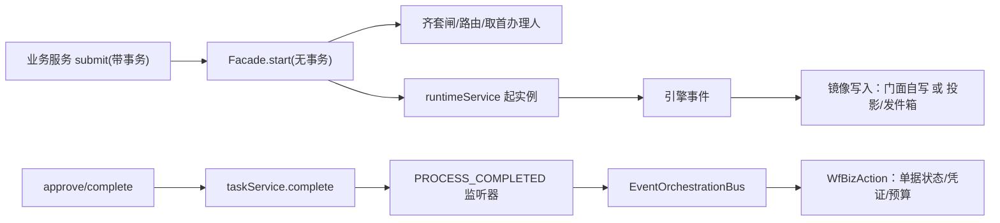

# 流程引擎（workflow）技术说明

> **读法约定**：本文每条结论都由当前代码逐条核对而来，句末 `（见 路径:行号）` 就是证据位置。后端 Java 源码公共前缀
> `fssc/fssc-server/fssc-start/src/main/java/com/fssc/` 在正文简写为 `J/`；补上该前缀后即为相对工作区根的完整路径。其余路径（`fssc/fssc-web/...`、`bpmn-repo/...`、`.../resources/application.yml`）已是完整写法。全部前缀缩写见 `docs/术语表.md`「路径缩写」表。
>
> **裸写行号怎么认**（指不带文件名、只写“L＋数字”的那些）：① 同一句里它前面点过名，就归那个文件；② 句里没点名，就归**本节开头那行"归属约定"声明的文件**；③ 换了主语文件，正文会把新文件名写出来。每条都能用 `Read` 跳到那一行核对。

## 0. 它解决什么问题

一张报销单提交后要走"部门审批 → 财务审核 → 主管复核 → 记账"，每一步由谁办、能否跳过、超时怎么办、驳回退到哪，这些规则不能写死在 Java 里。系统用 **Flowable 8.0.0** 作流程内核（BPMN XML＝流转图），外面包一层自有门面 `J/workflow/service/WfEngineFacade.java`，并在引擎表之外另建业务镜像表。

先认识四个词：**流程模型**（`wf_model`，一张 BPMN 图的数据库记录）、**流程实例**（一张具体单据的一次流转）、**节点配置**（`wf_node_config`，某个节点取人/超时/驳回规则）、**双账**（引擎 `ACT_*` 表 ＋ 业务镜像 `wf_instance`/`wf_task`/`wf_task_history`）。

## 1. 一张单从提交到办结

调用链（以费用报账为例）：
`ExpenseBillService#submit → WfEngineFacade#start → runtimeService#startProcessInstanceByKey →（逐节点）TaskService#create → WfEngineFacade#complete → taskService#complete → PROCESS_COMPLETED 监听器 → EventOrchestrationBus#onProcessEnded → ExpenseWfEventListener#execute`

1. **提交**：`ExpenseBillService.submit` 是唯一有 `@Transactional` 的一环（见 `J/expense/service/ExpenseBillService.java:638`），它在 L879 调门面 `start`。门面 `start` 本身**无事务包裹**，代码注释明写这一点（见 `J/workflow/service/WfEngineFacade.java:608-610`）——事务来自调用方；若从控制器直接调门面，就没有外层事务。
2. **门面里做了什么**（主重载见 `J/workflow/service/WfEngineFacade.java:513`）：注入流程变量（bizType/bizId/amount/billType/各分支开关）→ 多实例候选集注入（L2028）→ 齐套闸（提单层只告警不阻断，见 `J/workflow/service/BillCompletenessGuard.java:104` 与同类 L126-130）。**以下行号回到门面**（`J/workflow/service/WfEngineFacade.java`）：模型状态闸（`DISABLED`/`OFFLINE` 拒起流程，L472-473、L486-512，读失败时放行）→ 解析流程 key（L922）→ **L618 真正起流程** → 写 `wf_instance` 镜像（L631-656，是否由门面写取决于 `mirrorByFacade()`）→ 补一条 `SUBMIT` 轨迹（L659）→ 首任务办理人解析＋无候选空策略（L673-676）→ 待办镜像、首节点"提单即完成"自动跳过与待办通知（L699-710）。镜像写失败被记成缺陷后再抛出（L767），**不回滚引擎**。
3. **审批**：入口 `POST /api/tenant/wf/approve`（`J/workflow/controller/WfTaskController.java:754`）→ 门面 9 参 `complete`（见 `J/workflow/service/WfEngineFacade.java:3398`）。它按固定顺序过闸：审批项改写结果 → 驳回必填意见 → 操作权限 `canOperate` → 任务池不许驳回（L3464-3467）／未领取拒办（L3472-3476）→ 自审禁止 → 同人连办禁止 → 齐套闸（NODE 层硬拦）→ 加签回跳挂钩 → 指定节点驳回挂钩（L3547-3589） → **L3617 交给引擎** → L3635 镜像置 DONE → 写 `APPROVE`/`REJECT` 轨迹。乐观锁冲突转成"任务已被处理，请刷新待办"。
4. **状态回写在哪**：门面不碰业务单据状态。流程**终结**时由注册的 `PROCESS_COMPLETED` 监听器（`J/workflow/service/WfEngineFacade.java:205-299`）发布 `WfProcessEndedEvent`，`J/workflow/event/EventOrchestrationBus.java:141` 用普通 `@EventListener` **同步同线程**分发给 `J/workflow/action/` 下 20 个 `WfBizAction`（＋费用/资产/预算三个域监听器）。单据状态就在这一刻变：`J/expense/service/ExpenseWfEventListener.java:215` 置 `APPROVED`、`:627` 置 `REJECTED`/`WITHDRAWN`，并在 L138 写自己的审批轨迹表。**结论**：单状态只在流程终结时变一次，中间每一步只动 `wf_task*`。
5. **归档**：引擎侧没有"归档"动作。`wf_instance` 终态只有 `APPROVED/REJECTED/CANCELLED/TERMINATED`（见 `J/workflow/job/WfInstanceArchiveJob.java:85-88`）。本文的"归档"指历史数据搬冷表（§6）；档案域审批是另一回事（`J/workflow/action/ArchiveBizAction.java:37`）。

**想动手验证？** ① 提一张费用单，查 `SELECT status FROM exp_bill WHERE id=?` 应为 `APPROVING`，逐节点审批过程中该值不变，最后一个节点通过后立刻变 `APPROVED`。② 查 `SELECT action,oper_user_id FROM wf_task_history WHERE proc_inst_id=? ORDER BY id` 应看到 `SUBMIT→APPROVE…`。

## 2. 流程模型生命周期

| 阶段 | 入口 | 实际动作 |
|---|---|---|
| 草稿/编辑 | `J/workflow/service/WfModelService.java:88` | 仅改 `wf_model` 行；内容变了才顺带重新部署 |
| 校验 | `POST /api/tenant/wf/designer/validate` | `J/workflow/service/WfBpmnChecker.java`：查参与人、角色码是否存在、节点可达、网关默认流 |
| 发布 | `POST /api/tenant/wf/designer/publish`（见 `J/workflow/controller/WfDesignerController.java:305`） | 先跑同一个 checker，不过即拒；置 `status=DEPLOYED`；调 `J/workflow/service/WfModelService.java:118` → L131 部署进 Flowable → 回写 `deploy_id`/`proc_def_id`/`version+1` |
| 停用 | `J/workflow/service/WfModelService.java:213` | 只写 `DEPLOYED`/`DISABLED`；`DISABLED` 会让新提单被拒（§1 第 2 步） |
| 删除 | `J/workflow/service/WfModelService.java:237` | 物理删；有在途实例（`wf_instance.status=RUNNING`）直接拒绝。**没有"作废"这个状态** |

发布落盘（可追溯性）：`J/workflow/service/WfBpmnRepoService.java` 写 `bpmn-repo/INDEX.md`、`bpmn-repo/models/<key>/<id>_v<ver>.bpmn20.xml` ＋ `latest.bpmn20.xml`、`bpmn-repo/publish/<key>/v<old>_to_v<new>_<时间戳>.diff` ＋ `LOG.md`（同时统计在途旧实例数）。落盘失败**不回滚发布**（见 `J/workflow/service/WfModelService.java:147-159`）。仓库根目录由 `fssc/fssc-server/fssc-start/src/main/resources/application.yml:124` 的 `fssc.wf.bpmn-repo-dir` 决定，缺省 `./bpmn-repo`。

版本语义要注意：`wf_model` 一行只存**当前**版本，`/versions` 接口注释自陈"当前实现单版本"（见 `J/workflow/controller/WfDesignerController.java:334-340`）；历史版本只存在于 `bpmn-repo` 目录和 Flowable 自己的 deployment 里。另外标准流程模板（`wf_business_flow.node_json`）由 `J/workflow/service/WfBpmnTemplateService.java` 生成 XML，**每次应用启动**都会重新部署一遍（见 `J/workflow/service/WfEngineFacade.java:365-398`），所以重启一次版本号就涨一次。

**想动手验证？** ① 流程配置页改一个节点名点"保存"（不点发布），待办里的在途单不受影响；点"发布"后 `bpmn-repo/models/<key>/` 应多出一个 `*_v<N+1>.bpmn20.xml`。② `git status bpmn-repo` 直接看到发布产物。

## 3. 节点办理人到底怎么定出来

> 归属约定：本节裸写的 L行号 一律指 `J/workflow/service/WfEngineFacade.java`（点名其他类时以点名为准）。

唯一判定入口 `applyNodeConfig`（见 `J/workflow/service/WfEngineFacade.java:1480`），**自上而下**：

0. **取配置**：`model_key + node_key` **精确匹配**，命中不了就整行不读（`J/workflow/service/WfNodeConfigResolver.java:64-71`、`:172-176` 注明按位置兜底的旧逻辑已移除）。
1. **多实例优先**：`multi_type ∈ ALL/SEQ/VOTE` 时**直接 return**，办理人由 BPMN 多实例元素变量按候选集逐个分派（L1492-1499），此处严禁覆盖成一个人。
2. **`assign_type` 分支**：`USER` 指定人（L1502）｜`ROLE` 指定角色（L1506）｜`INITIATOR` 发起人（L1596）｜`DEPT_LEADER`/`DEPT_LEADER_UP` 沿汇报线取第 N 级，用 `up_level`（L1603-1623）｜其余落 `default` → 参与人方案（L1628）。
3. **`ROLE` 里再看"取人方式" `handling_mode`**：`POOL` 任务池——只挂候选组、**不指派到人**，任务停在"待领取"（L1511-1519）；`PICK` 上一环节点名（需总闸 `approve.pick_mode.enabled` ＋模型白名单，L1847-1870）；`AUTO` 解析范围后取一人。
4. **参与人方案**（`wf_assignee_scheme`/`wf_assignee_dim`）：按 `priority` 逐套试，每套可按 `OR/AND/EXCLUDE` 组合 8 种维度 `USER/ROLE/POST/DEPT/DEPT_TREE/DEPT_LEADER/REPORT_TO/VARIABLE`（见 `J/workflow/service/WfAssigneeResolver.java:104-133`、`:320-328`）。
5. 所有指派出口统一过**委托代办替换**：该人在委托期内就改成受托人并补一条 `DELEGATE_TAKEOVER` 轨迹（`J/workflow/service/WfEngineFacade.java:1662-1701`）。

**找不到人时**：① 方案没配 → 静默不覆盖（L1642-1651）；② 配了方案但一套都解析不出人 → 抛业务异常（`J/workflow/service/WfAssigneeResolver.java:129-132`）；③ 按角色取人取空 → 走空策略 `applyEmptyStrategy`（`J/workflow/service/NodeOrgResolver.java:509`，分支 L541-600）：`SKIP` 先补镜像留痕再自动跳过（镜像写失败就**阻止引擎推进**）、`ERROR` 报错阻断（缺省）、`ESCALATE` 沿汇报线升级、`ADMIN` 转租户管理员；④ 任务池节点不指派就是正常态，靠 `claim` 抢单（`J/workflow/service/WfEngineFacade.java:4441`），并发只有一人成功。

**想动手验证？** ① 给某节点配一个本租户下无人持有的角色码，按 `ERROR` 应提单报错、按 `SKIP` 应看到该节点自动 `AUTO_PASS` 留痕。② 把 `handling_mode` 改 `POOL`，待办里同角色多人应都能看到且带"领取"按钮。

## 4. 会签/加签/转办/驳回/撤回/作废

> 归属约定：本节裸写的 L行号 一律指 `J/workflow/service/WfEngineFacade.java`（点名其他类时以点名为准）。

除注明者外，本表行号均指门面 `J/workflow/service/WfEngineFacade.java`；HTTP 入口在 `J/workflow/controller/WfTaskController.java`。

| 动作 | 入口 | 给引擎的指令 | 前置校验（择关键） |
|---|---|---|---|
| 通过/驳回 | `POST /wf/approve` → `complete` | `taskService.complete(taskId,vars)`（L3617）；驳回且没指定目标节点时兜底 `deleteProcessInstance(…, "审批驳回")`（L2302） | 驳回意见≥2字；POOL 节点禁止驳回；未领取拒办 |
| 退回指定节点 | `approve` 带 `rejectToNodeKey` → `rejectToNode`（L5245） | Flowable **搬执行** | 本节点 `reject_scope≠NONE` ＋ 总闸 `wf.reject.free.enabled=1` ＋ 模型白名单，三者缺一即落回"终止本流程"（L3547-3589） |
| 退回上一节点/提单人 | 同上，`reject_scope=PREV_ONE`；目标由 `rejectTargets` 预览（L5132） | 同上 | 越级直接报错 |
| 会签（全员） | `multi_type=ALL` | 生成 `multiInstanceLoopCharacteristics`＋`completionCondition` all（`J/workflow/service/WfBpmnTemplateService.java:394-433`） | 候选集在 `start` 时注入；**改完必须重新发布**才生效 |
| 或签 | `multi_type=ANY` | **不生成多实例**，等同单人（`:526-546`） | — |
| 票签 | `multi_type=VOTE` ＋ `vote_ratio/vote_mode/vote_value/vote_basis/vote_fallback` | 比例完成条件（`:447-470`）＋门面计票（`J/workflow/service/WfEngineFacade.java:2135-2166`、`:2208-2271`），达阈值提前结束 | 反对票超补数阈值时提前驳回 |
| 加签 | `POST /wf/add-sign` → `addSign`（L3720） | **不插节点**：Flowable 8 没有运行期动态插节点的能力，实现取"临时改派＋回跳"等价语义（`J/workflow/entity/WfAddSign.java:15-36` 自述） | 灰度闸 `approve.addsign_gate.enabled`＋模型白名单＋`allow_addsign=1`；同一任务已有 ACTIVE 加签则拒；后加签若推进后产生 0 或 >1 个任务 → 记 `FAILED` 并通知发起人，不静默 |
| 转办 | `POST /wf/transfer` → `transfer`（L4326） | `setAssignee` ＋镜像同步＋`TRANSFER` 轨迹 | 目标须为可办理的真人（`assertAssignableUser`，L4346）；本节点 `allow_transfer=0` 直接拒（L4351-4355，超时自动转办不受该开关约束） |
| 改派（管理员） | `POST /wf/reassign` → `reassign`（L4592） | 同上 | 不受 `allow_transfer` 约束 |
| 领取/释放 | `POST /wf/claim`、`/unclaim`（L4441、L4490） | `setAssignee`／清空办理人回候选组 | 非 POOL 节点报"本节点不存在任务池" |
| 撤回 | `J/expense/service/ExpenseBillService.java:1490` → 门面 `withdraw`（`J/workflow/service/WfEngineFacade.java:5866`，本行后续 L 号都在这个文件） | `deleteProcessInstance(…, "申请人撤回")`（L5933），因该路径不触发 `PROCESS_COMPLETED`，门面手动补发事件（L5956） | 仅本人提交、实例在跑、模型 `allow_withdraw≠false`（L5917）；已办结后撤回需总闸 `wf.withdraw.done.enabled`（缺省关，fail-closed，L5844-5865） |
| 作废 | 草稿单：`J/expense/service/ExpenseBillService.java:1500` 只改业务状态 `VOID`，**不触引擎**；在途实例取消只有 `POST /api/tenant/wf/dev/instance/cancel`（`J/workflow/controller/WfDevController.java:59-67`）→ 门面 `cancelInstance`（`J/workflow/service/WfEngineFacade.java:3288`）→ `deleteProcessInstance`（L3293） | — | 受配置键 `fssc.wf.dev-tool-enabled` 约束（`@Value` 缺省 `true`，`application.yml` 里并未显式写这一项，见 `J/workflow/controller/WfDevController.java:44`）——正式环境应显式置 false |

**想动手验证？** 待办里对同一任务点两次"通过"，第二次应提示"任务已被处理，请刷新待办"（引擎乐观锁转成的业务提示，见 `J/workflow/service/WfEngineFacade.java:3617-3621`）。

## 5. 伪配置：哪些字段写了没用

判据：拿字段名在全后端包做检索，**找消费点**（`getX()`/`实体::字段`/字符串常量/SQL）。

**A. 确认当前不生效**

| 配置 | 我检索过的面 | 结论 |
|---|---|---|
| `wf_model.reject_strategy`（`J/workflow/entity/WfModel.java:36`） | `com/fssc` 全包检索 `rejectStrategy`/`getRejectStrategy` | 只命中字段声明本身，**未找到消费点** |
| `wf_model.form_json`（`:41`） | `workflow` 包检索 `formJson`/`getFormJson` | 同上，设计器存得进、运行时不读 |
| `wf_node_config.auto_pass_self` | `workflow` 包检索 + 写入闸 | 无运行时读取点，且写入时非 0 **强制归 0**（`J/workflow/service/WfNodeConfigService.java:123-124`，注释自陈"当前无读取点，预留防 SoD"） |
| `wf_process_config.condition_expr` | 检索 + 路由实现 | 声明处即自陈为死列（`J/workflow/entity/WfProcessConfig.java:37-39`）；路由只用 bizType/subType/amount/组织范围（`J/workflow/service/WfProcessConfigService.java:99-155`） |
| `wf_flow_config.cfg_type` 的 `THRESHOLD`/`ACTION`/`INTEGRATION` | `workflow`＋`compliance` 包检索 `"TIMEOUT"`/`"APPROVAL_RULE"`/上述三串 | 配置页仍提供这三种类型的结构化表单（`fssc/fssc-web/src/views/system/FlowConfig.vue:604/644/665`），但后端只查 `cfg_type=TIMEOUT`（`J/workflow/job/WfTimeoutJob.java:211`）与 `APPROVAL_RULE`（`fssc/fssc-server/fssc-start/src/main/java/com/fssc/compliance/service/ApprovalRuleService.java:35`）；其余三类**未找到读取方** |
| `wf_model.status = OFFLINE` | 检索 `"OFFLINE"` | 只在拦截集合里出现（`J/workflow/service/WfEngineFacade.java:473`），**没有任何代码写入该值**（enable 只写 DEPLOYED/DISABLED）⇒ 不可达的历史值；真正生效的是 `DISABLED` |
| `bpmn-repo/drafts/` | 检索 `drafts` | 该目录已于 2026-10-25 移出仓库；`WfBpmnRepoService` 从不写它，代码只在注释里引用它作取证记录 ⇒ 它**不是发布产物**，属人工/脚本留档 |

**B. 半生效（词表与实现不一致，最坑人）**

- `assign_type` 注释列出 8 档（`J/workflow/entity/WfNodeConfig.java:25`），`switch` 只实现 5 档；`POST`/`EXPRESSION` 落 `default`，**没配参与人方案就静默 no-op**（`J/workflow/entity/WfAssigneeScheme.java:15` 自陈）。`SHARE_POOL` 特殊：取人上不生效，但超时链路把它当"作业档"读（`J/workflow/job/WfTimeoutJob.java:590`）。
- `empty_strategy=ADMIN`：运行分支还在（`J/workflow/service/NodeOrgResolver.java:566-577`），新写入被拒（`J/workflow/service/WfNodeConfigService.java:115-120`）⇒ 存量行仍会被读。
- `multi_type=ANY`：不是"或签多候选"，等同单人（`J/workflow/service/WfBpmnTemplateService.java:529-549`）。
- `timeout_action`：列注释写 `NOTIFY/AUTO_PASS/AUTO_TRANSFER`（`J/workflow/entity/WfNodeConfig.java:66`），实际由 `normalizeAction` 归一后落三档（`J/workflow/job/WfTimeoutJob.java:670-695`、`:507-540`）；`AUTO_PASS` 还要额外命中白名单 `wf.timeout.autopass.nodes` 且金额不超 `wf.timeout.autopass.max_amount`，否则**降级为催办**（`:160-162`、`:541-620`）。
- `first_node_auto_pass`、`reject_scope`、`resubmit_jump_back`、`cc_users`/`cc_roles`、`vote_*`、`up_level`、`handling_mode`、`allow_transfer`、`allow_addsign` **都已有真实消费点**（依次见 `J/workflow/service/WfEngineFacade.java:865-869`、`:5398-5448`、`:5449-5546`、`:3685-3690`、`:2065-2080`；`up_level` 见 `J/workflow/service/NodeOrgResolver.java:580`；`handling_mode` 见 `J/workflow/service/WfEngineFacade.java:1511`（POOL）/`:1565`(PICK)；`allow_transfer` 见 `:4348-4352`；`allow_addsign` 见 `:3733-3735`），属"曾经死列、现已接线"，别再按注释判定它们无效。

**C. 注释漂移（代码是对的，字段表说明是旧的）**：`handling_mode` 注释称"POOL 尚无实现"（`J/workflow/entity/WfNodeConfig.java:32`），实际 POOL 已实现（`J/workflow/service/WfEngineFacade.java:1511-1519`、`:4438`）；同文件 `:52` 的 `empty_strategy` 注释只列 ADMIN/SKIP/ERROR，代码另有 ESCALATE 分支（`J/workflow/service/NodeOrgResolver.java:578-595`）。

**想动手验证？** 在项目根跑：`grep -rn "getRejectStrategy\|getFormJson" --include=*.java fssc/fssc-server/fssc-start/src/main/java/com/fssc` 应只命中实体声明行——这就是"写了没人读"的实证。

## 6. 定时与异步作业

| 作业 | 触发方式 | 位置 | 频率 | 开关 |
|---|---|---|---|---|
| 超时/催办 | `@Scheduled` 兜底轮询 ＋ **BPMN 边界定时器**（第一触发点） | `J/workflow/job/WfTimeoutJob.java:197`、`J/workflow/delegate/WfTimeoutBoundaryDelegate.java:53-82` | 60 秒 | 节点 `timeout_hours/timeout_action`；两条路径共用同一个 `handleTimeoutTask`（`J/workflow/job/WfTimeoutJob.java:378`），语义不漂移；定时器为非中断式（`cancelActivity=false`），不打断原任务 |
| 镜像发件箱消费 | `@Scheduled` | `J/workflow/job/WfOutboxConsumerJob.java:80` | 5 秒 | 非 QUEUE 模式直接空转返回 |
| 业务账归档 | `@Scheduled` | `J/workflow/job/WfInstanceArchiveJob.java:107` | 日频 | `sys_config wf.archive.enabled`（缺省关）/`wf.archive.months`（硬钳 ≤3）/`wf.archive.batch.limit`（`:71-79`） |
| `ACT_HI_*` 清理 | `@Scheduled` cron | `J/workflow/service/WfHistoryArchiveService.java:63` | 每天 03:30 判定，距上次不满 6 天跳过（`:61-88`，把"周日一瞬"的日历触发改成节奏闸门） | 保留期 `fssc/fssc-server/fssc-start/src/main/resources/application.yml:123 history-retention-months: 6`；**先落冷表才删引擎账**，判据 `wf_instance_cold`，查不到就跳过（fail-closed，`:95-169`） |
| 双账对账 | `@Scheduled`（周期可配） | `J/workflow/job/WfLedgerReconcileJob.java:120` | 缺省 10 分钟 | `fssc.wf.reconcile.*` |
| 委托到期 | 两个 `@Scheduled` | `J/workflow/job/WfDelegateExpireJob.java:68`、`:154` | 10 分钟 | — |
| 作业到期时间扫描 | `@Scheduled` | `J/workflow/ops/job/OpTaskDueTimeScanJob.java:56` | 5 分钟 | 只读，不改引擎 |

**单节点 vs 多实例部署**：所有作业方法都被 `JobHeartbeatService.run(jobName, body)` 包一层（`J/framework/job/JobHeartbeatService.java:52-99`）：先抢锁 `fssc_job_<jobName>`（TTL 2 小时），抢不到就跳过本轮，取锁本身抛异常则**降级为不加锁执行**；执行结果写 `op_job_heartbeat`（RUNNING/SUCCESS/FAIL）。锁由 `DistributedState` SPI 提供：`fssc.redis.enabled=false`（缺省，`fssc/fssc-server/fssc-start/src/main/resources/application.yml:127-132`）时是进程内实现，调度锁走 **MySQL 的 `GET_LOCK`（及与其配对的名字锁释放函数）** 并绑定连接亲和（`J/framework/spi/LocalDistributedState.java:173-263`）；置 `true` 时换 Redis SETNX+过期＋Lua 比对删除。

**这带来两个实际差别**：① 单机也照样加库锁，多实例部署共用同一把库/Redis 锁即可互斥，不需要额外配置；② 催办的 24 小时限频、卡死告警的去重也走同一个 SPI（`J/workflow/job/WfTimeoutJob.java:92`、`:742-752`、`:293`）——所以多实例不会重复轰炸办理人。要注意不接 Redis 时的代价：名字锁是**会话级**的，取锁与释放必须落在同一条数据库连接上，代码为此独占一条池连接并记录了一个曾因两条连接分别取/放而把全部定时任务饿死的缺陷（见 `J/framework/spi/LocalDistributedState.java:178-195`）。

**想动手验证？** `SELECT job_name,status,last_run_at FROM op_job_heartbeat ORDER BY last_run_at DESC` 看每个作业最近一次心跳；`SELECT GET_LOCK('fssc_job_WfTimeoutJob',0)` 在另一会话里应返回 0（已被占用），借此能直观理解互斥。

## 7. 引擎与业务表的耦合点

1. **配置侧单向读**：门面读 `wf_model`（状态/组织范围）、`wf_process_config`（路由）、`wf_node_config`＋`wf_assignee_scheme/dim`（取人/超时/抄送/驳回）、`sys_config`（灰度开关，统一走 `readConfig`/`isConfigGatedOn`，见 `J/workflow/service/WfEngineFacade.java:1871-1910`）。
2. **反向依赖业务实体**（耦合最重的一处）：齐套闸直接 `import` 费用、付款、 masterdata、sharing 的实体与 Mapper —— `exp_bill`/`exp_bill_attach`/`md_bank_account`/`op_pay_batch`（见 `J/workflow/service/BillCompletenessGuard.java:10-20`），并直读 `sys_config`。摘掉这个类，流程对单据内容的校验就归零。
3. **审批轨迹两套账**：门面写 `wf_task_history`（`J/workflow/service/WfEngineFacade.java:6110-6258`），业务域写自己的审计轨迹（`J/expense/service/ExpenseWfEventListener.java:138`）。
4. **凭证钩子确实存在**，但不在门面里：走事件分发到 `J/workflow/action/GlBizAction.java:150-199`，办结后调 `voucherService.generateGlJournalVoucher(...)`，凭证号有无决定终态写 `APPROVED` 还是 `POSTED`。同类收尾动作由 `wf_event_action_config` 表驱动 bizType→Bean 映射（`J/workflow/event/EventOrchestrationBus.java:28-64`）。
5. **共享作业中心与引擎解耦**：`workflow` 包内未检索到 `OpAuditTask` 引用；`J/sharing/service/SharingService.java:418` 的 `withdraw` 只是把已认领作业退回任务池（`RECEIVED→WAITING`），不调用流程引擎。流程侧的"任务池"是 §3/§4 说的候选组抢单，两套机制各自独立。
6. **镜像写入**：`fssc.wf.mirror.projection-enabled`（缺省 false）＋ `sys_config wf.process.mode` 共同决定镜像由门面手写还是由投影监听器/发件箱消费者写（`J/workflow/service/WfEngineFacade.java:113-120`、`:335-338`）——两个写者只能开一个，否则同一行争抢。

**想动手验证？** 走完一张单后对照 `ACT_HI_TASKINST` 与 `wf_task` 的行数与 `assignee`；两者应一一对应，不一致就是双账漂移，交给 `WfLedgerReconcileJob` 或手工对账。

---

## 8. 流程设计器（前端 bpmn-js）——改一条流程时手上要有的那张图

> **和 §2 的分工**：模型生命周期（草稿/校验/发布/停用/删除）的后端语义在 §2 已经写完，本章不重复，只补**前端这一侧**——按钮在哪、点下去发的是哪个请求、送出去的是哪一份 XML。后端分析一律以「见 §2」引用。

### 8.1 入口与形态：它不是一个独立页面

设计器是「流程配置」页里的一个**页签**，不是单独的画布路由。路由 `expense/flow` 指向 `V/system/FlowConfig.vue`（见 `fssc/fssc-web/src/router/routes/expense.js:31`，菜单标题「流程配置」），挂在根布局 `/` 下（见 `fssc/fssc-web/src/router.js:40-42`），且路由用的是 hash 模式（见 `fssc/fssc-web/src/router.js:4`），所以浏览器地址形如 `#/expense/flow`。

右侧详情区共七个页签：基本信息 `:73`、流程图 `:133`、节点配置 `:160`、流程绑定 `:215`、全局配置 `:243`、运行实例 `:277`、委托代理 `:307`（行号均属 `V/system/FlowConfig.vue`）。要点：

- 「流程图」页签要 `wf:model:list` 才出现，且新建模型草稿态不出现（见 `V/system/FlowConfig.vue:136`）——草稿还没有 `modelKey`，画布无处落。
- 画布组件是 `fssc/fssc-web/src/components/BpmnDesigner.vue`，全站**只被这一处引用**（`V/system/FlowConfig.vue:152`，另有异步声明 `:839`），bpmn-js 体积大，用 `defineAsyncComponent` 拆成独立 chunk、切到该页签才加载（见 `V/system/FlowConfig.vue:841-842`）。
- **只读态**：没有 `wf:model:update`（流程建模权限，代码里的权限码字面值就是 `wf:model:update`）时，同一页签改用 `NavigatedViewer`（bpmn-js 的只读浏览内核，只能拖动缩放、不能改图）渲染，调色板、工具栏、属性面板、节点快捷条全部隐藏（见 `V/system/FlowConfig.vue:154`、`fssc/fssc-web/src/components/BpmnDesigner.vue:687-695`），并在顶部给一条说明而不是让用户以为页面坏了（见 `BpmnDesigner.vue:6-8`）。模型没有 BPMN 图形定义且无编辑权时给显式告警（见 `V/system/FlowConfig.vue:139-141`）。
- 页签头部动作按钮：**校验 / 模拟 / 发布** 三枚受 `wf:model:update` 门控，**删除** 受 `wf:model:delete` 门控，而 **在途影响 / 导出入仓 / 导出** 三枚**没有** `v-if` 门控（见 `V/system/FlowConfig.vue:63-69`）。后端 javadoc 明确记着这一点，并说这是它暂时保留旧权限码 `wf:model` 的原因（见 `J/workflow/controller/WfDesignerController.java:40-44`）。
- 画布容器在隐藏页签里尺寸是 0×0，`zoom('fit-viewport')` 会算出非有限缩放并抛异常，代码为此挂了「容器无尺寸就延后适配、`ResizeObserver` 检测到 0→非 0 再补做」的保护（见 `BpmnDesigner.vue:180-187`、`:200-213`）。「全屏设计」按钮走浏览器原生全屏，退出后延时 150ms 让设计器重适配（见 `V/system/FlowConfig.vue:1644-1666`）。

**palette（左侧调色板）被改成了什么**：默认项整体保留，只覆盖两处、删掉一处——把「任务」按钮换成直接创建**用户任务**（`bpmn:UserTask`，即人工审批节点；BPMN 里 `Task` 是抽象任务，没有人像、不能配审批人），新增一个「子流程调用」按钮（`bpmn:CallActivity`），并**摘除 ServiceTask 入口**（见 `fssc/fssc-web/src/components/bpmn-palette.js:39-47`、`:48-56`）。摘除理由写在代码注释里：该属性无后端消费方，且没有 `delegateExpression` 的 ServiceTask 一到达就抛引擎异常，"画出来只会画出一个死节点"（见 `bpmn-palette.js:48-49`）；即便从别处导入这类节点，也不再为它提供配置面板（见 `BpmnDesigner.vue:467-468`）。

**property panel（右侧属性面板）被改成了什么**：装的是官方属性面板模块＋官方 BPMN 属性提供者＋中文翻译＋上面那个 palette，**没有任何本项目自己的面板分组**（见 `BpmnDesigner.vue:155`、`:698-703`）。也就是说面板只提供 BPMN 通用条目（节点 ID、名称、文档说明这一类），**审批人、条件、被调子流程都不在这里配**，而在画布下方三条自定义快捷条里配：节点取人（见 `BpmnDesigner.vue:92-110`）、连线条件（见 `:109-126`）、子流程调用（见 `:128-136`）。另外属性面板里那个"点输入框右侧箭头展开的英文公式编辑弹层"被 CSS 关掉了（见 `BpmnDesigner.vue:904-906`）。界面文案汉化靠覆盖 bpmn-js 的 `translate` 服务实现（见 `fssc/fssc-web/src/i18n/bpmn-zh.js:641-653`），新建节点自动补中文默认名（见 `bpmn-zh.js:656-659`、`BpmnDesigner.vue:724-735`）。依赖版本：bpmn-js 16.5.0、属性面板 5.63.0（见 `fssc/fssc-web/package.json:15-19`）。

### 8.2 画布内容存到哪、经过哪几跳 HTTP

**存储位置**：画布内容就是 `wf_model.bpmn_xml` 这一列（BPMN 2.0 XML 全文，见 `J/workflow/entity/WfModel.java:42`）。同表相关的还有 `version`（模型版本，`:43`）、`deploy_id`/`proc_def_id`（最近一次部署进引擎后回写的两个 ID，`:45`、`:47`）、`status`（`DRAFT` 草稿 / `DEPLOYED` 已部署 / `DISABLED` 已停用，`:49`）、`source`（`TEMPLATE` 模板 / `USER` 自建，`:25`）。设计器界面上"表单"那一列 `form_json` 存得进但运行时不读（见 §5）。**画布的唯一权威就是 `bpmn_xml`**，节点规则另存 `wf_node_config`（§8.3）。

一次编辑从点击到落盘经过的这些跳（每跳都给位置）：

| # | 触发动作 | 前端发出 | 端点 | 后端接手 |
|---|---|---|---|---|
| 1 | 画布上点「保存」（或 Ctrl+S） | `modeler.saveXML` 出 XML，emit `saved`（见 `BpmnDesigner.vue:603-609`、`:658-667`） | — | 组件内，未出网络 |
| 2 | `saved` 事件回调 | `flowApi.modelUpdate({...selectedModel, bpmnXml})`（见 `V/system/FlowConfig.vue:1524-1530`） | `POST /api/tenant/wf/config/model/update`（见 `fssc/fssc-web/src/api.js:516`、`J/workflow/controller/WfConfigController.java:81`） | `J/workflow/service/WfModelService.java:88`；XML 变了就顺带重新部署（`:92-98`→`:128`） |
| 3 | 点「校验」 | `designerApi.validate(selectedModel.bpmnXml)`（见 `V/system/FlowConfig.vue:1427`） | `POST /api/tenant/wf/designer/validate`（见 `api.js:459`） | `WfDesignerController.java:66-76` → `J/workflow/service/WfBpmnChecker.java:70` |
| 4 | 「模拟」弹窗点「执行模拟」 | `designerApi.simulate(bpmnXml, amount, itemName)`（见 `V/system/FlowConfig.vue:1442`） | `POST /wf/designer/simulate`（见 `api.js:460`） | `WfDesignerController.java:92-137` |
| 5 | 点「发布」→ 确认框 → 提交 | `designerApi.publish(selectedModel.value)`（见 `V/system/FlowConfig.vue:1457`） | `POST /wf/designer/publish`（见 `api.js:461`、`WfDesignerController.java:305`） | 先内联跑校验（`:314-318`），再 `WfModelService.publish`（`:115`）→ `deployToEngine`（`:128`） |
| 6 | 点「导出」 | 前端拿返回值拼 Blob 下载（见 `V/system/FlowConfig.vue:1501-1510`） | `GET /wf/designer/export`（见 `api.js:463`、`WfDesignerController.java:346`） | 返回 `modelKey/modelName/version/bpmnXml`（`:347-350`） |
| 7 | 点「导入」选文件 | 读文本＋`ElMessageBox` 要模型编码（校验正则 `^[A-Za-z][A-Za-z0-9_-]{1,49}$`），见 `V/system/FlowConfig.vue:1535-1562` | `POST /wf/designer/import`（见 `api.js:464`） | `WfDesignerController.java:360-382`：新建行，`source=IMPORT`、`version=1`、`status=DRAFT`（`:373-375`） |
| 8 | 点「导出入仓」 | `designerApi.exportRepo()`（见 `V/system/FlowConfig.vue:1494-1497`） | `POST /wf/designer/export-repo`（见 `api.js:467`） | `WfDesignerController.java:469-471` → `J/workflow/service/WfBpmnRepoService.java:69` |

前端所有请求都带 `/api` 前缀（axios `baseURL: '/api'`，见 `fssc/fssc-web/src/api.js:55`）。

**保存与发布在前端这一侧的差别**（后端语义见 §2）：

- **两段式，而且提示语会误导你**。画布上的「保存」只把 XML 从 bpmn-js 取出来并 emit，它**自己不发请求**；真正提交的是 `FlowConfig` 的回调（见 `V/system/FlowConfig.vue:1524-1527`）。弹出来的成功提示是"流程已保存，点击弹窗「保存」提交"（见 `BpmnDesigner.vue:608`），这句话和实际行为不一致——实际是 emit 之后回调就发了 `model/update`，界面上并不存在第二个要点的「保存」按钮。按代码读出来的净效果是：**点一次画布保存＝一次落库**，只要看到"流程图已保存"（见 `V/system/FlowConfig.vue:1530`）就说明已经写进 `wf_model` 了。
- **「未点发布就不生效」这个说法只对了一半**。`model/update` 只要 XML 与库里不同就会重新部署并让版本 +1（见 `J/workflow/service/WfModelService.java:95-101`、`:141`），所以**光保存画布也会产生一个新的引擎流程定义**。而节点配置页的告警讲的是另一件事：改「会签模式」不会部署 BPMN，所以必须点发布才生成多实例任务（见 `V/system/FlowConfig.vue:167-168`）——那说的是 `wf_node_config` 这条线，不是画布这条线。两处文字口径不同，别把它们当同一条规则。
- **校验/发布送出去的是"已保存的那份 XML"，不是"你眼前画布上的那份"**。「校验」传 `selectedModel.bpmnXml`（见 `V/system/FlowConfig.vue:1427`），「发布」把整个 `selectedModel` 对象传上去（见 `:1454`），而这个字段只在保存回调里才被刷新（见 `V/system/FlowConfig.vue:1528`）。**结论：画完没点保存就点校验/发布，被检的是旧图，新版本也是旧图**，界面上没有任何提示告诉你这一点。
- **报错呈现**：后端返回的 `errors` 数组逐条红字列在校验结果弹窗里（见 `V/system/FlowConfig.vue:740-746`）；发布被挡时错误来自内联校验，抛业务异常后前端只做 `ElMessage.error(e.message)`（见 `:1461`）。导入/导出/发布记录失败也是同一套 toast。

### 8.3 界面上叫什么 → 存进哪一列 → 后端在哪儿读它

这是改流程时唯一的地图。列名与实体字段名按驼峰→下划线对应。

> 归属约定：本节"列"一栏里裸写的 L行号 一律指 `J/workflow/entity/WfNodeConfig.java`；"后端读取处"一栏凡点过名的就归点名的那个文件。

| 界面标签（节点弹窗） | 列 | 后端读取处 | 备注 |
|---|---|---|---|
| 节点编码 | `node_key`（L23） | `J/workflow/service/WfNodeConfigResolver.java:64`（`model_key+node_key` 精确匹配） | 必须与已部署 BPMN 的 `userTask id` 逐字符一致，写入口有硬校验（`J/workflow/service/WfNodeConfigService.java:185-220`） |
| 节点名称 | `node_name`（L24） | 待办显示；必填收口 `WfNodeConfigService.java:84-88` | 改名**不再**影响控制流（旧版按名字含"提交"判定，见 §5 与 `WfNodeConfig.java:86-93`） |
| 审批人类型 | `assign_type`（L26） | `J/workflow/service/WfEngineFacade.java:1501`（switch 分支） | 下拉只给 4 个：`USER` 指定人 / `ROLE` 指定角色 / `INITIATOR` 发起人 / `DEPT_LEADER_UP` 逐级上级（见 `V/system/FlowConfig.vue:369-372`），列注释的 8 档其余落 `default` |
| 审批人取值 | `assign_value`（L28） | `WfEngineFacade.java:1500`；会签候选集展开 L1819、L2005 | `USER` 档前端要求纯数字 ID、逗号分隔（见 `V/system/FlowConfig.vue:1007`） |
| 取人方式 | `handling_mode`（L35） | `WfEngineFacade.java:1511`（`POOL` 只挂候选组不指派）／L1568-1573（`PICK` 消费上一环节点名的流程变量）；`PICK` 生效判定 `isPickNode`（L1968-1971） | 枚举字面值：`AUTO` 自动指派、`PICK` 由上一环节点名、`POOL` 进任务池自己领取（见 `fssc/fssc-web/src/constants/enums.js:186`）；`PICK`/`POOL` 只在 `assign_type=ROLE` 分支被读，界面据此置灰（见 `V/system/FlowConfig.vue:389-392`） |
| 会签模式 | `multi_type`（L45） | `J/workflow/service/WfBpmnTemplateService.java:404-406`（生成多实例）＋`WfEngineFacade.java:1492`（多实例优先直接 return） | 字面值 `ANY` 任一通过（等同单人）/`ALL` 全员会签/`SEQ` 顺序会签/`VOTE` 票签（见 `enums.js:192-197`）；词表由写入口硬拒非法值（`WfNodeConfigService.java:132-145`） |
| 票签阈值(%) | `vote_ratio`（L47） | `WfBpmnTemplateService.java:414-415`＋`WfEngineFacade.java:2068` | 仅 `multi_type=VOTE` 时界面才出现（见 `V/system/FlowConfig.vue:421`），范围 1~100 由服务端校验（`WfNodeConfigService.java:146-153`） |
| （界面上没有）票签新口径 | `vote_mode`/`vote_value`/`vote_basis`/`vote_fallback`（L123/L126/L132/L142） | `WfBpmnTemplateService.java:410-413`＋`WfEngineFacade.java:2074-2082` | **后端已消费但节点弹窗无控件**（`V/system/FlowConfig.vue:360-546` 全表无这四枚字段），只能按缺省走：`RATIO`/`BY_PERSON`/`REJECT`（见 `J/workflow/service/WfEngineFacade.java:2074-2079`） |
| 超时小时数 | `timeout_hours`（L64） | `WfEngineFacade.java:3149-3150`（算任务到期时间）＋`J/workflow/service/WfQueryService.java:273` | 空/0＝不限 |
| 超时动作 | `timeout_action`（L66） | `J/workflow/job/WfTimeoutJob.java:670-695` 归一后三档执行 | 界面四档 `NOTIFY` 催办 / `ESCALATE_AFTER_URGES` 催办 N 次后升级 / `AUTO_PASS` 自动通过 / `ESCALATE` 立即升级（见 `V/system/FlowConfig.vue:435-440`）；`AUTO_PASS` 还要命中白名单，否则**降级为催办**（§5-B） |
| 升级层级 | `up_level`（L37） | 取人 `WfEngineFacade.java:1603-1623`；超时升级 `J/workflow/service/NodeOrgResolver.java:580` | 界面同一字段被三处消费，控件按"逐级上级／超时升级／空策略升级"任一成立才出现（见 `V/system/FlowConfig.vue:449-451`），0~10 的界限由写入口硬拒（`WfNodeConfigService.java:161-169`） |
| 无候选空策略 | `empty_strategy`（L60） | `NodeOrgResolver.java:539-540`，分支 L541-600 | `ERROR` 报错阻断（缺省）/`ESCALATE` 沿汇报线升级/`SKIP` 自动跳过；`ADMIN` 转管理员**写入即拒**（`WfNodeConfigService.java:115-120`），界面也不给这一项（见 `V/system/FlowConfig.vue:461-465`） |
| 允许转办 | `allow_transfer`（L49） | `WfEngineFacade.java:4351-4355` | 0 时人工转办被拒，超时自动转办不受约束 |
| 允许加签 | `allow_addsign`（L58） | `WfEngineFacade.java:3736-3738` | 还需灰度总闸＋模型白名单才生效（见 `V/system/FlowConfig.vue:479-483`） |
| 提单即完成 | `first_node_auto_pass`（L94） | `WfEngineFacade.java:865-869` | `1` 是 / `0` 否 / `NULL` 未配置仍回退旧判据（见 `V/system/FlowConfig.vue:491-500`） |
| 办结后抄送 | `cc_users`（L76） | `J/workflow/service/WfCcService.java:114` | 逗号分隔用户 ID |
| 抄送角色 | `cc_roles`（L78） | `WfCcService.java:115` | 运行期展开为该租户在职成员 |
| 驳回范围 | `reject_scope`（L107） | `WfEngineFacade.java:5401-5451` | `NONE`/`PREV_ONE`/`ANY_DONE`，另需总闸 `wf.reject.free.enabled=1`（见 `V/system/FlowConfig.vue:528-536`） |
| 重新提交跳回本节点 | `resubmit_jump_back`（L114） | `WfEngineFacade.java:5452-5549` | 开启时把节点编码写入实例变量 `rejectOriginNode` |
| （界面上没有）本节点字段权限 | `form_perm`（L68） | `WfNodeConfigResolver.java:124-132` → `J/workflow/controller/WfTaskController.java:980` | 节点弹窗**没有任何控件**（`V/system/FlowConfig.vue:360-546` 全表无 `formPerm`），只能靠改库/脚本写入 |
| （界面上没有）排序 | `sort`（L79） | `WfNodeConfigService.java:41`（列表按它升序）；新建缺省 0（L54-55） | 同上，无控件 |

 一句话警告：**`node_key` 对不上已部署 BPMN 的 `userTask id`，这一行的全部配置一条都不读**（取人、超时、抄送、驳回范围一并不生效）。这是 §5-B「孤儿节点行」的前端成因，界面在抄送角色下方就写了这条提醒（见 `V/system/FlowConfig.vue:517-521`）。 同一条提示还把某个不在本仓库内的内部脚本名字写在界面上——外部读者照着找会撞死链，这本身是一条待改的文案缺陷。

### 8.4 前端到底校不校验：和后端那道闸差在哪

后端闸是 `WfBpmnChecker.check()`（见 `J/workflow/service/WfBpmnChecker.java:70-82`），做七项：解析 XML、人工节点必须有参与人（`:130-133`）、从开始节点可达（`:156-177`）、网关必须有默认流（`:179-223`）、金额分档可行性（`:305-362`、`:384-413`）、角色码必须在 `sys_role` 里存在（`:416-439`）、分支条件引用的变量必须在注入白名单内（`:541-548`＋`:553-575`）。`/validate`、`/simulate`、`/publish`、`/audit-models` 四个入口共用它（见 `WfDesignerController.java:69`、`:127`、`:426`）。

**前端做的校验很少，而且和后端不是同一套**：

1. **表单必填与格式**（Element Plus 规则）：节点编码、节点名称必填；`assign_value` 在 `USER` 档必须是"数字，逗号分隔"，其余档只要求非空；`INITIATOR`/`DEPT_LEADER_UP` 两档不挂必填（见 `V/system/FlowConfig.vue:998-1010`）。基本信息只有编码＋名称（`:991-994`）。导入时的模型编码格式校验（`:1545`）是前端独立正则。
2. **画布上的少量硬约束**：`USER` 档要求填数字用户 ID，否则拒绝写属性（见 `BpmnDesigner.vue:539-543`）；连线条件为空时拒绝应用（`:496`）；「默认流」开关只在连线源节点是排他/包容网关时才出现（`:460`、`:515-516`）。
3. **配置期预警（不是阻断）**：选中角色后实时打 `/wf/config/node/role-holders`，把"编码在 `sys_role` 不存在""本租户 0 个在职持有人""某几家营运公司 0 人""某家公司 ≥2 名持有人（自动指派会落到主键最小那个）"四类问题直接红/黄字写在配置条下方（见 `fssc/fssc-web/src/components/common/RoleHolderHint.vue:35-60`，调用点 `BpmnDesigner.vue:107-109`、`V/system/FlowConfig.vue:383`）。它是**提示不是拦截**，点了保存照样过。

**分歧必须讲明白（都不阻断，最终由发布那一关兜住）**：

- **连线条件字段名两边不同名**。设计器下拉给了 6 个字段：`amount` 单据金额、`expenseType` 费用类型、`overBudget` 是否超标、`billType` 单据类型、`deptId` 部门、`companyId` 公司（见 `BpmnDesigner.vue:410`）。后端白名单只有 `amount`/`orgType`/`expenseType`/`overStandard`/`abroad`/`hasLoan`/`outOfPlan`/`overLimit`/`hasContract`/`billType`/`bizType`/`subType`（见 `WfBpmnChecker.java:544-551`）。**`overBudget`、`deptId`、`companyId` 三个都不在白名单里**，"是否超标"的正确字面值是 `overStandard`；用下拉里这三项生成的条件一旦保存，**发布会被挡**（`:568-572`）。下拉本身不会因为后端白名单收缩而过期，改一处不会同步另一处。
- **「模拟」面板又是第三套词**。它只接受 `amount` 加 `expenseType/billType/subType/hasInvoice/payMethod/orgType`（见 `WfDesignerController.java:100`）。`hasInvoice`、`payMethod` **不在流程发布接受的变量白名单**里——模拟能算通的条件，发布仍可能被判非法。
- **前端不做任何 BPMN 结构校验**：不查可达性、不查默认流、不查角色是否存在、不查是否缺开始/结束节点。这些全在校验弹窗里第一次看见。
- **校验弹窗把 `warnings` 和 `roleRefs` 丢了**：后端返回 4 个键 `valid`/`errors`/`warnings`/`roleRefs`（见 `WfDesignerController.java:71-74`），前端只渲染 `valid` 与 `errors`（见 `V/system/FlowConfig.vue:740-746`）。角色"已停用"这类只进 `warnings` 的问题（见 `WfBpmnChecker.java:437`）在界面上**看不见**。
- **模拟轨迹字段名两边不匹配**：后端每步是 `{type, name, tip}` 三个字符串（见 `WfDesignerController.java:271-277`），前端时间线读的是 `t.passed`/`t.nodeName`/`t.nodeKey`/`t.assignee`/`t.action`（见 `V/system/FlowConfig.vue:759-765`）。五个键**没有一个对得上**，所以轨迹只会渲染出空白条目。这是纯代码比对得出的结论，我没有运行过。

### 8.5 为什么说"改完要重新发布"：在途不受影响、版本怎么涨、目录里多出什么

前端表现是这样三件事叠在一起：

- **在途单不受影响**。新版本的流程定义 ID 发布后回写到 `wf_model.proc_def_id`（见 `WfModelService.java:143`），而每个在途实例记的是自己发起时那个定义 ID；「在途影响」抽屉就是按这两个 ID 是否相等来数旧版本在办单（见 `J/workflow/service/WfQueryService.java:157-161`），并在同处写死了那句解释：**新版本只对之后发起的实例生效，要改走新流程只能撤销后重新提交或做改派/转办，本系统不做实例迁移**（见 `WfQueryService.java:171-172`）。抽屉标题那句"在途 N 单，其中 M 单仍按旧版本流程执行"就是这两个数（见 `V/system/FlowConfig.vue:775-777`）。发布前也会先查一次并把这句拼进确认框（见 `:1447-1453`），发布后自动再把抽屉打开（见 `:1460`）。
- **版本号 ＋1 的时机**。`version` 由部署成功后 `old.version + 1` 回写（见 `WfModelService.java:144`）。因为 `model/update` 在 XML 变化时也会走同一段部署（`:96-98`），**所以设计器点「保存」同样让版本 +1**，并不只在发布时涨。左侧列表每行显示的 `v{{ m.version }}`（见 `V/system/FlowConfig.vue:36`）因此会跟着跳。另外每次应用启动，模板生成的标准流程会被重新部署一遍（见 §2 引用的 `WfEngineFacade.java:365-398`），重启一次涨一次。`/versions` 接口的注释自陈"当前实现单版本"（见 `WfDesignerController.java:334-340`），`wf_model` 一行只存当前版本，历史只能在磁盘和引擎里找。
- **`bpmn-repo/` 里多出来的文件**：每次真实部署，`WfBpmnRepoService.recordPublish()` 写 4 样东西——`models/<key>/<id>_v<新版本>.bpmn20.xml` 快照、`models/<key>/latest.bpmn20.xml`、`publish/<key>/v<旧>_to_v<新>_<yyyyMMdd-HHmmss>.diff`、追加一行到 `publish/<key>/LOG.md`（见 `J/workflow/service/WfBpmnRepoService.java:144-156`；目录布局文档见 `:34-41`；落盘失败不回滚发布，见 `J/workflow/service/WfModelService.java:157-159`）。本仓库当前的实际产物可作对照：`bpmn-repo/models/CLAIM/` 下有 `107_v14…107_v18.bpmn20.xml` ＋ `latest.bpmn20.xml`（模型 ID 107、版本 14→18），`bpmn-repo/publish/CLAIM/` 下有 `LOG.md` ＋ `v14_to_v15_20260922-174443.diff`、`v15_to_v16_20260922-182204.diff`、`v16_to_v17_20260929-000701.diff`、`v17_to_v18_20260929-000800.diff`。根目录由 `RES/application.yml` 的 `fssc.wf.bpmn-repo-dir` 决定（见 §2；代码侧 `@Value` 缺省 `./bpmn-repo`，见 `WfBpmnRepoService.java:57`）。若两个版本 XML 完全相同，diff 里写的是一行"（BPMN 内容未变化，仅重新部署）"（见 `:143-144`）——**这也是判断你那次保存到底改了什么的快捷办法**。「全局导出入仓」按钮则跨租户把 `wf_model` 全表刷一遍快照（见 `WfBpmnRepoService.java:69-72`）。

**改一条流程的标准动作序列**（按代码里存在的按钮排，避免踩上面那几个坑）：

1. 左侧选中模型 →「流程图」页签，改图形；每条连线/节点动完就点画布上的「保存」，让 `selectedModel.bpmnXml` 与眼前画布同步（见 `V/system/FlowConfig.vue:1524-1530`）——**不点这一步，后面全白做**。
2. 点「校验」，把弹窗里逐条红字读完；红字为空不代表没问题，`warnings` 不显示（见 §8.4）。
3. 改取人/超时/会签/抄送/驳回，去「节点配置」页签的节点弹窗，按 §8.3 那张表对着填；「节点编码」必须与画布里那个 `userTask` 的 ID 一致，对不上会被写入口直接拒掉（见 §8.3 第一行）。
4. 改完先点「发布」再看「在途影响」抽屉，别只看 toast。
5. 在项目根 `git status bpmn-repo` 确认多出的快照与 `.diff`，把这次流程变更连同 diff 一起提交，后人才有可能 review／回滚。
6. 想验证新版本真的生效：新提一张单走一遍，旧在途单不会被它影响（§8.5 第一条）。

**想动手验证？**

1. 打开 `#/expense/flow`，左侧选一个模型 →「流程图」页签，改一个节点名但**不要**点画布上的「保存」，直接点页签头部「校验」。校验结果描述的仍是改动前的图；再点「保存」重开校验，结论才会变。
2. 给某条连线用「连线条件」下拉选**是否超标**生成条件并保存，然后点「发布」。发布应被挡下并提示该变量不在注入集合内（`overBudget`）；把字段名改成 `overStandard` 再发一次，应通过这一项。
3. 发布成功后依次看三处：左侧列表该行的 `v<N>` 是否 +1；`bpmn-repo/models/<key>/` 是否多出 `<id>_v<N>.bpmn20.xml`；「在途影响」抽屉里旧版/新版标签是否与 `bpmn-repo/publish/<key>/` 新增的 `.diff` 对得上。在项目根 `git status bpmn-repo` 能一次性看到全部产物。

---

*本章全部结论来自读码（前端 3 个源文件＋5 个后端 Java 文件＋`bpmn-repo/` 目录实际清单），每条都给到了可跳转的行号。**未做运行验证**：bpmn-js 画布与属性面板的实际渲染效果、快捷键生效、调色板删项后的视觉、模拟轨迹键名不匹配造成的空白条目、以及"保存即重新部署"在真实数据上的版本跳变，都是我按代码推断而非跑出来的；`wf:design:*`/`wf:model:*` 与菜单 ID 的授权对应关系也未逐一核对（后端 javadoc 提到 104／112／3358／3359 等号，见 `WfDesignerController.java:32-39`，我没有回到 SQL 脚本核对）。*

---

## 9. 新手改动指引：五件最常要做的事

> 本节只讲"改哪里、按什么顺序改、怎么确认改对了"。读代码的方法本身请看 [`docs/代码阅读指南.md`](代码阅读指南.md)（尤其它的"五种死件识别法"和"伪配置识别"两节——那两节能帮你避免改到一段没人执行的代码上）。权限相关的一切细节在 [`docs/权限与多租户.md`](权限与多租户.md)，表与列在 [`docs/数据模型.md`](数据模型.md)，域与接口前缀在 [`docs/模块地图.md`](模块地图.md)。这里不重复它们，只给动作序列。
>
> **动手前的三条硬前提**：① 服务已经跑起来，并且你亲手走通过一张报销单；② 你改的是"活的"代码（用上面那两节的方法确认过有消费点）；③ 你有一个能登录的**业务账号**，不是只有管理员——管理员看不到很多租户侧行为。

### 9.1 给一个列表页加一个查询条件

| 步 | 动哪里 | 参照 |
|---|---|---|
| 1 | 控制器加形参。**写成 `required = false`**，缺省值在 Service 里判，别在控制器里塞业务默认值 | `J/expense/controller/ExpenseBillController.java:88-91`（`loanLedger` 的 `onlyOverdue`） |
| 2 | Service 把条件拼进 wrapper；**"空值 = 不过滤"必须显式判**，别把 `null` 交给 wrapper | `J/expense/service/ExpenseBillService.java:1266-1278` |
| 3 | 如果这个方法要按人收口，`@DataScope` 注解 + 一行 `DataScopeKit.apply(...)`，把公司/部门/归属人三列交给它 | 同上 `:1263` 与 `:1270`；五级语义见 `J/framework/security/DataScopeKit.java:19-22` |
| 4 | 需要真分页就用 `IPage` 形参（拦截器会自动补 count）；顺序敏感，见下方坑 ③ | `J/framework/config/MybatisPlusConfig.java:27-33` |
| 5 | 前端：API 函数加参数 + 视图绑筛选控件。请求一律走 `WEB/request.js`，别新建 axios 实例 | 报销域的 API 集中在 `WEB/api.js:243` 起的 `billApi` 对象 |

**怎么验证**（三条都要做，缺一条就可能留下越权口子）：

1. 用**两个不同数据范围**的账号各查一次，行数差异要能由角色/部门解释。
2. 条件留空时结果应与改动前完全一致（旧行为没被吃掉）。
3. 若这条查询跨了第二张表，检查租户条件是否被追加两次（见坑 ①）。

**坑**：

- ① 用 `@Select` 手写 SQL 时租户条件仍由拦截器追加，而且是**给 SQL 里每张表**都追加——只有登记在 `J/framework/tenant/FsscTenantLineHandler.java:50-53` 那个全局表白名单里的表（菜单、字典定义、引擎账等）才豁免。多表 join 里出现 `pf_` 前缀以外的表，就要预期它被加条件。
- ② 空表不一定是没数据。`code=4030`（权限不足）在前端被渲染成"共 0 条 / 暂无数据"，先按 `docs/权限与多租户.md` 的 P1 排查，再去改查询。
- ③ 分页拦截器必须排在租户拦截器**之后**（`J/framework/config/MybatisPlusConfig.java:29-32` 注释写明了这一点），否则 count 不带 `tenant_id`，总数会比别人多。

### 9.2 给一张表加一个字段

| 步 | 动哪里 | 说明 |
|---|---|---|
| 1 | DDL | 本项目**没有接 Flyway / Liquibase**（三份 `pom.xml` 里零命中），也没有公开的迁移执行器。约定是：一个变更 = `V<版本>_<域摘要>_seed.sql` + 同名 `_rollback.sql` **成对**提交；"应用到哪一版"记在 `sys_schema_version` 台账表（它作为库级元数据被显式排除在租户过滤之外，见 `J/framework/tenant/FsscTenantLineHandler.java:44`）。 MySQL 的 DDL 不能事务回滚，所以本项目实际的回滚手段是**变更前整库备份 + 恢复**，`_rollback.sql` 是人写的、也可能写错 |
| 2 | 实体类加字段 | 域名实体统一继承 `C/entity/TenantAuditBase.java:23`（租户业务表）或 `C/entity/BaseEntity.java:27`；列名与字段名按下划线↔驼峰对应，`RES/application.yml` 未覆盖这一项，走 MyBatis-Plus 默认。名字对不上默认规则时必须显式 `@TableField("列名")` |
| 3 | 别手写审计列 | `create_by/update_by/create_time/update_time/del_flag/tenant_id` 由 `J/framework/config/FsscMetaObjectHandler.java:31-48` 自动填。**按实体里声明的字段填**，所以实体没声明的列它不会管；审计人字段还按类型自适应——`String` 填用户名、`Long` 填用户 ID（`J/framework/config/FsscMetaObjectHandler.java:58-71` 的 `fillAudit`） |
| 4 | 读写路径 | 查询条件见 9.1；返回给前端就加到视图的列配置里。列配置写在 JS 而不是 `.vue` 模板里的情况存在（例：`WEB/composables/useCrud.js:12` 的 `csvColumns`），改字段时两处都要看 |
| 5 | 逻辑删除 | `del_flag` 由 `@TableLogic` 接管（`C/entity/BaseEntity.java:51-53`），查询会自动追加 `del_flag=0`。**手工对账 SQL 时别忘自己补这个条件**，否则你会以为"库里多了几行" |

**怎么验证**：建一条新单 → 回读这一列。特别地：**这一列必须真的非 NULL**。坑在这里——

- ① 一个**没标 `@TableField(fill = ...)` 的裸字段**不会进 MyBatis-Plus 生成的 INSERT 列清单，于是 MetaObjectHandler 对它的填充无效，落库是 NULL。`C/entity/TenantAuditBase.java:33` 的注释就是在讲这件事（`create_by` 当年栽过一次）。
- ② 新加的列若允许 NULL，读侧要区分"没填"和"填了空串"；前端别拿 `||` 兜默认值，会把 0 和 false 一起吃掉。
- ③ 改了列名或删了列 ⇒ 一定要跑 `docs/数据模型.md` 的列名坑清单核对，本项目有大量按列名硬编码的取数点。

### 9.3 加一个权限（接口 + 按钮）

一个权限点要同时打通四处，少一处就是"看得见点不动"或"点得动看不见"。

| 步 | 动哪里 | 参照 |
|---|---|---|
| 1 | 接口方法加 `@RequiresPerm("域:资源:动作")` | `J/expense/controller/ExpenseBillController.java:88`；切面实现 `J/framework/security/PermissionAspect.java:48`。**注解挂在类上等于没挂**（`docs/权限与多租户.md` P6） |
| 2 | 在 `sys_menu` 建一行权限点，把权限码写进 `perms` 列 | `J/system/entity/SysMenu.java:38`。`perms` 允许**逗号分隔多码**，拆分点在 `J/system/service/RoleService.java:143-153`；多个码之间是 **OR** 语义（`docs/权限与多租户.md` 3.1） |
| 3 | 把菜单挂给角色（`sys_role_menu`），**不要**直接改用户 | `J/system/service/RoleService.java`；保存期还有三道配置校验会拦你，见 `docs/权限与多租户.md` 3.6 |
| 4 | 前端按钮加指令 | `v-permission` 用法见 `WEB/directives/permission.js:8-10`（数组＝任一满足）；逻辑里判断用 `hasPerm`，见 `WEB/utils/perm.js:44`。新码段（权限码第一段）要在 `WEB/utils/permMappings.js:10` 的 `MODULE_MAP` 登记中文，否则个人中心直显英文码 |

**怎么验证**：① 用**未授权**角色登录，点按钮应被隐藏且直接调接口应返回权限不足；② 授权后**退出重登**再试——改权限后 `/auth/refresh` 救不了你，权限是登录时装进 Token 上下文的（`docs/权限与多租户.md` P4）；③ 界面能进但列表空 → 按 P1 先分清"4030 伪装成暂无数据"与"真没数据"。

**坑**：最容易制造的是**幽灵权限键**——代码里引用了一个库里从没登记（或登记了但没有任何角色持有）的码，表现是功能永久不可达，且报错不提示权限问题。改动前先用 `docs/权限与多租户.md` P3 的普查方法确认这个码是否已有消费者；`docs/术语表.md` 里也登记了几枚已判作废的键，别照着它们写新代码。

### 9.4 改一个审批节点（谁办、怎么驳、超时怎么办）

这一类改动的难点不在代码，而在**两处真相源**：BPMN 定义（节点结构）与 `wf_node_config`（节点行为）。

1. 改"节点长什么样"（加减 `userTask`、改网关条件、改连线）→ 在流程设计器里改，然后**重新发布**。发布落什么产物、旧实例走哪个版本，见本文 §8。
2. 改"节点怎么办"（办理人模式、会签口径、驳回范围、超时动作）→ 只改配置，不动 BPMN。取人是怎么一步步定出来的见 §3，六类动作语义见 §4。
4. 改之前先读 §5 的伪配置清单：`reject_strategy`、`form_json`、`condition_expr` 等字段写了也没人读，往它们上面挂需求等于白做。

**怎么验证**：起一张新单走到那个节点，看 `wf_task` 的办理人与候选是否等于配置预期，并确认 `ACT_HI_TASKINST` 与 `wf_task` 一一对应（双账漂移判据见 §7 末）。 存量在途实例仍按它启动时的定义版本走，不会因为你重新发布就改道。

### 9.5 加一个状态码 / 枚举的中文显示

后端**没有**统一的状态枚举（`C/enums/` 目录下只有 `DataScope.java`、`SubjectType.java` 两枚），状态是散写在服务里的字符串字面量（例：`J/payplan/service/PayPlanService.java:186` 直接写 `"VOID"`）。显示层的收口反而在前端，一个文件管全部：

1. 在 `WEB/constants/billStatus.js:30` 起的 `STATUS_LABEL` 登记中文；未登记的码 `statusLabel()` 会**原样把英文渲染到界面**，只在开发模式打一条告警（`:153-162`）。这条"静默泄露英文码"是该文件注释自陈的历史根因，别指望它抛错。
2. 同一文件里还有 `statusType()`（标签颜色）与 `REJECT_TYPE_LABEL`（`:175-181`）。补一个码往往要补三处。
3. 加一条用例：显示层有单测在 `WEB/constants/billStatus.spec.js`（46 行，含"每个状态都有 label"的穷举断言），跑 `cd fssc-web && npm run test`。
4. 注释里写清**写侧取值口径来自哪里**（`REJECT_TYPE_LABEL` 那段就是这么写的：注明只有两个值会真的落库，以及是哪个方法写的）。没有出处就说明明没做，别让人以为取值域是这些 label。

**坑**：本项目**已接国际化框架**——`package.json` 里有 `vue-i18n`，`src/i18n/index.js` 建实例并在 `main.js` 注册（含全局 `LocaleSwitch`），`locales/{zh-CN,en-US}.js` 各 4,948 键，界面文案已全量抽取。所以：**新增用户可见文案必须走 `$t('域.模块.键')`**，并在 `zh-CN.js` 与 `en-US.js` 两侧同批补键；键名静态、不许拼接。`scripts/i18n_check.py` 是 CI （键对齐、悬空引用、动态拼接、消息编译、硬编码中文基线只许下降）。只有数据字典（`constants/enums.js`、`constants/billStatus.js`、`utils/permMappings.js`）与 bpmn-js 画布补丁 `i18n/bpmn-zh.js` 仍是中文字面量——它们是数据不是界面文案。

---

## 10. 最需要人工复核的结论（诚实清单）

本文全部结论来自**逐文件静态读码**，每条都带 `路径:行号`。以下事实必须与结论一起读，否则本文会被高估：

- 编写过程中**没有启动过服务、没有发过请求、没有连过数据库、没有跑过构建或测试**。所有 SQL 只作为示例给出，未执行。
- 行号会漂移。`_tools/cite_check.mjs` 能证明"文件存在 + 行号不越界"（CI 阻断项），**证明不了那行代码还干着本文说的事**。
- 表结构、配置项的真实取值来自代码与配置文件，**不是库里的现值**；本项目没有数据库基线脚本可依赖（建库靠整库 dump，这是已知的缺项）。

| # | 结论 | 目前依据强度 | 为什么还不能全信 | 谁来复核、怎么复核 |
|---|---|---|---|---|
| 1 | 提交/审批/驳回/撤回的过闸顺序（§1、§4） | 逐行读门面与监听器，带行号 | 顺序里任何一环被条件短路，静态读看不出来；异步事件的分发时序只有运行期能证 | 起一张单，全程开着 `wf_task_history` 与业务轨迹表的观察，比对本文列的先后 |
| 2 | 单据状态只在流程终结时变一次（§1 第 4 点） | 读事件分发链与域监听器 | 中间步骤是否另有旁路写状态（比如批处理作业、补偿脚本），只检索了包内引用 | 拿一张在途单，逐节点办理后回读 `exp_bill.status`，看是否中途变过 |
| 3 | 伪配置清单（§5 A 组） | "全后端检索无消费点" | 反射、SpEL、前端拼字符串、SQL 里按列名取，都能绕开检索。判据是**没有找到**，不是**证明没有** | 在运行期给该字段赋一个可见值（比如把 `reject_strategy` 改成不可能的枚举），看行为变不变 |
| 4 | 定时作业与调度锁（§6） | 读 `@Scheduled` 注解、配置键、心跳表写入点 | 没观察过一次真实执行；`GET_LOCK` 的连接亲和性在连接池换连接时的行为是代码自陈的缺陷，不是实测 | 查 `op_job_heartbeat` 的 `last_run_at` 与节奏是否吻合；另一会话试取同名锁 |
| 5 | 双账一致性判据（§7 末） | 读门面写镜像与投影开关 | 缺省开关值 + 库里的实际行数分布未测，可能现在就是不一致的 | 对若干在途实例做 `ACT_HI_TASKINST` vs `wf_task` 逐条比对 |
| 6 | 设计器三条最没把握的结论（§8.4 末、§8.2 前两条） | 静态比对＋模板穷举，作者本人已标注为推断 | ① 「模拟轨迹五个键名全不匹配 ⇒ 只渲染空白条目」——若响应拦截器或某处做过键名映射，结论即错；② 「点一次画布保存＝一次落库，界面上没有第二个要点的保存按钮」——是对 `.vue` 模板的穷举判断，漏看一个同名按钮就说过头；③ 「右侧属性面板只提供 BPMN 通用条目」——依据是模块清单里没本项目自己的 provider，实际渲染出哪几个输入框未运行验证 | 打开 `#/expense/flow` 走一遍：改图不点保存直接校验、点保存看是否落库、看模拟弹窗轨迹是否空白。这三眼比再读十遍代码都管用 |
| 7 | "改表结构怎么落到别人机器上"（§9.2 步 1） | **未决**。没有 Flyway/Liquibase，脚本成对是约定不是机制，迁移执行器不在本仓库内 | 新人拿到仓库可以用 `db/Dump<导出日期>/` 建出一个完整库，但**升级没有工具**——本仓库只含一次全量导出，不含结构基线与迁移器 | 发布前必须人工裁决：要么给出可执行的基线+迁移器，要么在 README 明示"当前不含迁移工具" |
| 8 | 多租户过滤"一定生效"（§9.1 坑 ①） | 读拦截器注册与 `ignoreTable` 实现 | 只对经 MyBatis-Plus 的语句成立；用 `JdbcTemplate` 直连的旁路（实测主源码里 18 个 Java 文件引用它）与原生数据源访问未经清点 | 全仓清点 `JdbcTemplate` 的每处用法，并为每处补跨租户验证结论（CI 清单里已有这一项） |
| 10 | 本文各节里的"缺省值/开关值" | 读 `RES/application.yml` 与配置读取代码 | 部署环境常用环境变量覆盖，缺省值 ≠ 现网值 | 维护者按自己的实际配置复核一遍，尤其 §6 的镜像与 Redis 开关 |

**如果发现本文某条错了**：请把它当缺陷提 issue，附上你实测到的现象与 `路径:行号`。这个项目最不缺的就是"看起来对、其实没人执行过"的代码，文档也一样——纠正它比让它挂着有用得多。
